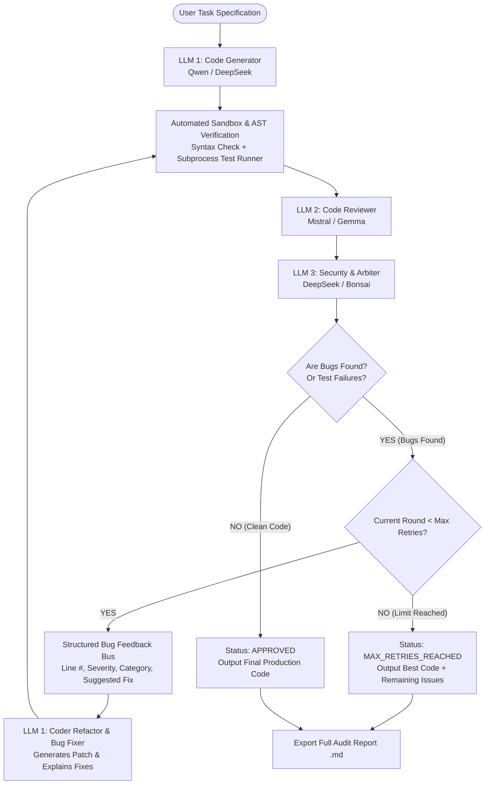

Enter your prompt here

# Project Structure

├─ 📁 workflow
  └─ __init__.py
  └─ review_loop.py
  └─ controller.py
├─ 📁 utils
  └─ logging_config.py
  └─ __init__.py
  └─ ollama_client.py
├─ 📁 validation
  └─ static_analyzer.py
  └─ __init__.py
  └─ test_runner.py
  └─ syntax_checker.py
├─ 📁 storage
  └─ history_store.py
  └─ __init__.py
  └─ report_generator.py
├─ 📁 tests
  └─ __init__.py
  └─ test_workflow.py
  └─ test_syntax_checker.py
  └─ test_schema.py
  └─ test_sandbox.py
  └─ test_review_parser.py
  └─ test_report_generator.py
  └─ test_langgraph.py
  └─ test_engine_workflow.py
  └─ test_diff_and_report.py
  └─ test_api_client.py
  └─ test_agents.py
├─ 📁 models
  └─ __init__.py
  └─ schemas.py
├─ 📁 examples
  └─ sample_slow_duplicate.py
  └─ basic_review.py
  └─ multi_reviewer_eval.py
├─ 📁 docs
  └─ TESTING.md
  └─ SETUP.md
  └─ SECURITY.md
  └─ ARCHITECTURE.md
├─ 📁 outputs
  ├─ 📁 reports
    └─ sample_report.md
  ├─ 📁 code
    └─ run_20261022_013221_ec7e89_iteration_2.py
    └─ run_20261022_013221_ec7e89_iteration_1.py
    └─ run_20261022_013221_ec7e89_final.py
    └─ run_20261022_011947_46fb45_iteration_1.py
    └─ run_20261022_011947_46fb45_final.py
    └─ run_20261022_010330_c2fcc1_iteration_1.py
    └─ run_20261022_010330_c2fcc1_final.py
    └─ run_20261022_010258_61dca5_iteration_1.py
    └─ run_20261022_010258_61dca5_final.py
    └─ run_20261022_010210_b3d25b_iteration_3.py
    └─ run_20261022_010210_b3d25b_iteration_2.py
    └─ run_20261022_010210_b3d25b_final.py
    └─ run_20261022_010032_34693d_iteration_3.py
    └─ run_20261022_010210_b3d25b_iteration_1.py
    └─ run_20261022_010032_34693d_iteration_2.py
    └─ run_20261022_010032_34693d_final.py
    └─ run_20261022_005825_06b7f5_iteration_3.py
    └─ run_20261022_005825_06b7f5_iteration_2.py
    └─ run_20261022_005825_06b7f5_final.py
    └─ run_20261022_005825_06b7f5_iteration_1.py
    └─ run_20261022_010032_34693d_iteration_1.py
  ├─ 📁 runs
    └─ run_20261022_013221_ec7e89.json
    └─ run_20261022_010330_c2fcc1.json
    └─ run_20261022_011947_46fb45.json
    └─ run_20261022_010258_61dca5.json
    └─ run_20261022_010210_b3d25b.json
    └─ run_20261022_010032_34693d.json
    └─ run_20261022_005825_06b7f5.json
├─ 📁 openreview_ai
  ├─ 📁 agents
    └─ __init__.py
    └─ validator.py
    └─ reviewer.py
    └─ generator.py
    └─ base.py
  ├─ 📁 providers
    └─ ollama.py
    └─ mock_provider.py
    └─ openai_compat.py
    └─ huggingface.py
    └─ factory.py
    └─ base.py
    └─ __init__.py
  ├─ 📁 sandbox
    └─ __init__.py
    └─ test_runner.py
    └─ syntax_checker.py
    └─ safe_workspace.py
    └─ executor.py
  ├─ 📁 utils
    └─ __init__.py
    └─ report_exporter.py
    └─ prompt_templates.py
    └─ diff_viewer.py
  └─ __init__.py
  └─ schema.py
  └─ langgraph_workflow.py
  └─ engine.py
  └─ config.py
├─ 📁 config
  └─ __init__.py
  └─ settings.py
├─ 📁 .streamlit
  └─ config.toml
├─ 📁 .ruff_cache
  ├─ 📁 0.17.1
    └─ 16338239362833479419
  └─ CACHEDIR.TAG
├─ 📁 .venv
  ├─ 📁 Scripts
    └─ deactivate.bat
    └─ Activate.ps1
    └─ activate.fish
    └─ activate.bat
    └─ activate
  ├─ 📁 share
    ├─ 📁 jupyter
      ├─ 📁 nbextensions
        ├─ 📁 pydeck
          └─ index.js
          └─ extensionRequires.js
  ├─ 📁 etc
    ├─ 📁 jupyter
      ├─ 📁 nbconfig
        ├─ 📁 notebook.d
          └─ pydeck.json
  ├─ 📁 Lib
    ├─ 📁 site-packages
      ├─ 📁 markupsafe
        └─ __init__.py
        └─ _speedups.pyi
        └─ _speedups.c
        └─ _native.py
        └─ py.typed
      ├─ 📁 altair
        ├─ 📁 utils
          └─ _dfi_types.py
          └─ server.py
          └─ selection.py
          └─ schemapi.py
          └─ save.py
          └─ plugin_registry.py
          └─ mimebundle.py
          └─ html.py
          └─ execeval.py
          └─ display.py
          └─ deprecation.py
          └─ data.py
          └─ core.py
          └─ compiler.py
          └─ __init__.py
          └─ _vegafusion_data.py
          └─ _transformed_data.py
          └─ _show.py
          └─ _importers.py
        ├─ 📁 expr
          └─ __init__.py
          └─ funcs.py
          └─ core.py
          └─ consts.py
        ├─ 📁 jupyter
          ├─ 📁 js
            └─ README.md
            └─ index.js
          └─ __init__.py
          └─ jupyter_chart.py
        ├─ 📁 datasets
          ├─ 📁 _metadata
            └─ metadata.parquet
            └─ metadata.csv.gz
            └─ schemas.json.gz
          └─ __init__.py
          └─ _typing.py
          └─ _readimpl.py
          └─ _reader.py
          └─ _loader.py
          └─ _exceptions.py
          └─ _data.py
          └─ _constraints.py
          └─ _cache.py
        ├─ 📁 typing
          └─ __init__.py
        ├─ 📁 vegalite
          ├─ 📁 v6
            ├─ 📁 schema
              └─ core.py
              └─ channels.py
              └─ mixins.py
              └─ vega-lite-schema.json
              └─ vega-themes.json
              └─ _config.py
              └─ _typing.py
              └─ __init__.py
            └─ api.py
            └─ __init__.py
            └─ theme.py
            └─ display.py
            └─ data.py
            └─ compiler.py
          └─ api.py
          └─ data.py
          └─ display.py
          └─ schema.py
          └─ __init__.py
        └─ _magics.py
        └─ __init__.py
        └─ theme.py
        └─ py.typed
      ├─ 📁 certifi
        ├─ 📁 tests
          └─ test_certify.py
          └─ __init__.py
        └─ __main__.py
        └─ __init__.py
        └─ py.typed
        └─ core.py
        └─ cacert.pem
      ├─ 📁 _pytest
        ├─ 📁 assertion
          └─ _guards.py
          └─ _typing.py
          └─ _compare_set.py
          └─ _compare_sequence.py
          └─ _compare_mapping.py
          └─ _compare_any.py
          └─ util.py
          └─ truncate.py
          └─ rewrite.py
          └─ highlight.py
          └─ compare_text.py
          └─ __init__.py
        ├─ 📁 mark
          └─ __init__.py
          └─ structures.py
          └─ expression.py
        ├─ 📁 config
          └─ __init__.py
          └─ findpaths.py
          └─ exceptions.py
          └─ argparsing.py
        ├─ 📁 _py
          └─ __init__.py
          └─ path.py
          └─ error.py
        ├─ 📁 _io
          └─ __init__.py
          └─ wcwidth.py
          └─ terminalwriter.py
          └─ saferepr.py
          └─ pprint.py
        ├─ 📁 _code
          └─ __init__.py
          └─ source.py
          └─ code.py
        └─ debugging.py
        └─ deprecated.py
        └─ faulthandler.py
        └─ fixtures.py
        └─ doctest.py
        └─ compat.py
        └─ capture.py
        └─ cacheprovider.py
        └─ setuponly.py
        └─ scope.py
        └─ runner.py
        └─ reports.py
        └─ recwarn.py
        └─ raises.py
        └─ setupplan.py
        └─ python_api.py
        └─ python.py
        └─ pytester_assertions.py
        └─ pytester.py
        └─ py.typed
        └─ pastebin.py
        └─ outcomes.py
        └─ nodes.py
        └─ monkeypatch.py
        └─ pathlib.py
        └─ stash.py
        └─ skipping.py
        └─ main.py
        └─ logging.py
        └─ legacypath.py
        └─ junitxml.py
        └─ hookspec.py
        └─ helpconfig.py
        └─ __init__.py
        └─ _version.py
        └─ _argcomplete.py
        └─ warning_types.py
        └─ warnings.py
        └─ unraisableexception.py
        └─ unittest.py
        └─ tracemalloc.py
        └─ tmpdir.py
        └─ timing.py
        └─ threadexception.py
        └─ terminalprogress.py
        └─ terminal.py
        └─ subtests.py
        └─ stepwise.py
        └─ freeze_support.py
      ├─ 📁 websockets
        ├─ 📁 legacy
          └─ handshake.py
          └─ server.py
          └─ protocol.py
          └─ http.py
          └─ __init__.py
          └─ framing.py
          └─ exceptions.py
          └─ client.py
          └─ auth.py
        ├─ 📁 sync
          └─ server.py
          └─ router.py
          └─ messages.py
          └─ connection.py
          └─ client.py
          └─ __init__.py
          └─ utils.py
        ├─ 📁 extensions
          └─ base.py
          └─ __init__.py
          └─ permessage_deflate.py
        ├─ 📁 trio
          └─ __init__.py
          └─ utils.py
          └─ server.py
          └─ router.py
          └─ messages.py
          └─ connection.py
          └─ client.py
        ├─ 📁 asyncio
          └─ __init__.py
          └─ server.py
          └─ router.py
          └─ messages.py
          └─ connection.py
          └─ client.py
        └─ headers.py
        └─ protocol.py
        └─ __init__.py
        └─ __main__.py
        └─ version.py
        └─ utils.py
        └─ uri.py
        └─ typing.py
        └─ streams.py
        └─ speedups.pyi
        └─ speedups.c
        └─ server.py
        └─ py.typed
        └─ proxy.py
        └─ imports.py
        └─ http11.py
        └─ frames.py
        └─ exceptions.py
        └─ datastructures.py
        └─ connection.py
        └─ client.py
        └─ cli.py
        └─ auth.py
      ├─ 📁 watchdog
        ├─ 📁 utils
          └─ platform.py
          └─ __init__.py
          └─ process_watcher.py
          └─ patterns.py
          └─ event_debouncer.py
          └─ echo.py
          └─ dirsnapshot.py
          └─ delayed_queue.py
          └─ bricks.py
        ├─ 📁 tricks
          └─ __init__.py
        ├─ 📁 observers
          └─ winapi.py
          └─ __init__.py
          └─ read_directory_changes.py
          └─ polling.py
          └─ kqueue.py
          └─ inotify_c.py
          └─ inotify_buffer.py
          └─ inotify.py
          └─ fsevents2.py
          └─ fsevents.py
          └─ api.py
        └─ __init__.py
        └─ watchmedo.py
        └─ version.py
        └─ py.typed
        └─ events.py
      ├─ 📁 urllib3
        ├─ 📁 contrib
          ├─ 📁 emscripten
            └─ __init__.py
            └─ response.py
            └─ request.py
            └─ fetch.py
            └─ emscripten_fetch_worker.js
            └─ connection.py
          └─ __init__.py
          └─ socks.py
          └─ pyopenssl.py
        ├─ 📁 util
          └─ __init__.py
          └─ wait.py
          └─ util.py
          └─ url.py
          └─ timeout.py
          └─ ssl_match_hostname.py
          └─ ssl_.py
          └─ ssltransport.py
          └─ retry.py
          └─ response.py
          └─ request.py
          └─ proxy.py
          └─ connection.py
        ├─ 📁 http2
          └─ __init__.py
          └─ probe.py
          └─ connection.py
        └─ connectionpool.py
        └─ exceptions.py
        └─ __init__.py
        └─ _version.py
        └─ _request_methods.py
        └─ _collections.py
        └─ _base_connection.py
        └─ response.py
        └─ py.typed
        └─ poolmanager.py
        └─ filepost.py
        └─ fields.py
        └─ connection.py
      ├─ 📁 uvicorn
        ├─ 📁 protocols
          ├─ 📁 websockets
            └─ __init__.py
            └─ wsproto_impl.py
            └─ websockets_sansio_impl.py
            └─ websockets_impl.py
            └─ auto.py
          ├─ 📁 http
            └─ auto.py
            └─ auto_zttp_impl.py
            └─ __init__.py
            └─ zttp_impl.py
            └─ zttp_h2_impl.py
            └─ httptools_impl.py
            └─ h11_impl.py
            └─ flow_control.py
          └─ __init__.py
          └─ utils.py
        ├─ 📁 middleware
          └─ __init__.py
          └─ wsgi.py
          └─ proxy_headers.py
          └─ message_logger.py
          └─ asgi2.py
        ├─ 📁 lifespan
          └─ __init__.py
          └─ on.py
          └─ off.py
        ├─ 📁 loops
          └─ __init__.py
          └─ zuvloop.py
          └─ uvloop.py
          └─ auto.py
          └─ asyncio.py
        ├─ 📁 supervisors
          └─ __init__.py
          └─ watchfilesreload.py
          └─ statreload.py
          └─ multiprocess.py
          └─ basereload.py
        └─ __main__.py
        └─ __init__.py
        └─ _types.py
        └─ _subprocess.py
        └─ _compat.py
        └─ _ansi.py
        └─ workers.py
        └─ server.py
        └─ py.typed
        └─ main.py
        └─ logging.py
        └─ importer.py
        └─ config.py
      ├─ 📁 tzdata
        ├─ 📁 zoneinfo
          ├─ 📁 Etc
            └─ GMT+0
            └─ GMT+1
            └─ GMT
            └─ Zulu
            └─ __init__.py
            └─ UTC
            └─ Universal
            └─ UCT
            └─ Greenwich
            └─ GMT0
            └─ GMT-9
            └─ GMT-8
            └─ GMT-7
            └─ GMT-6
            └─ GMT-5
            └─ GMT-4
            └─ GMT-3
            └─ GMT-2
            └─ GMT-14
            └─ GMT-13
            └─ GMT-12
            └─ GMT-11
            └─ GMT-10
            └─ GMT-1
            └─ GMT-0
            └─ GMT+9
            └─ GMT+8
            └─ GMT+7
            └─ GMT+6
            └─ GMT+5
            └─ GMT+4
            └─ GMT+3
            └─ GMT+2
            └─ GMT+12
            └─ GMT+11
            └─ GMT+10
          ├─ 📁 America
            ├─ 📁 Argentina
              └─ ComodRivadavia
              └─ Catamarca
              └─ Buenos_Aires
              └─ San_Juan
              └─ __init__.py
              └─ Ushuaia
              └─ Tucuman
              └─ San_Luis
              └─ Salta
              └─ Rio_Gallegos
              └─ Mendoza
              └─ La_Rioja
              └─ Jujuy
              └─ Cordoba
            ├─ 📁 North_Dakota
              └─ __init__.py
              └─ New_Salem
              └─ Center
              └─ Beulah
            ├─ 📁 Indiana
              └─ __init__.py
              └─ Winamac
              └─ Vincennes
              └─ Vevay
              └─ Tell_City
              └─ Petersburg
              └─ Marengo
              └─ Knox
              └─ Indianapolis
            ├─ 📁 Kentucky
              └─ __init__.py
              └─ Monticello
              └─ Louisville
            └─ Antigua
            └─ Buenos_Aires
            └─ Boise
            └─ Fortaleza
            └─ Fort_Wayne
            └─ Fort_Nelson
            └─ Ensenada
            └─ El_Salvador
            └─ Eirunepe
            └─ Edmonton
            └─ Dominica
            └─ Detroit
            └─ Denver
            └─ Lima
            └─ Lower_Princes
            └─ Monterrey
            └─ Montserrat
            └─ Montreal
            └─ Montevideo
            └─ Moncton
            └─ Miquelon
            └─ Mexico_City
            └─ Nassau
            └─ Metlakatla
            └─ Merida
            └─ Menominee
            └─ Mendoza
            └─ Port_of_Spain
            └─ Porto_Velho
            └─ Porto_Acre
            └─ Puerto_Rico
            └─ Port-au-Prince
            └─ Punta_Arenas
            └─ Phoenix
            └─ Paramaribo
            └─ Rainy_River
            └─ Pangnirtung
            └─ Panama
            └─ Ojinaga
            └─ Nuuk
            └─ St_Kitts
            └─ St_Lucia
            └─ St_Johns
            └─ St_Barthelemy
            └─ Sitka
            └─ Shiprock
            └─ Scoresbysund
            └─ Sao_Paulo
            └─ Santo_Domingo
            └─ Santiago
            └─ Santa_Isabel
            └─ Santarem
            └─ Rosario
            └─ Rio_Branco
            └─ Resolute
            └─ Regina
            └─ Recife
            └─ Rankin_Inlet
            └─ Noronha
            └─ Nome
            └─ Nipigon
            └─ New_York
            └─ Mazatlan
            └─ Matamoros
            └─ Martinique
            └─ Winnipeg
            └─ Yellowknife
            └─ Yakutat
            └─ Whitehorse
            └─ Virgin
            └─ Vancouver
            └─ Tortola
            └─ __init__.py
            └─ Toronto
            └─ Tijuana
            └─ Thunder_Bay
            └─ Thule
            └─ Tegucigalpa
            └─ Swift_Current
            └─ St_Vincent
            └─ St_Thomas
            └─ Marigot
            └─ Manaus
            └─ Managua
            └─ Maceio
            └─ Louisville
            └─ Los_Angeles
            └─ La_Paz
            └─ Kralendijk
            └─ Knox_IN
            └─ Juneau
            └─ Jujuy
            └─ Jamaica
            └─ Iqaluit
            └─ Inuvik
            └─ Indianapolis
            └─ Hermosillo
            └─ Havana
            └─ Halifax
            └─ Guyana
            └─ Guayaquil
            └─ Guatemala
            └─ Guadeloupe
            └─ Grenada
            └─ Grand_Turk
            └─ Goose_Bay
            └─ Godthab
            └─ Glace_Bay
            └─ Dawson_Creek
            └─ Dawson
            └─ Danmarkshavn
            └─ Curacao
            └─ Cuiaba
            └─ Creston
            └─ Coyhaique
            └─ Costa_Rica
            └─ Cordoba
            └─ Coral_Harbour
            └─ Ciudad_Juarez
            └─ Chihuahua
            └─ Chicago
            └─ Cayman
            └─ Cayenne
            └─ Catamarca
            └─ Caracas
            └─ Cancun
            └─ Campo_Grande
            └─ Cambridge_Bay
            └─ Bogota
            └─ Boa_Vista
            └─ Blanc-Sablon
            └─ Belize
            └─ Belem
            └─ Barbados
            └─ Bahia_Banderas
            └─ Bahia
            └─ Atka
            └─ Atikokan
            └─ Asuncion
            └─ Aruba
            └─ Araguaina
            └─ Anguilla
            └─ Anchorage
            └─ Adak
          ├─ 📁 Pacific
            └─ Enderbury
            └─ __init__.py
            └─ Yap
            └─ Wallis
            └─ Wake
            └─ Truk
            └─ Tongatapu
            └─ Tarawa
            └─ Tahiti
            └─ Saipan
            └─ Rarotonga
            └─ Port_Moresby
            └─ Ponape
            └─ Pohnpei
            └─ Pitcairn
            └─ Palau
            └─ Pago_Pago
            └─ Noumea
            └─ Norfolk
            └─ Niue
            └─ Nauru
            └─ Midway
            └─ Marquesas
            └─ Majuro
            └─ Kwajalein
            └─ Kosrae
            └─ Kiritimati
            └─ Kanton
            └─ Johnston
            └─ Honolulu
            └─ Guam
            └─ Guadalcanal
            └─ Gambier
            └─ Galapagos
            └─ Funafuti
            └─ Fiji
            └─ Fakaofo
            └─ Efate
            └─ Easter
            └─ Chuuk
            └─ Chatham
            └─ Bougainville
            └─ Auckland
            └─ Apia
            └─ Samoa
          ├─ 📁 Mexico
            └─ __init__.py
            └─ General
            └─ BajaSur
            └─ BajaNorte
          ├─ 📁 Europe
            └─ Kaliningrad
            └─ Jersey
            └─ Istanbul
            └─ Kiev
            └─ Isle_of_Man
            └─ Helsinki
            └─ Guernsey
            └─ Kirov
            └─ Kyiv
            └─ Gibraltar
            └─ Dublin
            └─ Copenhagen
            └─ Chisinau
            └─ Busingen
            └─ Budapest
            └─ Bucharest
            └─ Brussels
            └─ Bratislava
            └─ Berlin
            └─ Belgrade
            └─ Belfast
            └─ Athens
            └─ Astrakhan
            └─ Andorra
            └─ Amsterdam
            └─ Lisbon
            └─ Ljubljana
            └─ Riga
            └─ Prague
            └─ Podgorica
            └─ Paris
            └─ Oslo
            └─ Nicosia
            └─ Moscow
            └─ Monaco
            └─ Rome
            └─ Minsk
            └─ Samara
            └─ Mariehamn
            └─ Malta
            └─ Madrid
            └─ Luxembourg
            └─ San_Marino
            └─ London
            └─ Vilnius
            └─ Vienna
            └─ Vatican
            └─ Vaduz
            └─ Uzhgorod
            └─ Ulyanovsk
            └─ Tiraspol
            └─ Tirane
            └─ Tallinn
            └─ Stockholm
            └─ Sofia
            └─ Skopje
            └─ Simferopol
            └─ Saratov
            └─ Sarajevo
            └─ __init__.py
            └─ Zurich
            └─ Zaporozhye
            └─ Zagreb
            └─ Warsaw
            └─ Volgograd
          ├─ 📁 Indian
            └─ __init__.py
            └─ Reunion
            └─ Mayotte
            └─ Mauritius
            └─ Maldives
            └─ Mahe
            └─ Kerguelen
            └─ Comoro
            └─ Cocos
            └─ Christmas
            └─ Chagos
            └─ Antananarivo
          ├─ 📁 Chile
            └─ __init__.py
            └─ EasterIsland
            └─ Continental
          ├─ 📁 Canada
            └─ __init__.py
            └─ Yukon
            └─ Saskatchewan
            └─ Pacific
            └─ Newfoundland
            └─ Mountain
            └─ Eastern
            └─ Central
            └─ Atlantic
          ├─ 📁 Australia
            └─ Darwin
            └─ Currie
            └─ Eucla
            └─ Canberra
            └─ Broken_Hill
            └─ Brisbane
            └─ Adelaide
            └─ ACT
            └─ Hobart
            └─ __init__.py
            └─ Yancowinna
            └─ West
            └─ Victoria
            └─ Tasmania
            └─ Sydney
            └─ South
            └─ Queensland
            └─ Perth
            └─ NSW
            └─ North
            └─ Melbourne
            └─ Lord_Howe
            └─ Lindeman
            └─ LHI
          ├─ 📁 Asia
            └─ Brunei
            └─ Calcutta
            └─ Bishkek
            └─ Beirut
            └─ Barnaul
            └─ Bangkok
            └─ Baku
            └─ Bahrain
            └─ Chita
            └─ Baghdad
            └─ Atyrau
            └─ Choibalsan
            └─ Ashgabat
            └─ Aqtobe
            └─ Aqtau
            └─ Anadyr
            └─ Amman
            └─ Almaty
            └─ Aden
            └─ Ashkhabad
            └─ Dacca
            └─ Colombo
            └─ Damascus
            └─ Chungking
            └─ Chongqing
            └─ Hong_Kong
            └─ Hovd
            └─ Hebron
            └─ Harbin
            └─ Gaza
            └─ Ho_Chi_Minh
            └─ Irkutsk
            └─ Famagusta
            └─ Dushanbe
            └─ Dubai
            └─ Dili
            └─ Dhaka
            └─ Istanbul
            └─ Jakarta
            └─ Jerusalem
            └─ Jayapura
            └─ Macau
            └─ Macao
            └─ Kuwait
            └─ Kuching
            └─ Kuala_Lumpur
            └─ Krasnoyarsk
            └─ Kolkata
            └─ Khandyga
            └─ Katmandu
            └─ Kathmandu
            └─ Kashgar
            └─ Karachi
            └─ Kamchatka
            └─ Kabul
            └─ Muscat
            └─ Nicosia
            └─ Manila
            └─ Makassar
            └─ Magadan
            └─ Seoul
            └─ Shanghai
            └─ Samarkand
            └─ Sakhalin
            └─ Saigon
            └─ Riyadh
            └─ Rangoon
            └─ Qyzylorda
            └─ Qostanay
            └─ Qatar
            └─ Singapore
            └─ Pyongyang
            └─ Srednekolymsk
            └─ Taipei
            └─ Pontianak
            └─ Phnom_Penh
            └─ Oral
            └─ Omsk
            └─ Novosibirsk
            └─ Novokuznetsk
            └─ Ust-Nera
            └─ Vientiane
            └─ Urumqi
            └─ Ulan_Bator
            └─ Ulaanbaatar
            └─ Vladivostok
            └─ Ujung_Pandang
            └─ Tomsk
            └─ Tokyo
            └─ Thimphu
            └─ Thimbu
            └─ Tel_Aviv
            └─ Tehran
            └─ Yakutsk
            └─ Tbilisi
            └─ Tashkent
            └─ __init__.py
            └─ Yerevan
            └─ Yekaterinburg
            └─ Yangon
          ├─ 📁 Arctic
            └─ __init__.py
            └─ Longyearbyen
          ├─ 📁 Atlantic
            └─ __init__.py
            └─ St_Helena
            └─ Stanley
            └─ South_Georgia
            └─ Reykjavik
            └─ Madeira
            └─ Jan_Mayen
            └─ Faroe
            └─ Faeroe
            └─ Cape_Verde
            └─ Canary
            └─ Bermuda
            └─ Azores
          ├─ 📁 Antarctica
            └─ __init__.py
            └─ Vostok
            └─ Troll
            └─ Syowa
            └─ South_Pole
            └─ Rothera
            └─ Palmer
            └─ McMurdo
            └─ Mawson
            └─ Macquarie
            └─ DumontDUrville
            └─ Davis
            └─ Casey
          ├─ 📁 Africa
            └─ Mbabane
            └─ Maseru
            └─ Maputo
            └─ Malabo
            └─ Lusaka
            └─ Lubumbashi
            └─ Luanda
            └─ Mogadishu
            └─ Lome
            └─ Libreville
            └─ Lagos
            └─ Kinshasa
            └─ Kigali
            └─ Khartoum
            └─ Kampala
            └─ Juba
            └─ Johannesburg
            └─ Harare
            └─ Monrovia
            └─ Gaborone
            └─ Freetown
            └─ El_Aaiun
            └─ Douala
            └─ Djibouti
            └─ Dar_es_Salaam
            └─ Dakar
            └─ Conakry
            └─ Ceuta
            └─ Casablanca
            └─ Cairo
            └─ __init__.py
            └─ Windhoek
            └─ Tunis
            └─ Tripoli
            └─ Timbuktu
            └─ Sao_Tome
            └─ Porto-Novo
            └─ Ouagadougou
            └─ Nouakchott
            └─ Niamey
            └─ Ndjamena
            └─ Nairobi
            └─ Bujumbura
            └─ Brazzaville
            └─ Blantyre
            └─ Bissau
            └─ Banjul
            └─ Bangui
            └─ Bamako
            └─ Asmera
            └─ Asmara
            └─ Algiers
            └─ Addis_Ababa
            └─ Accra
            └─ Abidjan
          ├─ 📁 Brazil
            └─ Acre
            └─ DeNoronha
            └─ __init__.py
            └─ West
            └─ East
          ├─ 📁 US
            └─ Alaska
            └─ __init__.py
            └─ Samoa
            └─ Pacific
            └─ Mountain
            └─ Michigan
            └─ Indiana-Starke
            └─ Eastern
            └─ East-Indiana
            └─ Central
            └─ Arizona
            └─ Aleutian
            └─ Hawaii
          └─ Eire
          └─ EST5EDT
          └─ __init__.py
          └─ Zulu
          └─ zonenow.tab
          └─ zone1970.tab
          └─ zone.tab
          └─ WET
          └─ W-SU
          └─ UTC
          └─ Universal
          └─ UCT
          └─ tzdata.zi
          └─ Turkey
          └─ Singapore
          └─ ROK
          └─ ROC
          └─ PST8PDT
          └─ PRC
          └─ Portugal
          └─ Poland
          └─ NZ-CHAT
          └─ NZ
          └─ Navajo
          └─ MST7MDT
          └─ MST
          └─ MET
          └─ Libya
          └─ leapseconds
          └─ Kwajalein
          └─ Japan
          └─ Jamaica
          └─ Israel
          └─ iso3166.tab
          └─ Iran
          └─ Iceland
          └─ Hongkong
          └─ Greenwich
          └─ GMT0
          └─ GMT-0
          └─ GMT+0
          └─ GMT
          └─ GB-Eire
          └─ GB
          └─ Factory
          └─ HST
          └─ EST
          └─ Egypt
          └─ EET
          └─ Cuba
          └─ CST6CDT
          └─ CET
        └─ zones
        └─ __init__.py
      ├─ 📁 typing_inspection
        └─ __init__.py
        └─ typing_objects.pyi
        └─ typing_objects.py
        └─ py.typed
        └─ introspection.py
      ├─ 📁 streamlit
        ├─ 📁 static
          ├─ 📁 static
            ├─ 📁 js
              └─ array.BifhSqXX.js
              └─ array-utils-flat.Bzaz163T.js
              └─ architectureDiagram-5GKGNRK7.C0T1DU37.js
              └─ architecture-7GRP2DOG.C86uP8Fs.js
              └─ arc.CWQg8pc6.js
              └─ abnfDiagram-VCTEODGH.-FffO4KE.js
              └─ AudioInput.DBESybQk.js
              └─ Audio.DN4-Aiio.js
              └─ ArrowVegaLiteChart.C7VsfKqo.js
              └─ Autocomplete.kV4wwzw9.js
              └─ chunk-DU6HZSFF.Bd3C8gm5.js
              └─ chunk-75Z2AOVW.BjkuJICx.js
              └─ chunk-5VM5RSS4.TOl2eSYi.js
              └─ chunk-4HAMMTFA.BWoI50S5.js
              └─ chunk-2Q5K7J3B.BsaEqoYJ.js
              └─ checkboxIndicatorStyles.DhpEwaVI.js
              └─ Checkbox.JUhl2I0B.js
              └─ cynefinDiagram-5FMLGOSQ.CP__qXZf.js
              └─ cynefin-OW5HDTMX.DSNbKg8Y.js
              └─ cubic.yzfkjm1T.js
              └─ createDownloadLinkElement.Bs2iazyW.js
              └─ cose-bilkent-JH36ORCC.DYZHn9yi.js
              └─ cytoscape.esm.BZkf-uXn.js
              └─ ContentCopy.esm.BgWmYHP7.js
              └─ config.Mbx-WYSj.js
              └─ ComponentInstance.CTvsVNe7.js
              └─ colors.Cg5Vh3br.js
              └─ ColorPicker.BAeMtac3.js
              └─ classDiagram-ZZMXUADV.DYoya7zn.js
              └─ classDiagram-v2-VYDZK3BY.DYoya7zn.js
              └─ chunk-Y2CYZVJY.DsF7k-Jl.js
              └─ chunk-XXDRQBXY.Ca0SZrEx.js
              └─ chunk-TICWLB2K.BEU8VdFU.js
              └─ chunk-SVP7TREG.C61mXJwb.js
              └─ chunk-SHT3W25Y.DUeBhqoi.js
              └─ chunk-PWAF6VOD.CTDCHB6y.js
              └─ chunk-POPQ4Y6H.D0EWotgr.js
              └─ chunk-P2QGCYS3.BEMk81Ij.js
              └─ chunk-OSK3NFVY.BWZjmBW2.js
              └─ chunk-L3NEJ4N5.gocoKCti.js
              └─ chunk-JWPE2WC7.A3RzWITa.js
              └─ chunk-IMKFNOWR.NSZPWQES.js
              └─ chunk-GVQU2GXP.C867jRFN.js
              └─ chunk-GMAD6QVW.BAbI8wFL.js
              └─ chunk-FOHPRMQF.DzxwRta7.js
              └─ chunk-F27PBJKO.CYCxo906.js
              └─ Check.esm.C0_5iXfI.js
              └─ ChatInput.DkuqVMIK.js
              └─ channel.1xmGIIgp.js
              └─ Cancel.esm.DeTJ68K0.js
              └─ CameraInput.Dm7lRoiO.js
              └─ c4Diagram-7LVT6UL2.BmiJrxSn.js
              └─ ButtonGroup.C-wljCAm.js
              └─ Button.BNvfR8OZ.js
              └─ blockDiagram-I7D4REHJ.D09E9sbf.js
              └─ BidiComponent.DBslL13W.js
              └─ BaseButton.OzdXpw_T.js
              └─ Balloons.B5etAoFf.js
              └─ axios.BMCjfgfu.js
              └─ diagram-Z3DM3KII.Dkz2EBV4.js
              └─ diagram-VX7I27RA.CSH9pCrg.js
              └─ diagram-VSXAHHWV.sgbqbqSN.js
              └─ diagram-UQ7AKVKN.DvKkp2z-.js
              └─ diagram-S7CK7UJ4.CFrhmvrY.js
              └─ Delete.esm.udejQVvG.js
              └─ defaultLocale.CNPGWpMu.js
              └─ DeckGlJsonChart.Blda_-c4.js
              └─ DownloadButton.Cfu0gSfV.js
              └─ DateTimeInput.CSIlm7Lj.js
              └─ DateInput.B_H5mn8Y.js
              └─ DateField.BmiWmXHS.js
              └─ DataFrame.PZArLJF-.js
              └─ data-grid-overlay-editor.BWueyc-Y.js
              └─ dagre.Cpva6VwT.js
              └─ dagre-GXQ25YYZ.COAl-0sF.js
              └─ get-attribute-from-layouts.FT0pWSs0.js
              └─ gitGraph-4MIJSDKK.CQGYG9FD.js
              └─ ganttDiagram-EL5Y4UJY.DQyMJzig.js
              └─ FormClearHelper.Bf_L1jWh.js
              └─ formatNumber.CfJM5WTJ.js
              └─ formatMoment.CVxEWQ-Q.js
              └─ flowDiagram-HODETNUW.BVqk2Qk8.js
              └─ gitGraphDiagram-WWUBYQGX.BuCHLsMo.js
              └─ ImageList.C74YyQWo.js
              └─ IFrameUtil.PlC_b34Z.js
              └─ index.Dlja0TUX.js
              └─ iframeResizer.contentWindow.CwEfsvtk.js
              └─ IFrame.DG4BXuTl.js
              └─ Icon.BjxRA3oA.js
              └─ Html.CGCC7X4P.js
              └─ hastscript.HMW3Cnwp.js
              └─ infoDiagram-27XIBGKW.5ZoBy0Th.js
              └─ info-A6RAGUB7.BuZMklu_.js
              └─ index.esm.B2Ayivoz.js
              └─ GraphVizChart.XrRhFsiU.js
              └─ graphlib.D9QTypQK.js
              └─ FlexContext.BVLhnEIa.js
              └─ FileUploader.vbu43EpS.js
              └─ FileSystemHandle.CFTLjada.js
              └─ FileSystemFileHandle.DbovseGn.js
              └─ FileSystemDirectoryHandle.zncjIB0n.js
              └─ FileDownload.esm.StXIIdUo.js
              └─ Feedback.C-ZvrUK-.js
              └─ expression.BkvPlOqk.js
              └─ eventmodeling-NTZA5JFV.maQpmTxV.js
              └─ path.BR9dHT-M.js
              └─ pegDiagram-XKGWAZYB.W_Gunh66.js
              └─ Particles.DNEtAlif.js
              └─ pandasStylerUtils.CEhxV8Bo.js
              └─ Pagination.UefS8bsE.js
              └─ PageLink.DXB7RphW.js
              └─ packet-AYTQ26CC.Ba3324qV.js
              └─ ordinal.BefGibR5.js
              └─ opacities.BBavuN52.js
              └─ pie-WAS4IAKB.CWWmkDed.js
              └─ numbro.DQcaoYTv.js
              └─ NumberInput.CVHXW_KR.js
              └─ NumberFormatter.CHYrjPj-.js
              └─ number-overlay-editor.BuHzR1mF.js
              └─ Multiselect.CjOwLxvl.js
              └─ pieDiagram-E7YTZNPT.DjJ6BUNB.js
              └─ moment.jdB8VpKp.js
              └─ mindmap-definition-YA3MSWOX.CisS5XdD.js
              └─ Metric.DMz1h4un.js
              └─ PlotlyChart.CYzEM0AL.js
              └─ MermaidChart.CVfD3PSQ.js
              └─ mermaid.core.Yg6sqkf9.js
              └─ mermaid-parser.core.BI7LwrxK.js
              └─ merge.Dv47mehx.js
              └─ MenuButton.CNi3wIt4.js
              └─ memory.BlZBQQYs.js
              └─ map.C_LElyNk.js
              └─ loglevel.isY9rJjs.js
              └─ LiveAnnouncer.CJitgdIC.js
              └─ LinkButton.B_KC3kvh.js
              └─ linear.D5hxhwzn.js
              └─ line.B2tEjNzy.js
              └─ preload-helper.BaNbYf_w.js
              └─ lib.Dd69Svmo.js
              └─ lib.DaUKNU-6.js
              └─ lib.CMmWlZtt.js
              └─ lib.B_BqPfc4.js
              └─ last.DfjdtCRp.js
              └─ katex.DBqWCtLM.js
              └─ kanban-definition-UXKFOSKX.BBh31Kmw.js
              └─ Json.B9WXu3CK.js
              └─ journeyDiagram-3NMN7TZE.DX7sLRfW.js
              └─ Progress.XshKUQS2.js
              └─ isUndefined.Dk8JX1dj.js
              └─ isSymbol.CmW3dkoN.js
              └─ isString.C7-zy-83.js
              └─ ishikawaDiagram-5VMMS53U.DvuUEnCa.js
              └─ isEmpty.DjruDP6v.js
              └─ isArrayLikeObject.B3Zf3PTL.js
              └─ isArrayLike.Crw2F5li.js
              └─ inputUtils.CD44xxT-.js
              └─ InputInstructions.DhFz6BY9.js
              └─ Input.fxLfgd0d.js
              └─ init.ZlXS9mIS.js
              └─ ProgressBar.Bi8g9X53.js
              └─ protobuf.B-gz2osh.js
              └─ ProgressBar.DD0W8Jz8.js
              └─ quadrantDiagram-AXDQQJYC.D7ij_gMS.js
              └─ purify.es.-06brOip.js
              └─ railroad-abnf-HS5TGJTU.VAb_G_3H.js
              └─ railroad-74A4TZTK.BYQh_WYX.js
              └─ Radio.CR-M-CaH.js
              └─ radar-RG4KPBEZ.D8esMapX.js
              └─ sprintfjs.F03_KGhA.js
              └─ src.BFWwosPs.js
              └─ Spinner.7kXufiqR.js
              └─ space-separated-tokens.BqhiSyze.js
              └─ sortBy.BN5z75-Y.js
              └─ Snow.ljH7daGv.js
              └─ sizeCapture-INFHLROL.C-RahmM2.js
              └─ src.DjucD-iB.js
              └─ shim.BbyJgaa_.js
              └─ serialization.CtAXRYZS.js
              └─ sequenceDiagram-WJ2MYXX4.DLQ8ZbLs.js
              └─ Selectbox.DYo6P43Q.js
              └─ sankeyDiagram-P5KCCOFB.D7lAyQZA.js
              └─ sandbox.UJQFXkTA.js
              └─ rough.esm.Dy-Kn_BL.js
              └─ rolldown-runtime.C0FnF6B9.js
              └─ resolveDefaultExport.uGkX5Ctk.js
              └─ requirementDiagram-BXWQKSXE.CWnFdQnH.js
              └─ stateDiagram-D77RDMKH.JhkpIz81.js
              └─ types.cZoyy9Y-.js
              └─ treeView-Q6P3EWNA.TDsZnrUg.js
              └─ treemap.BfjIY-m6.js
              └─ treemap-WGGIJYW6.DYWqLWKX.js
              └─ toString.tRXNBxtF.js
              └─ Tooltip.pZ0H0kkf.js
              └─ Toolbar.BIGxuHA9.js
              └─ toConsumableArray.9bftr9Nu.js
              └─ Toast.CLPEAp8k.js
              └─ timeline-definition-24CTP7MA.DTytGr7s.js
              └─ TimeInput.Ctq_i4Er.js
              └─ time._HF-TomV.js
              └─ threshold.eoi7MLsD.js
              └─ TextInput.BxDbpba5.js
              └─ TextArea.TYysap43.js
              └─ Text.BGYNDAPw.js
              └─ TableChart.esm.CZMxyiKe.js
              └─ Table.BGLxt4km.js
              └─ swimlanesDiagram-VR7AAH4N.ByKKJK7Y.js
              └─ swimlanes-42K2YHIH.DWtM7zRz.js
              └─ styled-components.JuRIuEWs.js
              └─ styled-components.BGit4FcC.js
              └─ styled-components.BdEMXxou.js
              └─ string.6Z3wlNKv.js
              └─ StreamlitSyntaxHighlighter.BeGj-YZj.js
              └─ StreamlitMarkdown.Bazu52t_.js
              └─ stateDiagram-v2-MP3YSRHH.CQNBr8ws.js
              └─ requiredField.D-qdHmR1.js
              └─ ReorderedSegments.C8qqQ7Gw.js
              └─ remark-emoji.B0mKIVIF.js
              └─ rehype-raw.C0zIPPaY.js
              └─ rehype-katex.CnO_s45P.js
              └─ recordbatch.Dy76Ddqq.js
              └─ record.esm.DQrSs0W3.js
              └─ reactJsonViewCompat.CMMhomkZ.js
              └─ react-dom.CbzydqoA.js
              └─ range.EplFIxc7.js
              └─ range.DL19EGGd.js
              └─ railroadDiagram-O6MQD6OU.B7jW8tSH.js
              └─ railroad-peg-WCYAUIDC.BQY4qlJy.js
              └─ railroad-ebnf-LZEXJU2U.BSC-LKF5.js
              └─ useFilter.DgGGqDXt.js
              └─ useFormValidation.B2tszs_w.js
              └─ useFormReset.CGu8nFbN.js
              └─ useFloatingOverlay.BgVSLB_x.js
              └─ useField.CRclxxMJ.js
              └─ useEmotionTheme.5peYXGK6.js
              └─ useDescription.C7H7s2zg.js
              └─ useDebouncedCallback.DmVKnuOW.js
              └─ useCrossOriginAttribute.CohH4OEQ.js
              └─ useCopyToClipboard.CV8qDB_k.js
              └─ useLabel.CMDB9Bko.js
              └─ useCollection.CioWCs5V.js
              └─ useCollator.BrzclETm.js
              └─ useBasicWidgetState.QdjeajhU.js
              └─ useLoadMoreSentinel.DCeHgWhg.js
              └─ urls.B0fCYwet.js
              └─ UriUtil.Buqblitv.js
              └─ UploadFileInfo.WAP1L8Dh.js
              └─ unzip.BaBcYNJz.js
              └─ webgl.Dj7882tm.js
              └─ WidgetLabelHelpIconInline.DdQfVwea.js
              └─ WidgetLabelHelpIcon.BgW9s-G5.js
              └─ WidgetLabel.DZjDVnAx.js
              └─ withCalculatedWidth.CZk0CpLc.js
              └─ webgpu.S9_6QZBD.js
              └─ webgl-device.DiwA7-iA.js
              └─ web-namespaces.BxZ_GhEx.js
              └─ wavesurfer.esm.CICR1yXq.js
              └─ wardleyDiagram-VM6X3IG4.B5gYczAX.js
              └─ wardley-WFR3VGLG.CsGzHOj2.js
              └─ Video.-rYxtq-Y.js
              └─ vennDiagram-4TSXK5OY.BR-YvxqG.js
              └─ value.BWwTSlkG.js
              └─ withFullScreenWrapper.4cHUkpo2.js
              └─ utils.DUTo-bFv.js
              └─ utils.CoIY7z1V.js
              └─ utils.4-V1Nt9d.js
              └─ zip.DLtjLZjW.js
              └─ xychartDiagram-S5SC5T6Z.D7L5Bfxc.js
              └─ util.CLG7ea_X.js
              └─ _arrayReduce.CiwPAjrV.js
              └─ _baseAssignValue.DPvIkN18.js
              └─ _isIterateeCall.BUStsXAd.js
              └─ _hasUnicode.Cp9Achgk.js
              └─ _baseProperty.BV6HSwpm.js
              └─ _baseMap.OhVc4KF-.js
              └─ _baseIsEqual.sdZCjgvS.js
              └─ _baseIndexOf.CYLdY-L6.js
              └─ _baseFlatten.IOj0lc7G.js
              └─ _baseEach.PLhpSRgM.js
              └─ useWaveformController.ClXnfk0m.js
              └─ useUpdateUiValue.Bnm2do6r.js
              └─ useTimeout.DgWF0Nme.js
              └─ useTextInputAutoExpand.bb8b_LpZ.js
              └─ useTextField.BYnsszFh.js
              └─ useSyncComboBoxEnterTargetFocus.CVyCpz_n.js
              └─ useSlot.66mDqY92.js
              └─ useResizeObserver.3kyCQ1g6.js
              └─ useRequiredContext.DBsQavvD.js
              └─ useNumberFormatter.CF9pVEB6.js
              └─ useMenuTrigger.DknU0WL-.js
              └─ es6.COwh37fH.js
              └─ ErrorOutline.esm.CS4C5u_b.js
              └─ ErrorElement.B3JXfGpT.js
              └─ erDiagram-RLTQ6QDP.CyYt9D6g.js
              └─ emotion-styled.browser.esm.BlkDsJXZ.js
              └─ emotion-react.browser.esm.BYrexG3N.js
              └─ emotion-is-prop-valid.esm.CuYlOKOk.js
              └─ EChartsChart.0GL4T7_8.js
              └─ ebnfDiagram-PWID7BFC.CKNJwS2D.js
              └─ DynamicIcon.CpHr1HJ2.js
              └─ downloader.BrkuwUyl.js
              └─ downloadDataUrl.DgUN6zlz.js
            ├─ 📁 media
              └─ KaTeX_Math-BoldItalic.CZnvNsCZ.woff2
              └─ KaTeX_Math-Italic.t53AETM-.woff2
              └─ KaTeX_Main-Regular.B22Nviop.woff2
              └─ KaTeX_Main-Italic.NWA7e6Wa.woff2
              └─ KaTeX_Main-BoldItalic.DxDJ3AOS.woff2
              └─ KaTeX_Main-Bold.Cx986IdX.woff2
              └─ KaTeX_Fraktur-Regular.CTYiF6lA.woff2
              └─ KaTeX_Fraktur-Bold.CL6g_b3V.woff2
              └─ KaTeX_Script-Regular.D3wIWfF6.woff2
              └─ KaTeX_SansSerif-Regular.DDBCnlJ7.woff2
              └─ KaTeX_Size1-Regular.mCD8mA8B.woff2
              └─ KaTeX_SansSerif-Italic.C3H0VqGB.woff2
              └─ KaTeX_SansSerif-Bold.D1sUS0GD.woff2
              └─ KaTeX_Caligraphic-Regular.Di6jR-x-.woff2
              └─ SourceSerifVariable-Roman.ttf.mdpVL9bi.woff2
              └─ SourceSerifVariable-Italic.ttf.CVdzAtxO.woff2
              └─ SourceSansVF-Upright.ttf.BsWL4Kly.woff2
              └─ SourceSansVF-Italic.ttf.Bt9VkdQ3.woff2
              └─ SourceCodeVF-Upright.ttf.BjWn63N-.woff2
              └─ SourceCodeVF-Italic.ttf.Ba1oaZG1.woff2
              └─ MaterialSymbols-Rounded.D_GK7ERd.woff2
              └─ KaTeX_Typewriter-Regular.CO6r4hn1.woff2
              └─ KaTeX_Size4-Regular.Dl5lxZxV.woff2
              └─ KaTeX_Size2-Regular.Dy4dx90m.woff2
              └─ KaTeX_Caligraphic-Bold.Dq_IR9rO.woff2
              └─ KaTeX_AMS-Regular.BQhdFMY1.woff2
            ├─ 📁 css
              └─ index.DzL0gylu.css
              └─ DeckGlJsonChart.s6LXjV0D.css
              └─ DataFrame.DUkanX9_.css
          └─ manifest.json
          └─ index.html
        ├─ 📁 hello
          └─ __init__.py
          └─ utils.py
          └─ streamlit_app.py
          └─ plotting_demo.py
          └─ mapping_demo.py
          └─ hello.py
          └─ dataframe_demo.py
          └─ animation_demo.py
        ├─ 📁 watcher
          └─ event_based_path_watcher.py
          └─ folder_black_list.py
          └─ path_watcher.py
          └─ local_sources_watcher.py
          └─ polling_path_watcher.py
          └─ util.py
          └─ __init__.py
        ├─ 📁 web
          ├─ 📁 server
            ├─ 📁 starlette
              └─ starlette_app_utils.py
              └─ starlette_app.py
              └─ starlette_websocket.py
              └─ __init__.py
              └─ starlette_static_routes.py
              └─ starlette_server_config.py
              └─ starlette_server.py
              └─ starlette_routes.py
              └─ starlette_path_security_middleware.py
              └─ starlette_gzip_middleware.py
              └─ starlette_auth_routes.py
            └─ __init__.py
            └─ server_util.py
            └─ server.py
            └─ component_file_utils.py
            └─ app_discovery.py
          └─ __init__.py
          └─ skills.py
          └─ cli.py
          └─ cache_storage_manager_config.py
          └─ bootstrap.py
        ├─ 📁 vendor
          ├─ 📁 pympler
            └─ asizeof.py
            └─ __init__.py
          └─ __init__.py
        ├─ 📁 testing
          ├─ 📁 v1
            └─ __init__.py
            └─ util.py
            └─ local_script_runner.py
            └─ errors.py
            └─ element_tree.py
            └─ app_test.py
          └─ __init__.py
        ├─ 📁 runtime
          ├─ 📁 caching
            ├─ 📁 storage
              └─ __init__.py
              └─ local_disk_cache_storage.py
              └─ in_memory_cache_storage_wrapper.py
              └─ dummy_cache_storage.py
              └─ cache_storage_protocol.py
            └─ cached_message_replay.py
            └─ __init__.py
            └─ ttl_cleanup_cache.py
            └─ ttl_cache.py
            └─ hashing.py
            └─ cache_utils.py
            └─ cache_type.py
            └─ cache_resource_api.py
            └─ cache_errors.py
            └─ cache_data_api.py
            └─ cache_background_refresh.py
          ├─ 📁 state
            └─ presentation.py
            └─ common.py
            └─ query_params.py
            └─ query_params_proxy.py
            └─ __init__.py
            └─ widgets.py
            └─ session_state_proxy.py
            └─ session_state.py
            └─ safe_session_state.py
          ├─ 📁 scriptrunner_utils
            └─ __init__.py
            └─ thread_safe_set.py
            └─ shared_run_state.py
            └─ script_run_context_attr.py
            └─ script_run_context.py
            └─ script_requests.py
            └─ exceptions.py
          ├─ 📁 scriptrunner
            └─ __init__.py
            └─ script_runner.py
            └─ script_cache.py
            └─ magic_funcs.py
            └─ magic.py
            └─ exec_code.py
          └─ connection_factory.py
          └─ __init__.py
          └─ websocket_session_manager.py
          └─ uploaded_file_manager.py
          └─ theme_util.py
          └─ stats.py
          └─ session_manager.py
          └─ secrets.py
          └─ script_data.py
          └─ runtime_util.py
          └─ runtime.py
          └─ parallel_coordinator.py
          └─ pages_manager.py
          └─ outside_container_wrapper.py
          └─ metrics_util.py
          └─ memory_uploaded_file_manager.py
          └─ memory_session_storage.py
          └─ memory_media_file_storage.py
          └─ media_file_storage.py
          └─ media_file_manager.py
          └─ fragment.py
          └─ forward_msg_queue.py
          └─ forward_msg_cache.py
          └─ download_data_util.py
          └─ dataframe_source_manager.py
          └─ dataframe_chunk_handler.py
          └─ credentials.py
          └─ context_util.py
          └─ context.py
          └─ backend_operation_handler.py
          └─ app_session.py
        ├─ 📁 proto
          └─ AppPage_pb2.pyi
          └─ ButtonGroup_pb2.pyi
          └─ ClientState_pb2.pyi
          └─ ClientState_pb2.py
          └─ Code_pb2.py
          └─ Checkbox_pb2.pyi
          └─ Checkbox_pb2.py
          └─ Common_pb2.py
          └─ ColorPicker_pb2.pyi
          └─ ColorPicker_pb2.py
          └─ Code_pb2.pyi
          └─ ChatInput_pb2.pyi
          └─ Common_pb2.pyi
          └─ ChatInput_pb2.py
          └─ CameraInput_pb2.pyi
          └─ CameraInput_pb2.py
          └─ Feedback_pb2.py
          └─ Favicon_pb2.pyi
          └─ Favicon_pb2.py
          └─ Exception_pb2.pyi
          └─ Exception_pb2.py
          └─ Empty_pb2.pyi
          └─ Empty_pb2.py
          └─ Element_pb2.pyi
          └─ Element_pb2.py
          └─ EChartsChart_pb2.pyi
          └─ EChartsChart_pb2.py
          └─ DownloadButton_pb2.pyi
          └─ DownloadButton_pb2.py
          └─ Delta_pb2.pyi
          └─ Delta_pb2.py
          └─ DeckGlJsonChart_pb2.pyi
          └─ MetricsEvent_pb2.py
          └─ MenuButton_pb2.pyi
          └─ MenuButton_pb2.py
          └─ Markdown_pb2.pyi
          └─ Markdown_pb2.py
          └─ Logo_pb2.pyi
          └─ Logo_pb2.py
          └─ LinkButton_pb2.pyi
          └─ LinkButton_pb2.py
          └─ LabelVisibility_pb2.pyi
          └─ Navigation_pb2.py
          └─ MultiSelect_pb2.pyi
          └─ MultiSelect_pb2.py
          └─ Metric_pb2.pyi
          └─ Metric_pb2.py
          └─ Navigation_pb2.pyi
          └─ PageLink_pb2.py
          └─ PageInfo_pb2.pyi
          └─ PageInfo_pb2.py
          └─ PageConfig_pb2.pyi
          └─ PageConfig_pb2.py
          └─ openmetrics_data_model_pb2.pyi
          └─ PageLink_pb2.pyi
          └─ openmetrics_data_model_pb2.py
          └─ NumberInput_pb2.pyi
          └─ NumberInput_pb2.py
          └─ NewSession_pb2.pyi
          └─ NewSession_pb2.py
          └─ PageNotFound_pb2.py
          └─ MetricsEvent_pb2.pyi
          └─ LabelVisibility_pb2.py
          └─ Json_pb2.pyi
          └─ Json_pb2.py
          └─ Image_pb2.pyi
          └─ Image_pb2.py
          └─ IFrame_pb2.pyi
          └─ IFrame_pb2.py
          └─ PageNotFound_pb2.pyi
          └─ Html_pb2.pyi
          └─ Html_pb2.py
          └─ Help_pb2.pyi
          └─ Help_pb2.py
          └─ HeightConfig_pb2.pyi
          └─ HeightConfig_pb2.py
          └─ Heading_pb2.pyi
          └─ Heading_pb2.py
          └─ GraphVizChart_pb2.pyi
          └─ GraphVizChart_pb2.py
          └─ GitInfo_pb2.pyi
          └─ GitInfo_pb2.py
          └─ GapSize_pb2.pyi
          └─ GapSize_pb2.py
          └─ Progress_pb2.py
          └─ PlotlyChart_pb2.pyi
          └─ PlotlyChart_pb2.py
          └─ ParentMessage_pb2.pyi
          └─ Progress_pb2.pyi
          └─ ParentMessage_pb2.py
          └─ Pagination_pb2.pyi
          └─ Pagination_pb2.py
          └─ Radio_pb2.py
          └─ PageProfile_pb2.pyi
          └─ PageProfile_pb2.py
          └─ ForwardMsg_pb2.pyi
          └─ ForwardMsg_pb2.py
          └─ Radio_pb2.pyi
          └─ FileUploader_pb2.pyi
          └─ RootContainer_pb2.py
          └─ FileUploader_pb2.py
          └─ Feedback_pb2.pyi
          └─ DeckGlJsonChart_pb2.py
          └─ DateTimeInput_pb2.pyi
          └─ DateTimeInput_pb2.py
          └─ SessionEvent_pb2.pyi
          └─ SessionEvent_pb2.py
          └─ SelectWidgetFilterMode_pb2.pyi
          └─ SelectWidgetFilterMode_pb2.py
          └─ Selectbox_pb2.pyi
          └─ Selectbox_pb2.py
          └─ RootContainer_pb2.pyi
          └─ SessionStatus_pb2.pyi
          └─ SessionStatus_pb2.py
          └─ DateInput_pb2.pyi
          └─ DateInput_pb2.py
          └─ Skeleton_pb2.py
          └─ Dataframe_pb2.pyi
          └─ Dataframe_pb2.py
          └─ Components_pb2.pyi
          └─ Components_pb2.py
          └─ Button_pb2.pyi
          └─ Button_pb2.py
          └─ ButtonLikeIconPosition_pb2.pyi
          └─ Skeleton_pb2.pyi
          └─ ButtonLikeIconPosition_pb2.py
          └─ TextAlignmentConfig_pb2.py
          └─ Table_pb2.pyi
          └─ Table_pb2.py
          └─ Spinner_pb2.pyi
          └─ Spinner_pb2.py
          └─ TextAlignmentConfig_pb2.pyi
          └─ Space_pb2.pyi
          └─ Space_pb2.py
          └─ Snow_pb2.pyi
          └─ Snow_pb2.py
          └─ Slider_pb2.pyi
          └─ Slider_pb2.py
          └─ ButtonGroup_pb2.py
          └─ Block_pb2.pyi
          └─ Block_pb2.py
          └─ BidiComponent_pb2.pyi
          └─ TextArea_pb2.py
          └─ BidiComponent_pb2.py
          └─ Balloons_pb2.pyi
          └─ Balloons_pb2.py
          └─ BackMsg_pb2.pyi
          └─ TextArea_pb2.pyi
          └─ BackMsg_pb2.py
          └─ AutoRerun_pb2.pyi
          └─ AutoRerun_pb2.py
          └─ AuthRedirect_pb2.pyi
          └─ AuthRedirect_pb2.py
          └─ TextInput_pb2.py
          └─ Audio_pb2.pyi
          └─ Audio_pb2.py
          └─ AudioInput_pb2.pyi
          └─ AudioInput_pb2.py
          └─ ArrowNamedDataSet_pb2.pyi
          └─ TextInput_pb2.pyi
          └─ ArrowNamedDataSet_pb2.py
          └─ ArrowData_pb2.pyi
          └─ ArrowData_pb2.py
          └─ Transient_pb2.pyi
          └─ Transient_pb2.py
          └─ Toast_pb2.pyi
          └─ Toast_pb2.py
          └─ TimeInput_pb2.pyi
          └─ TimeInput_pb2.py
          └─ Text_pb2.pyi
          └─ Text_pb2.py
          └─ __init__.py
          └─ WidthConfig_pb2.pyi
          └─ WidthConfig_pb2.py
          └─ WidgetStates_pb2.pyi
          └─ WidgetStates_pb2.py
          └─ Video_pb2.pyi
          └─ Video_pb2.py
          └─ VegaLiteChart_pb2.pyi
          └─ VegaLiteChart_pb2.py
          └─ AppPage_pb2.py
          └─ Alert_pb2.pyi
          └─ Alert_pb2.py
        ├─ 📁 navigation
          └─ __init__.py
          └─ page.py
        ├─ 📁 dataframe
          └─ __init__.py
          └─ lazy_df_source.py
          └─ lazy_df_adapters.py
        ├─ 📁 elements
          ├─ 📁 lib
            └─ form_utils.py
            └─ file_uploader_utils.py
            └─ dicttools.py
            └─ dialog.py
            └─ column_types.py
            └─ column_config_utils.py
            └─ color_util.py
            └─ built_in_chart_utils.py
            └─ image_utils.py
            └─ js_number.py
            └─ layout_utils.py
            └─ mutable_expander_container.py
            └─ mutable_popover_container.py
            └─ __init__.py
            └─ utils.py
            └─ subtitle_utils.py
            └─ streamlit_plotly_theme.py
            └─ skeleton_placeholder.py
            └─ shortcut_utils.py
            └─ policies.py
            └─ pandas_styler_utils.py
            └─ options_selector_utils.py
            └─ mutable_tab_container.py
            └─ mutable_status_container.py
          ├─ 📁 widgets
            └─ feedback.py
            └─ file_uploader.py
            └─ data_editor.py
            └─ __init__.py
            └─ time_widgets.py
            └─ text_widgets.py
            └─ slider.py
            └─ select_slider.py
            └─ selectbox.py
            └─ radio.py
            └─ pagination.py
            └─ number_input.py
            └─ multiselect.py
            └─ menu_button.py
            └─ color_picker.py
            └─ checkbox.py
            └─ chat.py
            └─ camera_input.py
            └─ button_group.py
            └─ button.py
            └─ audio_input.py
          └─ pyplot.py
          └─ skeleton.py
          └─ progress.py
          └─ plotly_chart.py
          └─ pdf.py
          └─ metric.py
          └─ snow.py
          └─ space.py
          └─ mermaid_chart.py
          └─ spinner.py
          └─ media.py
          └─ markdown.py
          └─ map.py
          └─ __init__.py
          └─ write.py
          └─ vega_charts.py
          └─ toast.py
          └─ text.py
          └─ table.py
          └─ layouts.py
          └─ json.py
          └─ image.py
          └─ iframe.py
          └─ html.py
          └─ help.py
          └─ heading.py
          └─ graphviz_chart.py
          └─ form.py
          └─ exception.py
          └─ empty.py
          └─ echarts_chart.py
          └─ dialog_decorator.py
          └─ deck_gl_json_chart.py
          └─ code.py
          └─ bottom.py
          └─ balloons.py
          └─ arrow.py
          └─ alert.py
        ├─ 📁 components
          ├─ 📁 v2
            ├─ 📁 bidi_component
              └─ constants.py
              └─ __init__.py
              └─ state.py
              └─ serialization.py
              └─ main.py
            └─ get_bidi_component_manager.py
            └─ component_registry.py
            └─ component_path_utils.py
            └─ component_manifest_handler.py
            └─ component_manager.py
            └─ component_file_watcher.py
            └─ component_definition_resolver.py
            └─ __init__.py
            └─ types.py
            └─ presentation.py
            └─ manifest_scanner.py
          ├─ 📁 types
            └─ __init__.py
            └─ base_custom_component.py
            └─ base_component_registry.py
          ├─ 📁 v1
            └─ __init__.py
            └─ custom_component.py
            └─ component_registry.py
            └─ component_arrow.py
            └─ components.py
          ├─ 📁 lib
            └─ __init__.py
            └─ local_component_registry.py
          └─ __init__.py
        ├─ 📁 connections
          └─ __init__.py
          └─ util.py
          └─ sql_connection.py
          └─ snowflake_connection.py
          └─ retry_util.py
          └─ base_connection.py
        ├─ 📁 commands
          └─ __init__.py
          └─ page_config.py
          └─ navigation.py
          └─ logo.py
          └─ execution_control.py
          └─ echo.py
        └─ git_util.py
        └─ file_util.py
        └─ error_util.py
        └─ __main__.py
        └─ __init__.py
        └─ version.py
        └─ util.py
        └─ user_info.py
        └─ url_util.py
        └─ typing.py
        └─ type_util.py
        └─ toml_writer.py
        └─ time_util.py
        └─ temporary_directory.py
        └─ string_util.py
        └─ starlette.py
        └─ source_util.py
        └─ signal_util.py
        └─ py.typed
        └─ platform.py
        └─ path_security.py
        └─ net_util.py
        └─ material_icon_names.py
        └─ logger.py
        └─ errors.py
        └─ env_util.py
        └─ emojis.py
        └─ development.py
        └─ deprecation_util.py
        └─ delta_generator_singletons.py
        └─ delta_generator.py
        └─ dataframe_util.py
        └─ cursor.py
        └─ config_util.py
        └─ config_option.py
        └─ config.py
        └─ command_suggestions.py
        └─ column_config.py
        └─ cli_util.py
        └─ auth_util.py
      ├─ 📁 starlette
        ├─ 📁 middleware
          └─ __init__.py
          └─ wsgi.py
          └─ trustedhost.py
          └─ sessions.py
          └─ opentelemetry.py
          └─ httpsredirect.py
          └─ gzip.py
          └─ exceptions.py
          └─ errors.py
          └─ cors.py
          └─ body_limit.py
          └─ base.py
          └─ authentication.py
        └─ applications.py
        └─ __init__.py
        └─ _utils.py
        └─ _exception_handler.py
        └─ websockets.py
        └─ types.py
        └─ testclient.py
        └─ templating.py
        └─ status.py
        └─ staticfiles.py
        └─ schemas.py
        └─ routing.py
        └─ responses.py
        └─ requests.py
        └─ py.typed
        └─ formparsers.py
        └─ exceptions.py
        └─ endpoints.py
        └─ datastructures.py
        └─ convertors.py
        └─ config.py
        └─ concurrency.py
        └─ background.py
        └─ authentication.py
      ├─ 📁 ruff
        └─ __main__.py
        └─ __init__.py
        └─ _find_ruff.py
      ├─ 📁 rpds
        └─ __init__.pyi
        └─ __init__.py
        └─ py.typed
      ├─ 📁 requests
        └─ models.py
        └─ hooks.py
        └─ help.py
        └─ exceptions.py
        └─ cookies.py
        └─ compat.py
        └─ packages.py
        └─ certs.py
        └─ auth.py
        └─ api.py
        └─ adapters.py
        └─ __version__.py
        └─ __init__.py
        └─ _types.py
        └─ _internal_utils.py
        └─ utils.py
        └─ structures.py
        └─ status_codes.py
        └─ sessions.py
        └─ py.typed
      ├─ 📁 python_multipart
        └─ __init__.py
        └─ py.typed
        └─ multipart.py
        └─ exceptions.py
        └─ decoders.py
      ├─ 📁 pygments
        ├─ 📁 lexers
          └─ bare.py
          └─ basic.py
          └─ automation.py
          └─ asn1.py
          └─ berry.py
          └─ bdd.py
          └─ asm.py
          └─ asc.py
          └─ arturo.py
          └─ arrow.py
          └─ bibtex.py
          └─ archetype.py
          └─ apl.py
          └─ apdlexer.py
          └─ ampl.py
          └─ amdgpu.py
          └─ ambient.py
          └─ algebra.py
          └─ agile.py
          └─ ada.py
          └─ bitbake.py
          └─ actionscript.py
          └─ blueprint.py
          └─ bqn.py
          └─ boa.py
          └─ business.py
          └─ capnproto.py
          └─ carbon.py
          └─ elpi.py
          └─ elm.py
          └─ email.py
          └─ eiffel.py
          └─ ecl.py
          └─ erlang.py
          └─ esoteric.py
          └─ dylan.py
          └─ dsls.py
          └─ dotnet.py
          └─ dns.py
          └─ diff.py
          └─ ezhil.py
          └─ devicetree.py
          └─ dax.py
          └─ data.py
          └─ dalvik.py
          └─ factor.py
          └─ d.py
          └─ c_like.py
          └─ c_cpp.py
          └─ css.py
          └─ csound.py
          └─ fantom.py
          └─ felix.py
          └─ fift.py
          └─ floscript.py
          └─ crystal.py
          └─ cplint.py
          └─ console.py
          └─ configs.py
          └─ compiled.py
          └─ comal.py
          └─ codeql.py
          └─ clean.py
          └─ chapel.py
          └─ cel.py
          └─ cddl.py
          └─ graphql.py
          └─ graphviz.py
          └─ graphics.py
          └─ graph.py
          └─ grammar_notation.py
          └─ go.py
          └─ gsql.py
          └─ gleam.py
          └─ gdscript.py
          └─ gcodelexer.py
          └─ futhark.py
          └─ functional.py
          └─ func.py
          └─ freefem.py
          └─ foxpro.py
          └─ jmespath.py
          └─ javascript.py
          └─ jslt.py
          └─ j.py
          └─ iolang.py
          └─ int_fiction.py
          └─ julia.py
          └─ jsx.py
          └─ matlab.py
          └─ math.py
          └─ maxima.py
          └─ markup.py
          └─ maple.py
          └─ make.py
          └─ macaulay2.py
          └─ lisp.py
          └─ lilypond.py
          └─ lean.py
          └─ meson.py
          └─ ldap.py
          └─ kusto.py
          └─ kuin.py
          └─ jvm.py
          └─ jsonnet.py
          └─ json5.py
          └─ installers.py
          └─ inferno.py
          └─ minecraft.py
          └─ mime.py
          └─ igor.py
          └─ idl.py
          └─ html.py
          └─ hexdump.py
          └─ hdl.py
          └─ haxe.py
          └─ haskell.py
          └─ hare.py
          └─ fortran.py
          └─ forth.py
          └─ ml.py
          └─ mips.py
          └─ modeling.py
          └─ qvt.py
          └─ r.py
          └─ qlik.py
          └─ q.py
          └─ python.py
          └─ purescript.py
          └─ ptx.py
          └─ prql.py
          └─ promql.py
          └─ rebol.py
          └─ rdf.py
          └─ prolog.py
          └─ procfile.py
          └─ praat.py
          └─ pony.py
          └─ pointless.py
          └─ php.py
          └─ phix.py
          └─ perl.py
          └─ pddl.py
          └─ pawn.py
          └─ pascal.py
          └─ parsers.py
          └─ parasail.py
          └─ other.py
          └─ openscad.py
          └─ rego.py
          └─ roboconf.py
          └─ rnc.py
          └─ rita.py
          └─ ride.py
          └─ supercollider.py
          └─ urbi.py
          └─ unicon.py
          └─ ul4.py
          └─ typst.py
          └─ usd.py
          └─ typoscript.py
          └─ trafficscript.py
          └─ tnt.py
          └─ tls.py
          └─ varnish.py
          └─ tlb.py
          └─ thingsdb.py
          └─ theorem.py
          └─ textfmts.py
          └─ vip.py
          └─ verifpal.py
          └─ verification.py
          └─ textedit.py
          └─ vyper.py
          └─ text.py
          └─ testing.py
          └─ teraterm.py
          └─ templates.py
          └─ teal.py
          └─ tcl.py
          └─ tal.py
          └─ tact.py
          └─ tablegen.py
          └─ stata.py
          └─ web.py
          └─ srcinfo.py
          └─ sql.py
          └─ spice.py
          └─ special.py
          └─ webassembly.py
          └─ sophia.py
          └─ soong.py
          └─ solidity.py
          └─ webidl.py
          └─ _csound_builtins.py
          └─ _cocoa_builtins.py
          └─ _cl_builtins.py
          └─ _asy_builtins.py
          └─ _ada_builtins.py
          └─ zig.py
          └─ _css_builtins.py
          └─ yara.py
          └─ yang.py
          └─ xorg.py
          └─ x10.py
          └─ wren.py
          └─ wowtoc.py
          └─ _julia_builtins.py
          └─ _googlesql_builtins.py
          └─ whiley.py
          └─ wgsl.py
          └─ webmisc.py
          └─ snobol.py
          └─ smv.py
          └─ smithy.py
          └─ _sourcemod_builtins.py
          └─ __init__.py
          └─ _vim_builtins.py
          └─ _vbscript_builtins.py
          └─ _usd_builtins.py
          └─ _tsql_builtins.py
          └─ _stata_builtins.py
          └─ _stan_builtins.py
          └─ _sql_builtins.py
          └─ _scilab_builtins.py
          └─ _scheme_builtins.py
          └─ _qlik_builtins.py
          └─ _postgres_builtins.py
          └─ _php_builtins.py
          └─ _openedge_builtins.py
          └─ _mysql_builtins.py
          └─ _mql_builtins.py
          └─ _mapping.py
          └─ _lua_builtins.py
          └─ _luau_builtins.py
          └─ _lilypond_builtins.py
          └─ _lasso_builtins.py
          └─ smalltalk.py
          └─ slash.py
          └─ sieve.py
          └─ shell.py
          └─ sgf.py
          └─ scripting.py
          └─ scdoc.py
          └─ savi.py
          └─ sas.py
          └─ rust.py
          └─ ruby.py
          └─ robotframework.py
          └─ resource.py
          └─ rell.py
          └─ ooc.py
          └─ objective.py
          └─ oberon.py
          └─ numbair.py
          └─ nix.py
          └─ nit.py
          └─ nimrod.py
          └─ ncl.py
          └─ mosel.py
          └─ monte.py
          └─ mojo.py
          └─ modula2.py
        ├─ 📁 styles
          └─ algol.py
          └─ abap.py
          └─ algol_nu.py
          └─ arduino.py
          └─ autumn.py
          └─ borland.py
          └─ bw.py
          └─ dracula.py
          └─ default.py
          └─ colorful.py
          └─ coffee.py
          └─ emacs.py
          └─ friendly.py
          └─ fruity.py
          └─ friendly_grayscale.py
          └─ gh_dark.py
          └─ lightbulb.py
          └─ inkpot.py
          └─ igor.py
          └─ gruvbox.py
          └─ staroffice.py
          └─ solarized.py
          └─ sas.py
          └─ rrt.py
          └─ rainbow_dash.py
          └─ stata_dark.py
          └─ perldoc.py
          └─ pastie.py
          └─ paraiso_light.py
          └─ paraiso_dark.py
          └─ onedark.py
          └─ stata_light.py
          └─ nord.py
          └─ night_owl.py
          └─ native.py
          └─ tango.py
          └─ murphy.py
          └─ monokai.py
          └─ material.py
          └─ manni.py
          └─ lovelace.py
          └─ lilypond.py
          └─ trac.py
          └─ vim.py
          └─ vs.py
          └─ __init__.py
          └─ _mapping.py
          └─ zenburn.py
          └─ xcode.py
        ├─ 📁 formatters
          └─ __init__.py
          └─ _mapping.py
          └─ terminal256.py
          └─ terminal.py
          └─ svg.py
          └─ rtf.py
          └─ pangomarkup.py
          └─ other.py
          └─ latex.py
          └─ irc.py
          └─ img.py
          └─ html.py
          └─ groff.py
          └─ bbcode.py
        ├─ 📁 filters
          └─ __init__.py
        └─ __main__.py
        └─ __init__.py
        └─ util.py
        └─ unistring.py
        └─ token.py
        └─ style.py
        └─ sphinxext.py
        └─ scanner.py
        └─ regexopt.py
        └─ plugin.py
        └─ modeline.py
        └─ lexer.py
        └─ formatter.py
        └─ filter.py
        └─ console.py
        └─ cmdline.py
      ├─ 📁 pytest
        └─ __main__.py
        └─ __init__.py
        └─ py.typed
      ├─ 📁 referencing
        ├─ 📁 tests
          └─ test_referencing_suite.py
          └─ test_jsonschema.py
          └─ test_exceptions.py
          └─ __init__.py
          └─ test_retrieval.py
          └─ test_core.py
        └─ __init__.py
        └─ _core.py
        └─ _attrs.pyi
        └─ _attrs.py
        └─ typing.py
        └─ retrieval.py
        └─ py.typed
        └─ jsonschema.py
        └─ exceptions.py
      ├─ 📁 pydeck
        ├─ 📁 bindings
          └─ __init__.py
          └─ widget.py
          └─ view_state.py
          └─ view.py
          └─ map_styles.py
          └─ light_settings.py
          └─ layer.py
          └─ json_tools.py
          └─ deck.py
          └─ base_map_provider.py
        ├─ 📁 widget
          └─ __init__.py
          └─ _frontend.py
          └─ widget.py
          └─ debounce.py
        ├─ 📁 nbextension
          ├─ 📁 static
            └─ index.js
            └─ extensionRequires.js
          └─ __init__.py
        ├─ 📁 types
          └─ base.py
          └─ __init__.py
          └─ string.py
          └─ image.py
          └─ function.py
        ├─ 📁 io
          ├─ 📁 templates
            └─ style.j2
            └─ index.j2
          └─ html.py
          └─ __init__.py
        ├─ 📁 data_utils
          └─ __init__.py
          └─ viewport_helpers.py
          └─ type_checking.py
          └─ binary_transfer.py
          └─ color_scales.py
        ├─ 📁 exceptions
          └─ __init__.py
          └─ exceptions.py
        └─ __init__.py
        └─ _version.py
        └─ settings.py
        └─ frontend_semver.py
      ├─ 📁 pydantic_core
        ├─ 📁 _pydantic_core
          └─ __init__.pyi
          └─ _schema_gather.pyi
        └─ __init__.py
        └─ py.typed
        └─ core_schema.py
      ├─ 📁 pydantic
        ├─ 📁 experimental
          └─ __init__.py
          └─ pipeline.py
          └─ missing_sentinel.py
          └─ arguments_schema.py
        ├─ 📁 _internal
          └─ _decorators.py
          └─ _dataclasses.py
          └─ _decorators_v1.py
          └─ _core_utils.py
          └─ _core_metadata.py
          └─ _discriminated_union.py
          └─ _import_utils.py
          └─ _git.py
          └─ _generics.py
          └─ _generate_schema.py
          └─ _forward_ref.py
          └─ _validators.py
          └─ _validate_call.py
          └─ _utils.py
          └─ __init__.py
          └─ _typing_extra.py
          └─ _type_refs.py
          └─ _signature.py
          └─ _serializers.py
          └─ _schema_generation_shared.py
          └─ _schema_gather.py
          └─ _repr.py
          └─ _namespace_utils.py
          └─ _model_construction.py
          └─ _mock_val_ser.py
          └─ _known_annotated_metadata.py
          └─ _fields.py
          └─ _docs_extraction.py
          └─ _config.py
        ├─ 📁 plugin
          └─ __init__.py
          └─ _schema_validator.py
          └─ _loader.py
        ├─ 📁 v1
          └─ __init__.py
          └─ _hypothesis_plugin.py
          └─ version.py
          └─ validators.py
          └─ utils.py
          └─ typing.py
          └─ types.py
          └─ tools.py
          └─ schema.py
          └─ py.typed
          └─ parse.py
          └─ networks.py
          └─ mypy.py
          └─ main.py
          └─ json.py
          └─ generics.py
          └─ fields.py
          └─ error_wrappers.py
          └─ errors.py
          └─ env_settings.py
          └─ decorator.py
          └─ datetime_parse.py
          └─ dataclasses.py
          └─ config.py
          └─ color.py
          └─ class_validators.py
          └─ annotated_types.py
        ├─ 📁 deprecated
          └─ __init__.py
          └─ tools.py
          └─ parse.py
          └─ json.py
          └─ decorator.py
          └─ copy_internals.py
          └─ config.py
          └─ class_validators.py
        └─ aliases.py
        └─ mypy.py
        └─ main.py
        └─ json_schema.py
        └─ json.py
        └─ generics.py
        └─ functional_validators.py
        └─ functional_serializers.py
        └─ networks.py
        └─ fields.py
        └─ version.py
        └─ validators.py
        └─ validate_call_decorator.py
        └─ __init__.py
        └─ _migration.py
        └─ warnings.py
        └─ utils.py
        └─ typing.py
        └─ type_adapter.py
        └─ types.py
        └─ tools.py
        └─ schema.py
        └─ root_model.py
        └─ py.typed
        └─ parse.py
        └─ error_wrappers.py
        └─ errors.py
        └─ env_settings.py
        └─ decorator.py
        └─ datetime_parse.py
        └─ dataclasses.py
        └─ config.py
        └─ color.py
        └─ class_validators.py
        └─ annotated_handlers.py
        └─ alias_generators.py
      ├─ 📁 pyarrow
        ├─ 📁 vendored
          └─ __init__.py
          └─ version.py
          └─ docscrape.py
        ├─ 📁 tests
          ├─ 📁 parquet
            └─ test_parquet_file.py
            └─ test_parquet_writer.py
            └─ test_pandas.py
            └─ test_metadata.py
            └─ test_encryption.py
            └─ test_datetime.py
            └─ test_data_types.py
            └─ test_dataset.py
            └─ __init__.py
            └─ test_compliant_nested_type.py
            └─ test_basic.py
            └─ encryption.py
            └─ conftest.py
            └─ common.py
          ├─ 📁 interchange
            └─ test_conversion.py
            └─ test_interchange_spec.py
            └─ __init__.py
          ├─ 📁 data
            ├─ 📁 parquet
              └─ v0.7.1.parquet
              └─ v0.7.1.column-metadata-handling.parquet
            ├─ 📁 orc
              └─ TestOrcFile.test1.jsn.gz
              └─ TestOrcFile.emptyFile.jsn.gz
              └─ README.md
              └─ decimal.jsn.gz
              └─ TestOrcFile.testDate1900.jsn.gz
            ├─ 📁 feather
              └─ v0.17.0.version.2-compression.lz4.feather
          └─ pyarrow_cython_example.pyx
          └─ test_json.py
          └─ test_jvm.py
          └─ test_ipc.py
          └─ test_io.py
          └─ test_gdb.py
          └─ test_gandiva.py
          └─ test_fs.py
          └─ test_flight_async.py
          └─ test_flight.py
          └─ test_pandas.py
          └─ test_orc.py
          └─ test_misc.py
          └─ test_scalars.py
          └─ test_memory.py
          └─ test_feather.py
          └─ test_extension_type.py
          └─ test_exec_plan.py
          └─ test_dlpack.py
          └─ test_device.py
          └─ test_deprecations.py
          └─ test_schema.py
          └─ test_dataset_encryption.py
          └─ test_dataset.py
          └─ test_cython.py
          └─ test_cuda_numba_interop.py
          └─ test_cuda.py
          └─ test_csv.py
          └─ test_cpp_internals.py
          └─ test_convert_builtin.py
          └─ test_compute.py
          └─ test_cffi.py
          └─ test_sparse_tensor.py
          └─ test_array.py
          └─ test_adhoc_memory_leak.py
          └─ test_acero.py
          └─ strategies.py
          └─ test_substrait.py
          └─ test_strategies.py
          └─ read_record_batch.py
          └─ pandas_threaded_import.py
          └─ pandas_examples.py
          └─ __init__.py
          └─ wsgi_examples.py
          └─ util.py
          └─ test_without_numpy.py
          └─ test_util.py
          └─ test_udf.py
          └─ test_types.py
          └─ test_tensor.py
          └─ test_table.py
          └─ extensions.pyx
          └─ conftest.py
          └─ bound_function_visit_strings.pyx
          └─ arrow_7980.py
          └─ arrow_39313.py
          └─ arrow_16597.py
        ├─ 📁 parquet
          └─ __init__.py
          └─ encryption.py
          └─ core.py
        ├─ 📁 src
          ├─ 📁 arrow
            ├─ 📁 python
              ├─ 📁 vendored
                └─ pythoncapi_compat.h
                └─ CMakeLists.txt
              └─ common.h
              └─ config.cc
              └─ common.cc
              └─ CMakeLists.txt
              └─ benchmark.h
              └─ benchmark.cc
              └─ async.h
              └─ arrow_to_python_internal.h
              └─ arrow_to_pandas.h
              └─ arrow_to_pandas.cc
              └─ config.h
              └─ api.h
              └─ extension_type.h
              └─ extension_type.cc
              └─ decimal.h
              └─ decimal.cc
              └─ datetime.h
              └─ datetime.cc
              └─ csv.h
              └─ csv.cc
              └─ config_internal.h.cmake
              └─ python_test.cc
              └─ python_test.h
              └─ pyarrow_lib.h
              └─ python_to_arrow.h
              └─ python_to_arrow.cc
              └─ pyarrow_api.h
              └─ pyarrow.h
              └─ pyarrow.cc
              └─ platform.h
              └─ parquet_encryption.h
              └─ parquet_encryption.cc
              └─ numpy_to_arrow.h
              └─ numpy_to_arrow.cc
              └─ type_traits.h
              └─ numpy_interop.h
              └─ visibility.h
              └─ util.h
              └─ util.cc
              └─ udf.h
              └─ udf.cc
              └─ numpy_internal.h
              └─ numpy_init.h
              └─ numpy_init.cc
              └─ numpy_convert.h
              └─ numpy_convert.cc
              └─ iterators.h
              └─ ipc.h
              └─ ipc.cc
              └─ io.h
              └─ io.cc
              └─ inference.h
              └─ inference.cc
              └─ helpers.h
              └─ helpers.cc
              └─ gdb.h
              └─ gdb.cc
              └─ flight.h
              └─ flight.cc
              └─ filesystem.h
              └─ filesystem.cc
        ├─ 📁 interchange
          └─ __init__.py
          └─ from_dataframe.py
          └─ dataframe.py
          └─ column.py
          └─ buffer.py
        ├─ 📁 includes
          └─ libarrow_dataset.pxd
          └─ libarrow_dataset_parquet.pxd
          └─ libarrow_cuda.pxd
          └─ libarrow_acero.pxd
          └─ libarrow.pxd
          └─ common.pxd
          └─ __init__.pxd
          └─ libparquet_encryption.pxd
          └─ libparquet.pxd
          └─ libgandiva.pxd
          └─ libarrow_substrait.pxd
          └─ libarrow_python.pxd
          └─ libarrow_fs.pxd
          └─ libarrow_flight.pxd
          └─ libarrow_feather.pxd
        ├─ 📁 include
          ├─ 📁 parquet
            ├─ 📁 api
              └─ io.h
              └─ writer.h
              └─ schema.h
              └─ reader.h
            ├─ 📁 arrow
              └─ writer.h
              └─ test_util.h
              └─ schema.h
              └─ reader.h
            ├─ 📁 geospatial
              └─ statistics.h
            ├─ 📁 encryption
              └─ key_encryption_key.h
              └─ file_system_key_material_store.h
              └─ file_key_wrapper.h
              └─ key_material.h
              └─ file_key_unwrapper.h
              └─ file_key_material_store.h
              └─ encryption.h
              └─ key_toolkit.h
              └─ key_metadata.h
              └─ crypto_factory.h
              └─ type_fwd.h
              └─ two_level_cache_with_expiration.h
              └─ test_in_memory_kms.h
              └─ test_encryption_util.h
              └─ local_wrap_kms_client.h
              └─ kms_client_factory.h
              └─ kms_client.h
            └─ column_scanner.h
            └─ column_reader.h
            └─ column_page.h
            └─ bloom_filter_writer.h
            └─ bloom_filter_reader.h
            └─ bloom_filter.h
            └─ benchmark_util.h
            └─ xxhasher.h
            └─ windows_fixup.h
            └─ windows_compatibility.h
            └─ visit_type_inline.h
            └─ type_fwd.h
            └─ types.h
            └─ test_util.h
            └─ stream_writer.h
            └─ stream_reader.h
            └─ statistics.h
            └─ size_statistics.h
            └─ schema.h
            └─ properties.h
            └─ printer.h
            └─ platform.h
            └─ parquet_version.h
            └─ page_index.h
            └─ metadata.h
            └─ level_conversion_inc.h
            └─ level_conversion.h
            └─ level_comparison_inc.h
            └─ level_comparison.h
            └─ index_location.h
            └─ hasher.h
            └─ file_writer.h
            └─ file_reader.h
            └─ exception.h
            └─ encoding.h
            └─ column_writer.h
          ├─ 📁 arrow
            ├─ 📁 array
              └─ validate.h
              └─ util.h
              └─ statistics.h
              └─ diff.h
              └─ data.h
              └─ concatenate.h
              └─ array_run_end.h
              └─ array_primitive.h
              └─ array_nested.h
              └─ array_dict.h
              └─ array_decimal.h
              └─ array_binary.h
              └─ array_base.h
            ├─ 📁 telemetry
              └─ logging.h
            ├─ 📁 dataset
              └─ visibility.h
              └─ type_fwd.h
              └─ scanner.h
              └─ projector.h
              └─ plan.h
              └─ partition.h
              └─ parquet_encryption_config.h
              └─ file_parquet.h
              └─ file_orc.h
              └─ file_json.h
              └─ file_ipc.h
              └─ file_csv.h
              └─ file_base.h
              └─ discovery.h
              └─ dataset_writer.h
              └─ dataset.h
              └─ api.h
            ├─ 📁 testing
              └─ async_test_util.h
              └─ examplefs.h
              └─ executor_util.h
              └─ visibility.h
              └─ util.h
              └─ uniform_real.h
              └─ random.h
              └─ process.h
              └─ math.h
              └─ matchers.h
              └─ gtest_util.h
              └─ gtest_compat.h
              └─ generator.h
              └─ future_util.h
              └─ fixed_width_test_util.h
              └─ extension_type.h
            ├─ 📁 vendored
              ├─ 📁 datetime
                └─ date.h
                └─ tz.h
                └─ tz_private.h
                └─ ios.h
                └─ visibility.h
              ├─ 📁 portable-snippets
                └─ debug-trap.h
              ├─ 📁 safeint
                └─ safe_math_impl.h
                └─ safe_math.h
              ├─ 📁 xxhash
                └─ xxhash.h
              ├─ 📁 pcg
                └─ pcg_uint128.hpp
                └─ pcg_random.hpp
                └─ pcg_extras.hpp
              ├─ 📁 double-conversion
                └─ utils.h
                └─ strtod.h
                └─ string-to-double.h
                └─ ieee.h
                └─ fixed-dtoa.h
                └─ fast-dtoa.h
                └─ double-to-string.h
                └─ double-conversion.h
                └─ diy-fp.h
                └─ cached-powers.h
                └─ bignum.h
                └─ bignum-dtoa.h
              └─ xxhash.h
              └─ strptime.h
              └─ ProducerConsumerQueue.h
              └─ datetime.h
            ├─ 📁 util
              └─ converter.h
              └─ config.h
              └─ concurrent_map.h
              └─ cpu_info.h
              └─ compression.h
              └─ compare.h
              └─ checked_cast.h
              └─ cancel.h
              └─ byte_size.h
              └─ bit_util.h
              └─ bit_run_reader.h
              └─ bit_block_counter.h
              └─ bitmap_writer.h
              └─ bitmap_visit.h
              └─ crc32.h
              └─ bitmap_reader.h
              └─ bitmap_ops.h
              └─ bitmap_generate.h
              └─ bitmap.h
              └─ binary_view_util.h
              └─ benchmark_util.h
              └─ debug.h
              └─ basic_decimal.h
              └─ base64.h
              └─ async_util.h
              └─ async_generator_fwd.h
              └─ decimal.h
              └─ async_generator.h
              └─ align_util.h
              └─ float16.h
              └─ endian.h
              └─ delimiting.h
              └─ aligned_storage.h
              └─ formatting.h
              └─ algorithm.h
              └─ functional.h
              └─ future.h
              └─ hashing.h
              └─ hash_util.h
              └─ int_util.h
              └─ launder.h
              └─ logging.h
              └─ logger.h
              └─ list_util.h
              └─ key_value_metadata.h
              └─ iterator.h
              └─ io_util.h
              └─ macros.h
              └─ int_util_overflow.h
              └─ pcg_random.h
              └─ parallel.h
              └─ mutex.h
              └─ math_constants.h
              └─ prefetch.h
              └─ queue.h
              └─ range.h
              └─ ree_util.h
              └─ small_vector.h
              └─ simd.h
              └─ secure_string.h
              └─ string.h
              └─ rows_to_batches.h
              └─ regex.h
              └─ test_common.h
              └─ task_group.h
              └─ string_util.h
              └─ uri.h
              └─ unreachable.h
              └─ union_util.h
              └─ ubsan.h
              └─ type_traits.h
              └─ type_fwd.h
              └─ tracing.h
              └─ time.h
              └─ thread_pool.h
              └─ windows_fixup.h
              └─ windows_compatibility.h
              └─ visibility.h
              └─ vector.h
              └─ value_parsing.h
              └─ utf8.h
            ├─ 📁 python
              ├─ 📁 vendored
                └─ pythoncapi_compat.h
              └─ benchmark.h
              └─ async.h
              └─ arrow_to_pandas.h
              └─ common.h
              └─ api.h
              └─ config.h
              └─ csv.h
              └─ extension_type.h
              └─ decimal.h
              └─ datetime.h
              └─ filesystem.h
              └─ flight.h
              └─ numpy_interop.h
              └─ numpy_to_arrow.h
              └─ numpy_init.h
              └─ numpy_convert.h
              └─ lib_api.h
              └─ lib.h
              └─ iterators.h
              └─ ipc.h
              └─ io.h
              └─ parquet_encryption.h
              └─ inference.h
              └─ helpers.h
              └─ gdb.h
              └─ pyarrow_api.h
              └─ pyarrow.h
              └─ platform.h
              └─ pyarrow_lib.h
              └─ python_test.h
              └─ python_to_arrow.h
              └─ visibility.h
              └─ util.h
              └─ udf.h
              └─ type_traits.h
            ├─ 📁 tensor
              └─ converter.h
            ├─ 📁 json
              └─ chunker.h
              └─ api.h
              └─ converter.h
              └─ from_string.h
              └─ options.h
              └─ type_fwd.h
              └─ test_common.h
              └─ reader.h
              └─ rapidjson_defs.h
              └─ parser.h
            ├─ 📁 ipc
              └─ options.h
              └─ message.h
              └─ feather.h
              └─ dictionary.h
              └─ reader.h
              └─ api.h
              └─ test_common.h
              └─ writer.h
              └─ util.h
              └─ type_fwd.h
            ├─ 📁 flight
              └─ client_auth.h
              └─ client.h
              └─ api.h
              └─ client_cookie_middleware.h
              └─ test_auth_handlers.h
              └─ server_tracing_middleware.h
              └─ server_middleware.h
              └─ server_auth.h
              └─ test_definitions.h
              └─ server.h
              └─ platform.h
              └─ otel_logging.h
              └─ middleware.h
              └─ client_tracing_middleware.h
              └─ client_middleware.h
              └─ visibility.h
              └─ type_fwd.h
              └─ types_async.h
              └─ types.h
              └─ transport_server.h
              └─ transport.h
              └─ test_util.h
              └─ test_flight_server.h
            ├─ 📁 filesystem
              └─ azurefs.h
              └─ api.h
              └─ filesystem.h
              └─ s3_visibility.h
              └─ s3_test_util.h
              └─ s3fs.h
              └─ path_util.h
              └─ mockfs.h
              └─ test_util.h
              └─ localfs.h
              └─ hdfs.h
              └─ gcsfs.h
              └─ filesystem_library.h
              └─ type_fwd.h
            ├─ 📁 extension
              └─ fixed_shape_tensor.h
              └─ bool8.h
              └─ variable_shape_tensor.h
              └─ uuid.h
              └─ parquet_variant.h
              └─ opaque.h
              └─ json.h
            ├─ 📁 csv
              └─ chunker.h
              └─ api.h
              └─ column_decoder.h
              └─ converter.h
              └─ invalid_row.h
              └─ options.h
              └─ writer.h
              └─ type_fwd.h
              └─ test_common.h
              └─ reader.h
              └─ parser.h
            ├─ 📁 compute
              ├─ 📁 row
                └─ grouper.h
              └─ visibility.h
              └─ util.h
              └─ type_fwd.h
              └─ registry.h
              └─ ordering.h
              └─ kernel.h
              └─ initialize.h
              └─ function_options.h
              └─ function.h
              └─ expression.h
              └─ exec.h
              └─ cast.h
              └─ api_vector.h
              └─ api_scalar.h
              └─ api_aggregate.h
              └─ api.h
            ├─ 📁 acero
              └─ accumulation_queue.h
              └─ asof_join_node.h
              └─ api.h
              └─ aggregate_node.h
              └─ hash_join.h
              └─ hash_join_dict.h
              └─ exec_plan.h
              └─ bloom_filter.h
              └─ benchmark_util.h
              └─ backpressure_handler.h
              └─ visibility.h
              └─ util.h
              └─ type_fwd.h
              └─ tpch_node.h
              └─ time_series_util.h
              └─ test_nodes.h
              └─ task_util.h
              └─ schema_util.h
              └─ query_context.h
              └─ partition_util.h
              └─ order_by_impl.h
              └─ options.h
              └─ map_node.h
              └─ hash_join_node.h
            ├─ 📁 c
              └─ abi.h
              └─ helpers.h
              └─ dlpack_abi.h
              └─ dlpack.h
              └─ bridge.h
            ├─ 📁 engine
              ├─ 📁 substrait
                └─ util.h
                └─ visibility.h
                └─ type_fwd.h
                └─ test_util.h
                └─ serde.h
                └─ relation.h
                └─ options.h
                └─ extension_types.h
                └─ extension_set.h
                └─ api.h
              └─ api.h
            ├─ 📁 adapters
              ├─ 📁 orc
                └─ options.h
                └─ adapter.h
              ├─ 📁 tensorflow
                └─ convert.h
            ├─ 📁 io
              └─ caching.h
              └─ buffered.h
              └─ api.h
              └─ compressed.h
              └─ file.h
              └─ concurrency.h
              └─ type_fwd.h
              └─ transform.h
              └─ test_common.h
              └─ stdio.h
              └─ slow.h
              └─ mman.h
              └─ memory.h
              └─ interfaces.h
            └─ datum.h
            └─ table.h
            └─ stl_iterator.h
            └─ visit_type_inline.h
            └─ visit_scalar_inline.h
            └─ visit_data_inline.h
            └─ visit_array_inline.h
            └─ visitor_generate.h
            └─ visitor.h
            └─ type_traits.h
            └─ type.h
            └─ type_fwd.h
            └─ tensor.h
            └─ stl_allocator.h
            └─ stl.h
            └─ status.h
            └─ sparse_tensor.h
            └─ scalar.h
            └─ result.h
            └─ record_batch.h
            └─ pretty_print.h
            └─ memory_pool_test.h
            └─ memory_pool.h
            └─ extension_type.h
            └─ device_allocation_type_set.h
            └─ device.h
            └─ config.h
            └─ compare.h
            └─ chunk_resolver.h
            └─ chunked_array.h
            └─ buffer.h
            └─ array.h
            └─ api.h
        └─ acero.py
        └─ array.pxi
        └─ _acero.pyx
        └─ _azurefs.pyx
        └─ _acero.pxd
        └─ _dataset_orc.pyx
        └─ _dataset.pyx
        └─ _dataset.pxd
        └─ _dataset_parquet.pxd
        └─ _cuda.pyx
        └─ _json.pyx
        └─ _json.pxd
        └─ _hdfs.pyx
        └─ _generated_version.py
        └─ _gcsfs.pyx
        └─ _fs.pyx
        └─ _fs.pxd
        └─ _flight.pyx
        └─ _feather.pyx
        └─ _dlpack.pxi
        └─ _dataset_parquet_encryption.pyx
        └─ _dataset_parquet.pyx
        └─ _cuda.pxd
        └─ _csv.pyx
        └─ _csv.pxd
        └─ _compute_docstrings.py
        └─ _compute.pyx
        └─ _compute.pxd
        └─ util.py
        └─ types.py
        └─ types.pxi
        └─ _parquet.pyx
        └─ _parquet.pxd
        └─ _orc.pyx
        └─ _orc.pxd
        └─ tensor.pxi
        └─ table.pxi
        └─ substrait.py
        └─ _parquet_encryption.pxd
        └─ __init__.py
        └─ __init__.pxd
        └─ _substrait.pyx
        └─ _s3fs.pyx
        └─ _pyarrow_cpp_tests.pyx
        └─ _pyarrow_cpp_tests.pxd
        └─ _parquet_encryption.pyx
        └─ scalar.pxi
        └─ public-api.pxi
        └─ pandas_compat.py
        └─ pandas-shim.pxi
        └─ orc.py
        └─ memory.pxi
        └─ lib.pyx
        └─ lib.pxd
        └─ jvm.py
        └─ json.py
        └─ ipc.py
        └─ ipc.pxi
        └─ io.pxi
        └─ gandiva.pyx
        └─ fs.py
        └─ flight.py
        └─ feather.py
        └─ error.pxi
        └─ device.pxi
        └─ dataset.py
        └─ cuda.py
        └─ csv.py
        └─ conftest.py
        └─ config.pxi
        └─ compute.py
        └─ compat.pxi
        └─ cffi.py
        └─ benchmark.py
        └─ benchmark.pxi
      ├─ 📁 pluggy
        └─ py.typed
        └─ _callers.py
        └─ _caller.py
        └─ _compat.py
        └─ __init__.py
        └─ _warnings.py
        └─ _tracing.py
        └─ _result.py
        └─ _manager.py
        └─ _impl.py
        └─ _hooks.py
        └─ _execution.py
        └─ _decorators.py
        └─ _config.py
      ├─ 📁 pip
        ├─ 📁 _vendor
          ├─ 📁 resolvelib
            ├─ 📁 resolvers
              └─ __init__.py
              └─ resolution.py
              └─ exceptions.py
              └─ criterion.py
              └─ abstract.py
            └─ __init__.py
            └─ structs.py
            └─ reporters.py
            └─ py.typed
            └─ providers.py
            └─ LICENSE
          ├─ 📁 urllib3
            ├─ 📁 util
              └─ __init__.py
              └─ wait.py
              └─ util.py
              └─ url.py
              └─ timeout.py
              └─ ssl_match_hostname.py
              └─ ssl_.py
              └─ ssltransport.py
              └─ retry.py
              └─ response.py
              └─ request.py
              └─ proxy.py
              └─ connection.py
            ├─ 📁 http2
              └─ __init__.py
              └─ probe.py
              └─ connection.py
            ├─ 📁 contrib
              ├─ 📁 emscripten
                └─ request.py
                └─ fetch.py
                └─ emscripten_fetch_worker.js
                └─ response.py
                └─ connection.py
                └─ __init__.py
              └─ __init__.py
              └─ socks.py
              └─ pyopenssl.py
            └─ connection.py
            └─ connectionpool.py
            └─ LICENSE.txt
            └─ __init__.py
            └─ _version.py
            └─ _request_methods.py
            └─ _collections.py
            └─ _base_connection.py
            └─ response.py
            └─ py.typed
            └─ poolmanager.py
            └─ filepost.py
            └─ fields.py
            └─ exceptions.py
          ├─ 📁 idna
            └─ __init__.py
            └─ uts46data.py
            └─ py.typed
            └─ package_data.py
            └─ LICENSE.md
            └─ intranges.py
            └─ idnadata.py
            └─ core.py
            └─ compat.py
            └─ codec.py
          ├─ 📁 truststore
            └─ _api.py
            └─ py.typed
            └─ LICENSE
            └─ _ssl_constants.py
            └─ _openssl.py
            └─ _macos.py
            └─ __init__.py
            └─ _windows.py
          ├─ 📁 tomli
            └─ py.typed
            └─ __init__.py
            └─ _types.py
            └─ _re.py
            └─ _parser.py
            └─ LICENSE
          ├─ 📁 rich
            └─ abc.py
            └─ constrain.py
            └─ containers.py
            └─ console.py
            └─ columns.py
            └─ color_triplet.py
            └─ color.py
            └─ cells.py
            └─ diagnose.py
            └─ emoji.py
            └─ default_styles.py
            └─ control.py
            └─ errors.py
            └─ filesize.py
            └─ box.py
            └─ bar.py
            └─ ansi.py
            └─ align.py
            └─ file_proxy.py
            └─ highlighter.py
            └─ json.py
            └─ jupyter.py
            └─ _export_format.py
            └─ _emoji_replace.py
            └─ _emoji_codes.py
            └─ _extension.py
            └─ _cell_widths.py
            └─ tree.py
            └─ _fileno.py
            └─ traceback.py
            └─ themes.py
            └─ text.py
            └─ theme.py
            └─ terminal_theme.py
            └─ table.py
            └─ syntax.py
            └─ styled.py
            └─ _inspect.py
            └─ style.py
            └─ status.py
            └─ spinner.py
            └─ segment.py
            └─ screen.py
            └─ scope.py
            └─ rule.py
            └─ repr.py
            └─ region.py
            └─ _log_render.py
            └─ py.typed
            └─ protocol.py
            └─ prompt.py
            └─ progress.py
            └─ pretty.py
            └─ panel.py
            └─ palette.py
            └─ pager.py
            └─ padding.py
            └─ measure.py
            └─ markup.py
            └─ logging.py
            └─ live_render.py
            └─ progress_bar.py
            └─ live.py
            └─ LICENSE
            └─ layout.py
            └─ __main__.py
            └─ __init__.py
            └─ _wrap.py
            └─ _windows_renderer.py
            └─ _windows.py
            └─ _win32_console.py
            └─ _timer.py
            └─ _stack.py
            └─ _spinners.py
            └─ _ratio.py
            └─ _pick.py
            └─ _palettes.py
            └─ _null_file.py
            └─ _loop.py
          ├─ 📁 tomli_w
            └─ __init__.py
            └─ _writer.py
            └─ py.typed
            └─ LICENSE
          ├─ 📁 packaging
            ├─ 📁 licenses
              └─ __init__.py
              └─ _spdx.py
            └─ metadata.py
            └─ markers.py
            └─ LICENSE.BSD
            └─ LICENSE.APACHE
            └─ LICENSE
            └─ errors.py
            └─ direct_url.py
            └─ dependency_groups.py
            └─ py.typed
            └─ specifiers.py
            └─ requirements.py
            └─ pylock.py
            └─ tags.py
            └─ __init__.py
            └─ _tokenizer.py
            └─ _structures.py
            └─ _parser.py
            └─ _musllinux.py
            └─ _manylinux.py
            └─ _elffile.py
            └─ version.py
            └─ utils.py
          ├─ 📁 cachecontrol
            ├─ 📁 caches
              └─ __init__.py
              └─ redis_cache.py
              └─ file_cache.py
            └─ adapter.py
            └─ cache.py
            └─ __init__.py
            └─ _cmd.py
            └─ wrapper.py
            └─ serialize.py
            └─ py.typed
            └─ LICENSE.txt
            └─ heuristics.py
            └─ filewrapper.py
            └─ controller.py
          ├─ 📁 msgpack
            └─ __init__.py
            └─ fallback.py
            └─ ext.py
            └─ exceptions.py
            └─ COPYING
          ├─ 📁 certifi
            └─ cacert.pem
            └─ __main__.py
            └─ __init__.py
            └─ py.typed
            └─ LICENSE
            └─ core.py
          ├─ 📁 pygments
            ├─ 📁 styles
              └─ _mapping.py
              └─ __init__.py
            ├─ 📁 filters
              └─ __init__.py
            ├─ 📁 lexers
              └─ __init__.py
              └─ _mapping.py
              └─ python.py
            ├─ 📁 formatters
              └─ _mapping.py
              └─ __init__.py
            └─ __main__.py
            └─ __init__.py
            └─ util.py
            └─ unistring.py
            └─ token.py
            └─ style.py
            └─ sphinxext.py
            └─ scanner.py
            └─ regexopt.py
            └─ plugin.py
            └─ modeline.py
            └─ LICENSE
            └─ lexer.py
            └─ formatter.py
            └─ filter.py
            └─ console.py
          ├─ 📁 pkg_resources
            └─ LICENSE
            └─ __init__.py
          ├─ 📁 pyproject_hooks
            ├─ 📁 _in_process
              └─ __init__.py
              └─ _in_process.py
            └─ __init__.py
            └─ _impl.py
            └─ py.typed
            └─ LICENSE
          ├─ 📁 requests
            └─ __version__.py
            └─ __init__.py
            └─ _internal_utils.py
            └─ utils.py
            └─ structures.py
            └─ status_codes.py
            └─ sessions.py
            └─ packages.py
            └─ models.py
            └─ LICENSE
            └─ hooks.py
            └─ help.py
            └─ exceptions.py
            └─ cookies.py
            └─ compat.py
            └─ certs.py
            └─ auth.py
            └─ api.py
            └─ adapters.py
          ├─ 📁 platformdirs
            └─ __main__.py
            └─ __init__.py
            └─ windows.py
            └─ version.py
            └─ unix.py
            └─ py.typed
            └─ macos.py
            └─ LICENSE
            └─ api.py
            └─ android.py
          └─ __init__.py
          └─ vendor.txt
          └─ README.rst
        ├─ 📁 _internal
          ├─ 📁 vcs
            └─ subversion.py
            └─ mercurial.py
            └─ git.py
            └─ bazaar.py
            └─ __init__.py
            └─ versioncontrol.py
          ├─ 📁 utils
            └─ deprecation.py
            └─ direct_url_helpers.py
            └─ datetime.py
            └─ compatibility_tags.py
            └─ egg_link.py
            └─ compat.py
            └─ appdirs.py
            └─ hashes.py
            └─ glibc.py
            └─ filetypes.py
            └─ filesystem.py
            └─ entrypoints.py
            └─ logging.py
            └─ urls.py
            └─ unpacking.py
            └─ virtualenv.py
            └─ temp_dir.py
            └─ subprocess.py
            └─ retry.py
            └─ pylock.py
            └─ packaging.py
            └─ wheel.py
            └─ misc.py
            └─ __init__.py
            └─ _log.py
            └─ _jaraco_text.py
          ├─ 📁 resolution
            ├─ 📁 legacy
              └─ __init__.py
              └─ resolver.py
            ├─ 📁 resolvelib
              └─ base.py
              └─ __init__.py
              └─ resolver.py
              └─ requirements.py
              └─ reporter.py
              └─ provider.py
              └─ found_candidates.py
              └─ factory.py
              └─ candidates.py
            └─ __init__.py
            └─ base.py
          ├─ 📁 operations
            ├─ 📁 install
              └─ __init__.py
              └─ wheel.py
            └─ __init__.py
            └─ prepare.py
            └─ freeze.py
            └─ check.py
          ├─ 📁 network
            └─ auth.py
            └─ __init__.py
            └─ xmlrpc.py
            └─ utils.py
            └─ session.py
            └─ lazy_wheel.py
            └─ download.py
            └─ cache.py
          ├─ 📁 models
            └─ installation_report.py
            └─ index.py
            └─ format_control.py
            └─ link.py
            └─ direct_url.py
            └─ candidate.py
            └─ selection_prefs.py
            └─ search_scope.py
            └─ scheme.py
            └─ release_control.py
            └─ __init__.py
            └─ wheel.py
          ├─ 📁 req
            └─ __init__.py
            └─ req_uninstall.py
            └─ req_set.py
            └─ req_install.py
            └─ req_file.py
            └─ req_dependency_group.py
            └─ pep723.py
            └─ constructors.py
          ├─ 📁 metadata
            ├─ 📁 importlib
              └─ __init__.py
              └─ _envs.py
              └─ _compat.py
            └─ __init__.py
            └─ _json.py
            └─ pkg_resources.py
            └─ base.py
          ├─ 📁 locations
            └─ _sysconfig.py
            └─ base.py
            └─ __init__.py
          ├─ 📁 index
            └─ __init__.py
            └─ sources.py
            └─ package_finder.py
            └─ collector.py
          ├─ 📁 commands
            └─ help.py
            └─ index.py
            └─ hash.py
            └─ freeze.py
            └─ download.py
            └─ debug.py
            └─ __init__.py
            └─ wheel.py
            └─ uninstall.py
            └─ show.py
            └─ search.py
            └─ lock.py
            └─ list.py
            └─ install.py
            └─ inspect.py
            └─ configuration.py
            └─ completion.py
            └─ cache.py
            └─ check.py
          ├─ 📁 cli
            └─ progress_bars.py
            └─ parser.py
            └─ req_command.py
            └─ main.py
            └─ main_parser.py
            └─ index_command.py
            └─ command_context.py
            └─ cmdoptions.py
            └─ base_command.py
            └─ autocompletion.py
            └─ spinners.py
            └─ status_codes.py
            └─ __init__.py
          └─ __init__.py
          └─ self_outdated_check.py
          └─ pyproject.py
          └─ main.py
          └─ exceptions.py
          └─ configuration.py
          └─ cache.py
        └─ py.typed
        └─ __pip-runner__.py
        └─ __main__.py
        └─ __init__.py
      ├─ 📁 PIL
        └─ ImageFile.py
        └─ ImageEnhance.py
        └─ ImageDraw2.py
        └─ ImageDraw.py
        └─ ImageColor.py
        └─ ImageCms.py
        └─ ImageChops.py
        └─ Image.py
        └─ IcnsImagePlugin.py
        └─ Hdf5StubImagePlugin.py
        └─ GribStubImagePlugin.py
        └─ GimpPaletteFile.py
        └─ IcoImagePlugin.py
        └─ ImageMode.py
        └─ ImageMorph.py
        └─ ImageMath.py
        └─ ImageGrab.py
        └─ ImageFont.py
        └─ ImageFilter.py
        └─ ImagePath.py
        └─ ImageQt.py
        └─ ImageText.py
        └─ ImageStat.py
        └─ PixarImagePlugin.py
        └─ PdfParser.py
        └─ PdfImagePlugin.py
        └─ PcxImagePlugin.py
        └─ PcfFontFile.py
        └─ PcdImagePlugin.py
        └─ PalmImagePlugin.py
        └─ PaletteFile.py
        └─ MspImagePlugin.py
        └─ MpoImagePlugin.py
        └─ MpegImagePlugin.py
        └─ MicImagePlugin.py
        └─ McIdasImagePlugin.py
        └─ JpegPresets.py
        └─ JpegImagePlugin.py
        └─ Jpeg2KImagePlugin.py
        └─ _imagingmath.pyi
        └─ _imagingft.pyi
        └─ _imagingmorph.pyi
        └─ _imagingcms.pyi
        └─ _imaging.pyi
        └─ _deprecate.py
        └─ _binary.py
        └─ _avif.pyi
        └─ __main__.py
        └─ __init__.py
        └─ _webp.pyi
        └─ _version.py
        └─ _util.py
        └─ _typing.py
        └─ _tkinter_finder.py
        └─ _imagingtk.pyi
        └─ XVThumbImagePlugin.py
        └─ XpmImagePlugin.py
        └─ XbmImagePlugin.py
        └─ WmfImagePlugin.py
        └─ WebPImagePlugin.py
        └─ WalImageFile.py
        └─ TiffTags.py
        └─ TiffImagePlugin.py
        └─ TgaImagePlugin.py
        └─ TarIO.py
        └─ SunImagePlugin.py
        └─ SpiderImagePlugin.py
        └─ SgiImagePlugin.py
        └─ report.py
        └─ QoiImagePlugin.py
        └─ py.typed
        └─ PSDraw.py
        └─ PsdImagePlugin.py
        └─ PpmImagePlugin.py
        └─ PngImagePlugin.py
        └─ IptcImagePlugin.py
        └─ ImtImagePlugin.py
        └─ ImImagePlugin.py
        └─ ImageWin.py
        └─ ImageTransform.py
        └─ ImageTk.py
        └─ ImageShow.py
        └─ ImageSequence.py
        └─ ImagePalette.py
        └─ ImageOps.py
        └─ GimpGradientFile.py
        └─ GifImagePlugin.py
        └─ GdImageFile.py
        └─ GbrImagePlugin.py
        └─ FtexImagePlugin.py
        └─ FpxImagePlugin.py
        └─ FontFile.py
        └─ FliImagePlugin.py
        └─ FitsImagePlugin.py
        └─ features.py
        └─ ExifTags.py
        └─ EpsImagePlugin.py
        └─ DdsImagePlugin.py
        └─ DcxImagePlugin.py
        └─ CurImagePlugin.py
        └─ ContainerIO.py
        └─ BufrStubImagePlugin.py
        └─ BmpImagePlugin.py
        └─ BlpImagePlugin.py
        └─ BdfFontFile.py
        └─ AvifImagePlugin.py
      ├─ 📁 pandas
        ├─ 📁 compat
          ├─ 📁 numpy
            └─ __init__.py
            └─ function.py
          └─ __init__.py
          └─ _optional.py
          └─ _constants.py
          └─ pyarrow.py
          └─ pickle_compat.py
        ├─ 📁 io
          ├─ 📁 formats
            ├─ 📁 templates
              └─ typst.tpl
              └─ string.tpl
              └─ latex_table.tpl
              └─ latex_longtable.tpl
              └─ latex.tpl
              └─ html_table.tpl
              └─ html_style.tpl
              └─ html.tpl
            └─ console.py
            └─ css.py
            └─ __init__.py
            └─ _color_data.py
            └─ xml.py
            └─ style_render.py
            └─ style.py
            └─ string.py
            └─ printing.py
            └─ info.py
            └─ html.py
            └─ format.py
            └─ excel.py
            └─ csvs.py
          ├─ 📁 excel
            └─ _odfreader.py
            └─ _odswriter.py
            └─ _calamine.py
            └─ _base.py
            └─ _openpyxl.py
            └─ _pyxlsb.py
            └─ __init__.py
            └─ _xlsxwriter.py
            └─ _xlrd.py
            └─ _util.py
          ├─ 📁 parsers
            └─ arrow_parser_wrapper.py
            └─ base_parser.py
            └─ c_parser_wrapper.py
            └─ __init__.py
            └─ readers.py
            └─ python_parser.py
          ├─ 📁 json
            └─ __init__.py
            └─ _table_schema.py
            └─ _normalize.py
            └─ _json.py
          ├─ 📁 sas
            └─ __init__.py
            └─ sas_xport.py
            └─ sas_constants.py
            └─ sasreader.py
            └─ sas7bdat.py
          ├─ 📁 clipboard
            └─ __init__.py
          └─ iceberg.py
          └─ orc.py
          └─ html.py
          └─ __init__.py
          └─ _util.py
          └─ xml.py
          └─ stata.py
          └─ sql.py
          └─ spss.py
          └─ pytables.py
          └─ pickle.py
          └─ parquet.py
          └─ feather_format.py
          └─ common.py
          └─ clipboards.py
          └─ api.py
        ├─ 📁 _libs
          ├─ 📁 window
            └─ __init__.py
            └─ indexers.pyi
            └─ aggregations.pyi
          ├─ 📁 tslibs
            └─ fields.pyi
            └─ dtypes.pyi
            └─ nattype.pyi
            └─ conversion.pyi
            └─ ccalendar.pyi
            └─ offsets.pyi
            └─ parsing.pyi
            └─ np_datetime.pyi
            └─ __init__.py
            └─ vectorized.pyi
            └─ tzconversion.pyi
            └─ timezones.pyi
            └─ timestamps.pyi
            └─ timedeltas.pyi
            └─ strptime.pyi
            └─ period.pyi
          └─ index.pyi
          └─ hashtable.pyi
          └─ hashing.pyi
          └─ groupby.pyi
          └─ json.pyi
          └─ join.pyi
          └─ lib.pyi
          └─ properties.pyi
          └─ parsers.pyi
          └─ reshape.pyi
          └─ ops_dispatch.pyi
          └─ ops.pyi
          └─ missing.pyi
          └─ interval.pyi
          └─ internals.pyi
          └─ indexing.pyi
          └─ byteswap.pyi
          └─ sas.pyi
          └─ arrays.pyi
          └─ algos.pyi
          └─ sparse.pyi
          └─ testing.pyi
          └─ tslib.pyi
          └─ __init__.py
          └─ writers.pyi
        ├─ 📁 _testing
          └─ __init__.py
          └─ _warnings.py
          └─ _io.py
          └─ _hypothesis.py
          └─ contexts.py
          └─ compat.py
          └─ asserters.py
        ├─ 📁 api
          ├─ 📁 typing
            └─ __init__.py
            └─ aliases.py
          ├─ 📁 types
            └─ __init__.py
          ├─ 📁 interchange
            └─ __init__.py
          ├─ 📁 indexers
            └─ __init__.py
          ├─ 📁 extensions
            └─ __init__.py
          ├─ 📁 executors
            └─ __init__.py
          └─ __init__.py
          └─ internals.py
        ├─ 📁 plotting
          ├─ 📁 _matplotlib
            └─ groupby.py
            └─ core.py
            └─ converter.py
            └─ boxplot.py
            └─ __init__.py
            └─ tools.py
            └─ timeseries.py
            └─ style.py
            └─ misc.py
            └─ hist.py
          └─ __init__.py
          └─ _misc.py
          └─ _core.py
        ├─ 📁 util
          ├─ 📁 version
            └─ __init__.py
          └─ _exceptions.py
          └─ _doctools.py
          └─ _decorators.py
          └─ __init__.py
          └─ _validators.py
          └─ _test_decorators.py
          └─ _tester.py
          └─ _print_versions.py
        ├─ 📁 _config
          └─ config.py
          └─ __init__.py
          └─ localization.py
          └─ display.py
          └─ dates.py
        ├─ 📁 errors
          └─ cow.py
          └─ __init__.py
        ├─ 📁 tseries
          └─ __init__.py
          └─ offsets.py
          └─ holiday.py
          └─ frequencies.py
          └─ api.py
        ├─ 📁 tests
          ├─ 📁 series
            ├─ 📁 methods
              └─ test_searchsorted.py
              └─ test_round.py
              └─ test_reset_index.py
              └─ test_replace.py
              └─ test_repeat.py
              └─ test_rename_axis.py
              └─ test_rename.py
              └─ test_reindex_like.py
              └─ test_reindex.py
              └─ test_rank.py
              └─ test_quantile.py
              └─ test_pop.py
              └─ test_pct_change.py
              └─ test_nunique.py
              └─ test_nlargest.py
              └─ test_matmul.py
              └─ test_map.py
              └─ test_item.py
              └─ test_is_unique.py
              └─ test_is_monotonic.py
              └─ test_isna.py
              └─ test_isin.py
              └─ test_interpolate.py
              └─ test_info.py
              └─ test_infer_objects.py
              └─ test_head_tail.py
              └─ test_get_numeric_data.py
              └─ test_fillna.py
              └─ test_explode.py
              └─ test_equals.py
              └─ test_duplicated.py
              └─ test_dtypes.py
              └─ test_drop_duplicates.py
              └─ test_dropna.py
              └─ test_drop.py
              └─ test_diff.py
              └─ test_describe.py
              └─ test_cov_corr.py
              └─ test_count.py
              └─ test_copy.py
              └─ test_convert_dtypes.py
              └─ test_compare.py
              └─ test_combine.py
              └─ test_combine_first.py
              └─ test_case_when.py
              └─ test_between.py
              └─ test_autocorr.py
              └─ test_astype.py
              └─ test_asof.py
              └─ test_argsort.py
              └─ test_align.py
              └─ test_add_prefix_suffix.py
              └─ test_clip.py
              └─ test_unique.py
              └─ test_unstack.py
              └─ test_tz_localize.py
              └─ test_truncate.py
              └─ test_to_numpy.py
              └─ test_to_frame.py
              └─ test_to_dict.py
              └─ test_to_csv.py
              └─ test_tolist.py
              └─ test_sort_values.py
              └─ test_sort_index.py
              └─ test_size.py
              └─ test_update.py
              └─ test_set_name.py
              └─ test_values.py
              └─ __init__.py
              └─ test_value_counts.py
            ├─ 📁 indexing
              └─ test_where.py
              └─ test_take.py
              └─ test_set_value.py
              └─ test_setitem.py
              └─ test_mask.py
              └─ test_indexing.py
              └─ __init__.py
              └─ test_xs.py
              └─ test_getitem.py
              └─ test_get.py
              └─ test_delitem.py
              └─ test_datetime.py
            ├─ 📁 accessors
              └─ test_sparse_accessor.py
              └─ test_struct_accessor.py
              └─ test_list_accessor.py
              └─ test_dt_accessor.py
              └─ test_cat_accessor.py
              └─ __init__.py
              └─ test_str_accessor.py
            └─ test_api.py
            └─ __init__.py
            └─ test_validate.py
            └─ test_unary.py
            └─ test_ufunc.py
            └─ test_subclass.py
            └─ test_reductions.py
            └─ test_npfuncs.py
            └─ test_missing.py
            └─ test_logical_ops.py
            └─ test_iteration.py
            └─ test_formats.py
            └─ test_cumulative.py
            └─ test_constructors.py
            └─ test_arrow_interface.py
            └─ test_arithmetic.py
          ├─ 📁 util
            └─ test_shares_memory.py
            └─ test_rewrite_warning.py
            └─ test_numba.py
            └─ test_hashing.py
            └─ test_show_versions.py
            └─ test_doc.py
            └─ test_deprecate_nonkeyword_arguments.py
            └─ test_deprecate_kwarg.py
            └─ __init__.py
            └─ test_validate_kwargs.py
            └─ test_validate_inclusive.py
            └─ test_validate_args_and_kwargs.py
            └─ test_validate_args.py
            └─ test_util.py
            └─ test_deprecate.py
            └─ test_assert_series_equal.py
            └─ test_assert_produces_warning.py
            └─ test_assert_numpy_array_equal.py
            └─ test_assert_interval_array_equal.py
            └─ test_assert_index_equal.py
            └─ test_assert_frame_equal.py
            └─ test_assert_extension_array_equal.py
            └─ test_assert_categorical_equal.py
            └─ test_assert_attr_equal.py
            └─ test_assert_almost_equal.py
            └─ conftest.py
          ├─ 📁 window
            ├─ 📁 moments
              └─ test_moments_consistency_ewm.py
              └─ __init__.py
              └─ test_moments_consistency_rolling.py
              └─ test_moments_consistency_expanding.py
              └─ conftest.py
            └─ __init__.py
            └─ test_win_type.py
            └─ test_timeseries_window.py
            └─ test_rolling_skew_kurt.py
            └─ test_rolling_quantile.py
            └─ test_rolling_functions.py
            └─ test_rolling.py
            └─ test_pairwise.py
            └─ test_online.py
            └─ test_numba.py
            └─ test_groupby.py
            └─ test_expanding.py
            └─ test_ewm.py
            └─ test_dtypes.py
            └─ test_cython_aggregations.py
            └─ test_base_indexer.py
            └─ test_apply.py
            └─ test_api.py
            └─ conftest.py
          ├─ 📁 strings
            └─ __init__.py
            └─ test_string_array.py
            └─ test_strings.py
            └─ test_split_partition.py
            └─ test_get_dummies.py
            └─ test_find_replace.py
            └─ test_extract.py
            └─ test_cat.py
            └─ test_case_justify.py
            └─ test_api.py
            └─ conftest.py
          ├─ 📁 scalar
            ├─ 📁 period
              └─ __init__.py
              └─ test_period.py
              └─ test_asfreq.py
              └─ test_arithmetic.py
            ├─ 📁 timestamp
              ├─ 📁 methods
                └─ test_as_unit.py
                └─ test_to_pydatetime.py
                └─ test_to_julian_date.py
                └─ test_timestamp_method.py
                └─ test_round.py
                └─ test_replace.py
                └─ test_normalize.py
                └─ test_tz_convert.py
                └─ __init__.py
                └─ test_tz_localize.py
              └─ __init__.py
              └─ test_timezones.py
              └─ test_timestamp.py
              └─ test_formats.py
              └─ test_constructors.py
              └─ test_comparisons.py
              └─ test_arithmetic.py
            ├─ 📁 interval
              └─ test_arithmetic.py
              └─ test_interval.py
              └─ test_formats.py
              └─ test_contains.py
              └─ test_overlaps.py
              └─ __init__.py
              └─ test_constructors.py
            ├─ 📁 timedelta
              ├─ 📁 methods
                └─ __init__.py
                └─ test_round.py
                └─ test_as_unit.py
              └─ __init__.py
              └─ test_timedelta.py
              └─ test_formats.py
              └─ test_constructors.py
              └─ test_arithmetic.py
            └─ __init__.py
            └─ test_na_scalar.py
            └─ test_nat.py
          ├─ 📁 tslibs
            └─ test_api.py
            └─ test_tzconversion.py
            └─ __init__.py
            └─ test_to_offset.py
            └─ test_timezones.py
            └─ test_timedeltas.py
            └─ test_strptime.py
            └─ test_resolution.py
            └─ test_period.py
            └─ test_parsing.py
            └─ test_parse_iso8601.py
            └─ test_np_datetime.py
            └─ test_npy_units.py
            └─ test_liboffsets.py
            └─ test_libfrequencies.py
            └─ test_fields.py
            └─ test_conversion.py
            └─ test_ccalendar.py
            └─ test_array_to_datetime.py
          ├─ 📁 tools
            └─ test_to_datetime.py
            └─ __init__.py
            └─ test_to_timedelta.py
            └─ test_to_time.py
            └─ test_to_numeric.py
          ├─ 📁 tseries
            ├─ 📁 frequencies
              └─ __init__.py
              └─ test_inference.py
              └─ test_freq_code.py
              └─ test_frequencies.py
            ├─ 📁 holiday
              └─ __init__.py
              └─ test_observance.py
              └─ test_holiday.py
              └─ test_federal.py
              └─ test_calendar.py
            ├─ 📁 offsets
              └─ test_business_hour.py
              └─ test_business_month.py
              └─ test_business_quarter.py
              └─ test_business_halfyear.py
              └─ test_business_day.py
              └─ common.py
              └─ test_business_year.py
              └─ test_custom_business_day.py
              └─ test_common.py
              └─ test_custom_business_hour.py
              └─ __init__.py
              └─ test_week.py
              └─ test_ticks.py
              └─ test_quarter.py
              └─ test_offsets_properties.py
              └─ test_offsets.py
              └─ test_month.py
              └─ test_index.py
              └─ test_halfyear.py
              └─ test_easter.py
              └─ test_fiscal.py
              └─ test_dst.py
              └─ test_custom_business_month.py
              └─ test_year.py
            └─ __init__.py
          ├─ 📁 resample
            └─ __init__.py
            └─ test_time_grouper.py
            └─ test_timedelta.py
            └─ test_resample_api.py
            └─ test_resampler_grouper.py
            └─ test_period_index.py
            └─ test_datetime_index.py
            └─ test_base.py
            └─ conftest.py
          ├─ 📁 reshape
            ├─ 📁 merge
              └─ test_merge.py
              └─ test_join.py
              └─ test_merge_antijoin.py
              └─ __init__.py
              └─ test_multi.py
              └─ test_merge_ordered.py
              └─ test_merge_index_as_string.py
              └─ test_merge_cross.py
              └─ test_merge_asof.py
            ├─ 📁 concat
              └─ __init__.py
              └─ test_sort.py
              └─ test_series.py
              └─ test_invalid.py
              └─ test_index.py
              └─ test_empty.py
              └─ test_datetimes.py
              └─ test_dataframe.py
              └─ test_concat.py
              └─ test_categorical.py
              └─ test_append_common.py
              └─ test_append.py
            └─ __init__.py
            └─ test_union_categoricals.py
            └─ test_qcut.py
            └─ test_pivot_multilevel.py
            └─ test_pivot.py
            └─ test_melt.py
            └─ test_get_dummies.py
            └─ test_from_dummies.py
            └─ test_cut.py
            └─ test_crosstab.py
          ├─ 📁 plotting
            ├─ 📁 frame
              └─ __init__.py
              └─ test_hist_box_by.py
              └─ test_frame_subplots.py
              └─ test_frame_legend.py
              └─ test_frame_groupby.py
              └─ test_frame_color.py
              └─ test_frame.py
            └─ common.py
            └─ conftest.py
            └─ __init__.py
            └─ test_style.py
            └─ test_series.py
            └─ test_misc.py
            └─ test_hist_method.py
            └─ test_groupby.py
            └─ test_datetimelike.py
            └─ test_converter.py
            └─ test_common.py
            └─ test_boxplot_method.py
            └─ test_backend.py
          ├─ 📁 libs
            └─ __init__.py
            └─ test_libalgos.py
            └─ test_lib.py
            └─ test_join.py
            └─ test_hashtable.py
          ├─ 📁 reductions
            └─ __init__.py
            └─ test_stat_reductions.py
            └─ test_reductions.py
          ├─ 📁 io
            ├─ 📁 pytables
              └─ __init__.py
              └─ test_time_series.py
              └─ test_timezones.py
              └─ test_subclass.py
              └─ test_store.py
              └─ test_select.py
              └─ test_round_trip.py
              └─ test_retain_attributes.py
              └─ test_read.py
              └─ test_pytables_missing.py
              └─ test_put.py
              └─ test_keys.py
              └─ test_file_handling.py
              └─ test_errors.py
              └─ test_complex.py
              └─ test_compat.py
              └─ test_categorical.py
              └─ test_append.py
              └─ conftest.py
              └─ common.py
            ├─ 📁 sas
              └─ __init__.py
              └─ test_xport.py
              └─ test_sas7bdat.py
              └─ test_sas.py
              └─ test_byteswap.py
            ├─ 📁 xml
              └─ __init__.py
              └─ test_xml_dtypes.py
              └─ test_xml.py
              └─ test_to_xml.py
              └─ conftest.py
            ├─ 📁 json
              └─ test_deprecated_kwargs.py
              └─ test_readlines.py
              └─ __init__.py
              └─ test_ujson.py
              └─ test_pandas.py
              └─ test_normalize.py
              └─ test_json_table_schema_ext_dtype.py
              └─ test_json_table_schema.py
              └─ test_compression.py
              └─ conftest.py
            ├─ 📁 formats
              ├─ 📁 style
                └─ __init__.py
                └─ test_to_typst.py
                └─ test_to_string.py
                └─ test_to_latex.py
                └─ test_tooltip.py
                └─ test_style.py
                └─ test_non_unique.py
                └─ test_matplotlib.py
                └─ test_html.py
                └─ test_highlight.py
                └─ test_format.py
                └─ test_exceptions.py
                └─ test_bar.py
              └─ __init__.py
              └─ test_to_string.py
              └─ test_to_markdown.py
              └─ test_to_latex.py
              └─ test_to_html.py
              └─ test_to_excel.py
              └─ test_to_csv.py
              └─ test_printing.py
              └─ test_ipython_compat.py
              └─ test_format.py
              └─ test_eng_formatting.py
              └─ test_css.py
              └─ test_console.py
            ├─ 📁 parser
              ├─ 📁 dtypes
                └─ test_categorical.py
                └─ __init__.py
                └─ test_empty.py
                └─ test_dtypes_basic.py
              ├─ 📁 usecols
                └─ __init__.py
                └─ test_usecols_basic.py
                └─ test_strings.py
                └─ test_parse_dates.py
              ├─ 📁 common
                └─ __init__.py
                └─ test_read_errors.py
                └─ test_iterator.py
                └─ test_ints.py
                └─ test_inf.py
                └─ test_index.py
                └─ test_float.py
                └─ test_file_buffer_url.py
                └─ test_decimal.py
                └─ test_data_list.py
                └─ test_common_basic.py
                └─ test_chunksize.py
              └─ test_comment.py
              └─ test_mangle_dupes.py
              └─ test_network.py
              └─ test_na_values.py
              └─ test_multi_thread.py
              └─ test_index_col.py
              └─ test_header.py
              └─ test_encoding.py
              └─ test_dialect.py
              └─ test_c_parser_only.py
              └─ test_converters.py
              └─ test_concatenate_chunks.py
              └─ test_compression.py
              └─ test_parse_dates.py
              └─ conftest.py
              └─ __init__.py
              └─ test_upcast.py
              └─ test_unsupported.py
              └─ test_textreader.py
              └─ test_skiprows.py
              └─ test_read_fwf.py
              └─ test_quoting.py
              └─ test_python_parser_only.py
            ├─ 📁 excel
              └─ __init__.py
              └─ test_xlsxwriter.py
              └─ test_xlrd.py
              └─ test_writers.py
              └─ test_style.py
              └─ test_readers.py
              └─ test_openpyxl.py
              └─ test_odswriter.py
              └─ test_odf.py
            └─ test_sql.py
            └─ test_spss.py
            └─ test_s3.py
            └─ test_pickle.py
            └─ test_parquet.py
            └─ test_orc.py
            └─ test_iceberg.py
            └─ test_http_headers.py
            └─ test_html.py
            └─ test_gcs.py
            └─ test_stata.py
            └─ test_fsspec.py
            └─ test_feather.py
            └─ test_compression.py
            └─ test_common.py
            └─ test_clipboard.py
            └─ test_util.py
            └─ __init__.py
            └─ generate_legacy_storage_files.py
            └─ conftest.py
          ├─ 📁 internals
            └─ __init__.py
            └─ test_internals.py
            └─ test_api.py
          ├─ 📁 indexing
            ├─ 📁 interval
              └─ __init__.py
              └─ test_interval_new.py
              └─ test_interval.py
            ├─ 📁 multiindex
              └─ __init__.py
              └─ test_sorted.py
              └─ test_slice.py
              └─ test_setitem.py
              └─ test_partial.py
              └─ test_multiindex.py
              └─ test_loc.py
              └─ test_indexing_slow.py
              └─ test_iloc.py
              └─ test_getitem.py
              └─ test_datetime.py
              └─ test_chaining_and_caching.py
            └─ common.py
            └─ __init__.py
            └─ test_scalar.py
            └─ test_partial.py
            └─ test_na_indexing.py
            └─ test_loc.py
            └─ test_indexing.py
            └─ test_indexers.py
            └─ test_iloc.py
            └─ test_iat.py
            └─ test_floats.py
            └─ test_datetime.py
            └─ test_coercion.py
            └─ test_check_indexer.py
            └─ test_chaining_and_caching.py
            └─ test_categorical.py
            └─ test_at.py
          ├─ 📁 interchange
            └─ __init__.py
            └─ test_utils.py
            └─ test_spec_conformance.py
            └─ test_impl.py
          ├─ 📁 groupby
            ├─ 📁 transform
              └─ __init__.py
              └─ test_transform.py
              └─ test_numba.py
            ├─ 📁 methods
              └─ test_nth.py
              └─ test_skew.py
              └─ test_value_counts.py
              └─ test_size.py
              └─ test_sample.py
              └─ __init__.py
              └─ test_rank.py
              └─ test_quantile.py
              └─ test_nlargest_nsmallest.py
              └─ test_kurt.py
              └─ test_is_monotonic.py
              └─ test_groupby_shift_diff.py
              └─ test_describe.py
            ├─ 📁 aggregate
              └─ __init__.py
              └─ test_other.py
              └─ test_numba.py
              └─ test_cython.py
              └─ test_aggregate.py
            └─ test_raises.py
            └─ test_pipe.py
            └─ __init__.py
            └─ test_timegrouper.py
            └─ test_reductions.py
            └─ test_numeric_only.py
            └─ test_numba.py
            └─ test_missing.py
            └─ test_libgroupby.py
            └─ test_index_as_string.py
            └─ test_indexing.py
            └─ test_grouping.py
            └─ test_groupby_subclass.py
            └─ test_groupby_dropna.py
            └─ test_groupby.py
            └─ test_filters.py
            └─ test_cumulative.py
            └─ test_counting.py
            └─ test_categorical.py
            └─ test_bin_groupby.py
            └─ test_apply.py
            └─ test_api.py
            └─ test_all_methods.py
            └─ conftest.py
          ├─ 📁 frame
            ├─ 📁 methods
              └─ test_info.py
              └─ test_infer_objects.py
              └─ test_head_tail.py
              └─ test_get_numeric_data.py
              └─ test_first_valid_index.py
              └─ test_filter.py
              └─ test_fillna.py
              └─ test_explode.py
              └─ test_equals.py
              └─ test_duplicated.py
              └─ test_dtypes.py
              └─ test_drop_duplicates.py
              └─ test_dropna.py
              └─ test_droplevel.py
              └─ test_drop.py
              └─ test_dot.py
              └─ test_diff.py
              └─ test_describe.py
              └─ test_cov_corr.py
              └─ test_count.py
              └─ test_copy.py
              └─ test_convert_dtypes.py
              └─ test_compare.py
              └─ test_combine_first.py
              └─ test_combine.py
              └─ test_clip.py
              └─ test_between_time.py
              └─ test_at_time.py
              └─ test_astype.py
              └─ test_assign.py
              └─ test_asof.py
              └─ test_asfreq.py
              └─ test_align.py
              └─ test_add_prefix_suffix.py
              └─ test_interpolate.py
              └─ test_isin.py
              └─ test_isetitem.py
              └─ test_to_numpy.py
              └─ test_to_dict_of_blocks.py
              └─ test_to_dict.py
              └─ test_to_csv.py
              └─ test_tz_convert.py
              └─ test_tz_localize.py
              └─ test_truncate.py
              └─ test_transpose.py
              └─ test_to_timestamp.py
              └─ test_to_records.py
              └─ test_update.py
              └─ test_values.py
              └─ test_to_period.py
              └─ test_value_counts.py
              └─ __init__.py
              └─ test_swaplevel.py
              └─ test_sort_values.py
              └─ test_sort_index.py
              └─ test_size.py
              └─ test_shift.py
              └─ test_set_index.py
              └─ test_set_axis.py
              └─ test_select_dtypes.py
              └─ test_sample.py
              └─ test_round.py
              └─ test_reset_index.py
              └─ test_replace.py
              └─ test_reorder_levels.py
              └─ test_rename_axis.py
              └─ test_rename.py
              └─ test_reindex_like.py
              └─ test_reindex.py
              └─ test_rank.py
              └─ test_quantile.py
              └─ test_pop.py
              └─ test_pipe.py
              └─ test_pct_change.py
              └─ test_nlargest.py
              └─ test_matmul.py
              └─ test_map.py
              └─ test_join.py
              └─ test_iterrows.py
              └─ test_is_homogeneous_dtype.py
            ├─ 📁 indexing
              └─ test_coercion.py
              └─ test_get.py
              └─ test_delitem.py
              └─ test_getitem.py
              └─ test_get_value.py
              └─ test_indexing.py
              └─ test_mask.py
              └─ test_insert.py
              └─ __init__.py
              └─ test_xs.py
              └─ test_where.py
              └─ test_take.py
              └─ test_set_value.py
              └─ test_setitem.py
            ├─ 📁 constructors
              └─ test_from_records.py
              └─ test_from_dict.py
              └─ __init__.py
            └─ test_api.py
            └─ test_arithmetic.py
            └─ test_alter_axes.py
            └─ test_iteration.py
            └─ test_cumulative.py
            └─ __init__.py
            └─ test_validate.py
            └─ test_unary.py
            └─ test_ufunc.py
            └─ test_subclass.py
            └─ test_stack_unstack.py
            └─ test_repr.py
            └─ test_reductions.py
            └─ test_query_eval.py
            └─ test_npfuncs.py
            └─ test_nonunique_indexes.py
            └─ test_logical_ops.py
            └─ test_constructors.py
            └─ test_block_internals.py
            └─ test_arrow_interface.py
            └─ conftest.py
            └─ common.py
          ├─ 📁 generic
            └─ test_duplicate_labels.py
            └─ __init__.py
            └─ test_to_xarray.py
            └─ test_series.py
            └─ test_label_or_level_utils.py
            └─ test_generic.py
            └─ test_frame.py
            └─ test_finalize.py
          ├─ 📁 indexes
            ├─ 📁 timedeltas
              ├─ 📁 methods
                └─ __init__.py
                └─ test_shift.py
                └─ test_repeat.py
                └─ test_insert.py
                └─ test_fillna.py
                └─ test_astype.py
                └─ test_factorize.py
              └─ test_scalar_compat.py
              └─ test_searchsorted.py
              └─ test_pickle.py
              └─ test_setops.py
              └─ test_ops.py
              └─ test_join.py
              └─ test_indexing.py
              └─ test_freq_attr.py
              └─ test_formats.py
              └─ test_delete.py
              └─ test_timedelta.py
              └─ __init__.py
              └─ test_timedelta_range.py
              └─ test_constructors.py
              └─ test_arithmetic.py
            ├─ 📁 period
              ├─ 📁 methods
                └─ test_insert.py
                └─ test_is_full.py
                └─ test_fillna.py
                └─ test_factorize.py
                └─ test_astype.py
                └─ test_asfreq.py
                └─ __init__.py
                └─ test_to_timestamp.py
                └─ test_shift.py
                └─ test_repeat.py
              └─ test_setops.py
              └─ test_searchsorted.py
              └─ test_tools.py
              └─ test_scalar_compat.py
              └─ test_resolution.py
              └─ test_pickle.py
              └─ test_period_range.py
              └─ test_period.py
              └─ test_partial_slicing.py
              └─ test_monotonic.py
              └─ test_join.py
              └─ test_indexing.py
              └─ test_freq_attr.py
              └─ __init__.py
              └─ test_formats.py
              └─ test_constructors.py
            ├─ 📁 ranges
              └─ __init__.py
              └─ test_setops.py
              └─ test_range.py
              └─ test_join.py
              └─ test_indexing.py
              └─ test_constructors.py
            ├─ 📁 string
              └─ __init__.py
              └─ test_indexing.py
              └─ test_astype.py
            ├─ 📁 interval
              └─ test_join.py
              └─ test_pickle.py
              └─ test_interval_tree.py
              └─ test_interval_range.py
              └─ test_interval.py
              └─ test_indexing.py
              └─ test_formats.py
              └─ test_equals.py
              └─ test_constructors.py
              └─ test_astype.py
              └─ __init__.py
              └─ test_setops.py
            ├─ 📁 datetimes
              ├─ 📁 methods
                └─ test_tz_localize.py
                └─ test_tz_convert.py
                └─ __init__.py
                └─ test_unique.py
                └─ test_to_series.py
                └─ test_to_pydatetime.py
                └─ test_to_period.py
                └─ test_to_julian_date.py
                └─ test_to_frame.py
                └─ test_snap.py
                └─ test_shift.py
                └─ test_round.py
                └─ test_resolution.py
                └─ test_repeat.py
                └─ test_normalize.py
                └─ test_map.py
                └─ test_isocalendar.py
                └─ test_insert.py
                └─ test_fillna.py
                └─ test_factorize.py
                └─ test_delete.py
                └─ test_astype.py
                └─ test_asof.py
              └─ test_scalar_compat.py
              └─ __init__.py
              └─ test_timezones.py
              └─ test_setops.py
              └─ test_reindex.py
              └─ test_pickle.py
              └─ test_partial_slicing.py
              └─ test_ops.py
              └─ test_npfuncs.py
              └─ test_join.py
              └─ test_iter.py
              └─ test_indexing.py
              └─ test_freq_attr.py
              └─ test_formats.py
              └─ test_date_range.py
              └─ test_datetime.py
              └─ test_constructors.py
              └─ test_arithmetic.py
            ├─ 📁 datetimelike_
              └─ __init__.py
              └─ test_value_counts.py
              └─ test_sort_values.py
              └─ test_nat.py
              └─ test_is_monotonic.py
              └─ test_indexing.py
              └─ test_equals.py
              └─ test_drop_duplicates.py
            ├─ 📁 numeric
              └─ __init__.py
              └─ test_setops.py
              └─ test_numeric.py
              └─ test_join.py
              └─ test_indexing.py
              └─ test_astype.py
            ├─ 📁 object
              └─ __init__.py
              └─ test_indexing.py
              └─ test_astype.py
            ├─ 📁 multi
              └─ __init__.py
              └─ test_util.py
              └─ test_take.py
              └─ test_sorting.py
              └─ test_setops.py
              └─ test_reshape.py
              └─ test_reindex.py
              └─ test_pickle.py
              └─ test_partial_indexing.py
              └─ test_names.py
              └─ test_monotonic.py
              └─ test_missing.py
              └─ test_lexsort.py
              └─ test_join.py
              └─ test_isin.py
              └─ test_integrity.py
              └─ test_indexing.py
              └─ test_get_set.py
              └─ test_get_level_values.py
              └─ test_formats.py
              └─ test_equivalence.py
              └─ test_duplicates.py
              └─ test_drop.py
              └─ test_copy.py
              └─ test_conversion.py
              └─ test_constructors.py
              └─ test_compat.py
              └─ test_astype.py
              └─ test_analytics.py
              └─ conftest.py
            ├─ 📁 categorical
              └─ test_append.py
              └─ test_astype.py
              └─ test_category.py
              └─ test_constructors.py
              └─ test_equals.py
              └─ test_fillna.py
              └─ test_formats.py
              └─ test_indexing.py
              └─ test_map.py
              └─ test_reindex.py
              └─ test_setops.py
              └─ __init__.py
            ├─ 📁 base_class
              └─ __init__.py
              └─ test_where.py
              └─ test_setops.py
              └─ test_reshape.py
              └─ test_pickle.py
              └─ test_indexing.py
              └─ test_formats.py
              └─ test_constructors.py
            └─ __init__.py
            └─ test_subclass.py
            └─ test_setops.py
            └─ test_old_base.py
            └─ test_numpy_compat.py
            └─ test_index_new.py
            └─ test_indexing.py
            └─ test_frozen.py
            └─ test_engines.py
            └─ test_datetimelike.py
            └─ test_common.py
            └─ test_base.py
            └─ test_any_index.py
            └─ conftest.py
          ├─ 📁 dtypes
            ├─ 📁 cast
              └─ test_promote.py
              └─ test_infer_dtype.py
              └─ __init__.py
              └─ test_infer_datetimelike.py
              └─ test_find_common_type.py
              └─ test_downcast.py
              └─ test_dict_compat.py
              └─ test_construct_object_arr.py
              └─ test_construct_ndarray.py
              └─ test_construct_from_scalar.py
              └─ test_can_hold_element.py
              └─ test_box_unbox.py
            └─ __init__.py
            └─ test_missing.py
            └─ test_inference.py
            └─ test_generic.py
            └─ test_dtypes.py
            └─ test_concat.py
            └─ test_common.py
          ├─ 📁 copy_view
            ├─ 📁 index
              └─ __init__.py
              └─ test_timedeltaindex.py
              └─ test_periodindex.py
              └─ test_intervalindex.py
              └─ test_index.py
              └─ test_datetimeindex.py
            └─ __init__.py
            └─ util.py
            └─ test_util.py
            └─ test_setitem.py
            └─ test_replace.py
            └─ test_methods.py
            └─ test_interp_fillna.py
            └─ test_internals.py
            └─ test_indexing.py
            └─ test_functions.py
            └─ test_core_functionalities.py
            └─ test_copy_deprecation.py
            └─ test_constructors.py
            └─ test_clip.py
            └─ test_chained_assignment_deprecation.py
            └─ test_astype.py
            └─ test_array.py
          ├─ 📁 construction
            └─ __init__.py
            └─ test_extract_array.py
          ├─ 📁 extension
            ├─ 📁 base
              └─ __init__.py
              └─ setitem.py
              └─ reshaping.py
              └─ reduce.py
              └─ printing.py
              └─ ops.py
              └─ missing.py
              └─ methods.py
              └─ io.py
              └─ interface.py
              └─ index.py
              └─ groupby.py
              └─ getitem.py
              └─ dtype.py
              └─ dim2.py
              └─ constructors.py
              └─ casting.py
              └─ base.py
              └─ accumulate.py
            ├─ 📁 array_with_attr
              └─ __init__.py
              └─ test_array_with_attr.py
              └─ array.py
            ├─ 📁 uuid
              └─ __init__.py
              └─ test_uuid.py
            ├─ 📁 list
              └─ test_list.py
              └─ array.py
              └─ __init__.py
            ├─ 📁 json
              └─ __init__.py
              └─ test_json.py
              └─ array.py
            ├─ 📁 decimal
              └─ __init__.py
              └─ test_decimal.py
              └─ array.py
            ├─ 📁 date
              └─ __init__.py
              └─ array.py
            └─ conftest.py
            └─ __init__.py
            └─ test_string.py
            └─ test_sparse.py
            └─ test_period.py
            └─ test_numpy.py
            └─ test_masked.py
            └─ test_interval.py
            └─ test_extension.py
            └─ test_datetime.py
            └─ test_common.py
            └─ test_categorical.py
            └─ test_arrow.py
          ├─ 📁 config
            └─ test_localization.py
            └─ __init__.py
            └─ test_config.py
          ├─ 📁 base
            └─ test_transpose.py
            └─ test_misc.py
            └─ test_fillna.py
            └─ test_conversion.py
            └─ test_constructors.py
            └─ common.py
            └─ test_unique.py
            └─ __init__.py
            └─ test_value_counts.py
          ├─ 📁 computation
            └─ __init__.py
            └─ test_eval.py
            └─ test_compat.py
          ├─ 📁 arrays
            ├─ 📁 interval
              └─ test_interval.py
              └─ test_formats.py
              └─ test_astype.py
              └─ __init__.py
              └─ test_overlaps.py
              └─ test_interval_pyarrow.py
            ├─ 📁 string_
              └─ __init__.py
              └─ test_string_arrow.py
              └─ test_string.py
              └─ test_concat.py
            ├─ 📁 sparse
              └─ test_astype.py
              └─ test_array.py
              └─ test_arithmetics.py
              └─ test_accessor.py
              └─ test_combine_concat.py
              └─ __init__.py
              └─ test_unary.py
              └─ test_reductions.py
              └─ test_libsparse.py
              └─ test_indexing.py
              └─ test_dtype.py
              └─ test_constructors.py
            ├─ 📁 period
              └─ test_reductions.py
              └─ test_constructors.py
              └─ __init__.py
              └─ test_astype.py
              └─ test_arrow_compat.py
            ├─ 📁 timedeltas
              └─ __init__.py
              └─ test_reductions.py
              └─ test_cumulative.py
              └─ test_constructors.py
            ├─ 📁 masked
              └─ __init__.py
              └─ test_indexing.py
              └─ test_arrow_compat.py
              └─ test_arithmetic.py
              └─ test_function.py
            ├─ 📁 numpy_
              └─ __init__.py
              └─ test_numpy.py
              └─ test_indexing.py
            ├─ 📁 categorical
              └─ test_repr.py
              └─ test_sorting.py
              └─ test_replace.py
              └─ test_operators.py
              └─ test_missing.py
              └─ test_map.py
              └─ test_indexing.py
              └─ test_dtypes.py
              └─ test_constructors.py
              └─ test_take.py
              └─ test_warnings.py
              └─ test_subclass.py
              └─ test_astype.py
              └─ test_api.py
              └─ __init__.py
              └─ test_analytics.py
              └─ test_algos.py
            ├─ 📁 datetimes
              └─ __init__.py
              └─ test_reductions.py
              └─ test_cumulative.py
              └─ test_constructors.py
            ├─ 📁 integer
              └─ test_construction.py
              └─ test_concat.py
              └─ test_comparison.py
              └─ test_arithmetic.py
              └─ conftest.py
              └─ test_dtypes.py
              └─ test_repr.py
              └─ __init__.py
              └─ test_reduction.py
              └─ test_indexing.py
              └─ test_function.py
            ├─ 📁 boolean
              └─ __init__.py
              └─ test_repr.py
              └─ test_reduction.py
              └─ test_ops.py
              └─ test_logical.py
              └─ test_indexing.py
              └─ test_function.py
              └─ test_construction.py
              └─ test_comparison.py
              └─ test_astype.py
              └─ test_arithmetic.py
            ├─ 📁 floating
              └─ __init__.py
              └─ test_to_numpy.py
              └─ test_repr.py
              └─ test_function.py
              └─ test_contains.py
              └─ test_construction.py
              └─ test_concat.py
              └─ test_comparison.py
              └─ test_astype.py
              └─ test_arithmetic.py
              └─ conftest.py
            └─ test_datetimes.py
            └─ test_datetimelike.py
            └─ test_array.py
            └─ __init__.py
            └─ test_timedeltas.py
            └─ test_period.py
            └─ test_ndarray_backed.py
            └─ masked_shared.py
          ├─ 📁 arithmetic
            └─ __init__.py
            └─ test_timedelta64.py
            └─ test_string.py
            └─ test_period.py
            └─ test_object.py
            └─ test_numeric.py
            └─ test_interval.py
            └─ test_datetime64.py
            └─ test_categorical.py
            └─ test_bool.py
            └─ test_array_ops.py
            └─ conftest.py
            └─ common.py
          ├─ 📁 apply
            └─ __init__.py
            └─ test_str.py
            └─ test_series_transform.py
            └─ test_series_apply_relabeling.py
            └─ test_series_apply.py
            └─ test_numba.py
            └─ test_invalid_arg.py
            └─ test_frame_transform.py
            └─ test_frame_apply_relabeling.py
            └─ test_frame_apply.py
            └─ conftest.py
            └─ common.py
          ├─ 📁 api
            └─ __init__.py
            └─ test_types.py
            └─ test_api.py
          └─ test_errors.py
          └─ test_optional_dependency.py
          └─ test_nanops.py
          └─ test_multilevel.py
          └─ test_flags.py
          └─ test_expressions.py
          └─ test_downstream.py
          └─ test_common.py
          └─ test_col.py
          └─ test_algos.py
          └─ test_aggregation.py
          └─ __init__.py
          └─ test_take.py
          └─ test_sorting.py
          └─ test_register_accessor.py
        ├─ 📁 arrays
          └─ __init__.py
        ├─ 📁 core
          ├─ 📁 reshape
            └─ tile.py
            └─ reshape.py
            └─ __init__.py
            └─ pivot.py
            └─ merge.py
            └─ melt.py
            └─ encoding.py
            └─ concat.py
            └─ api.py
          ├─ 📁 indexes
            └─ extension.py
            └─ datetimes.py
            └─ frozen.py
            └─ interval.py
            └─ datetimelike.py
            └─ range.py
            └─ period.py
            └─ multi.py
            └─ category.py
            └─ base.py
            └─ timedeltas.py
            └─ api.py
            └─ accessors.py
            └─ __init__.py
          ├─ 📁 util
            └─ __init__.py
            └─ numba_.py
            └─ hashing.py
          ├─ 📁 window
            └─ __init__.py
            └─ rolling.py
            └─ online.py
            └─ numba_.py
            └─ expanding.py
            └─ ewm.py
            └─ doc.py
            └─ common.py
          ├─ 📁 _numba
            ├─ 📁 kernels
              └─ mean_.py
              └─ __init__.py
              └─ var_.py
              └─ sum_.py
              └─ shared.py
              └─ min_max_.py
            └─ __init__.py
            └─ extensions.py
            └─ executor.py
          ├─ 📁 strings
            └─ __init__.py
            └─ object_array.py
            └─ accessor.py
          ├─ 📁 ops
            └─ __init__.py
            └─ missing.py
            └─ mask_ops.py
            └─ invalid.py
            └─ docstrings.py
            └─ dispatch.py
            └─ common.py
            └─ array_ops.py
          ├─ 📁 sparse
            └─ __init__.py
            └─ api.py
          ├─ 📁 tools
            └─ __init__.py
            └─ times.py
            └─ timedeltas.py
            └─ numeric.py
            └─ datetimes.py
          ├─ 📁 methods
            └─ __init__.py
            └─ to_dict.py
            └─ selectn.py
            └─ describe.py
          ├─ 📁 internals
            └─ __init__.py
            └─ ops.py
            └─ managers.py
            └─ construction.py
            └─ concat.py
            └─ blocks.py
            └─ api.py
          ├─ 📁 interchange
            └─ buffer.py
            └─ column.py
            └─ __init__.py
            └─ utils.py
            └─ from_dataframe.py
            └─ dataframe_protocol.py
            └─ dataframe.py
          ├─ 📁 groupby
            └─ base.py
            └─ categorical.py
            └─ ops.py
            └─ numba_.py
            └─ indexing.py
            └─ grouper.py
            └─ groupby.py
            └─ generic.py
            └─ __init__.py
          ├─ 📁 indexers
            └─ __init__.py
            └─ utils.py
            └─ objects.py
          ├─ 📁 computation
            └─ check.py
            └─ common.py
            └─ api.py
            └─ align.py
            └─ ops.py
            └─ expressions.py
            └─ expr.py
            └─ eval.py
            └─ engines.py
            └─ __init__.py
            └─ scope.py
            └─ pytables.py
            └─ parsing.py
          ├─ 📁 dtypes
            └─ __init__.py
            └─ missing.py
            └─ inference.py
            └─ generic.py
            └─ dtypes.py
            └─ concat.py
            └─ common.py
            └─ cast.py
            └─ base.py
            └─ astype.py
            └─ api.py
          ├─ 📁 array_algos
            └─ masked_accumulations.py
            └─ datetimelike_accumulations.py
            └─ __init__.py
            └─ transforms.py
            └─ take.py
            └─ replace.py
            └─ quantile.py
            └─ putmask.py
            └─ masked_reductions.py
          ├─ 📁 arrays
            ├─ 📁 sparse
              └─ accessor.py
              └─ __init__.py
              └─ scipy_sparse.py
              └─ array.py
            ├─ 📁 arrow
              └─ __init__.py
              └─ _arrow_utils.py
              └─ extension_types.py
              └─ array.py
              └─ accessors.py
            └─ boolean.py
            └─ base.py
            └─ integer.py
            └─ floating.py
            └─ datetimes.py
            └─ interval.py
            └─ datetimelike.py
            └─ categorical.py
            └─ period.py
            └─ numpy_.py
            └─ timedeltas.py
            └─ string_arrow.py
            └─ string_.py
            └─ __init__.py
            └─ _utils.py
            └─ _ranges.py
            └─ _mixins.py
            └─ _arrow_string_mixins.py
            └─ numeric.py
            └─ masked.py
          └─ series.py
          └─ sample.py
          └─ roperator.py
          └─ __init__.py
          └─ sorting.py
          └─ shared_docs.py
          └─ resample.py
          └─ nanops.py
          └─ missing.py
          └─ indexing.py
          └─ generic.py
          └─ frame.py
          └─ flags.py
          └─ construction.py
          └─ config_init.py
          └─ common.py
          └─ col.py
          └─ base.py
          └─ arraylike.py
          └─ apply.py
          └─ api.py
          └─ algorithms.py
          └─ accessor.py
        └─ conftest.py
        └─ __init__.py
        └─ _version_meson.py
        └─ _version.py
        └─ _typing.py
        └─ testing.py
        └─ pyproject.toml
      ├─ 📁 narwhals
        ├─ 📁 _arrow
          └─ series.py
          └─ selectors.py
          └─ namespace.py
          └─ group_by.py
          └─ series_cat.py
          └─ expr.py
          └─ dataframe.py
          └─ series_dt.py
          └─ series_str.py
          └─ series_list.py
          └─ series_struct.py
          └─ typing.py
          └─ utils.py
          └─ __init__.py
        ├─ 📁 _duckdb
          └─ __init__.py
          └─ utils.py
          └─ typing.py
          └─ series.py
          └─ selectors.py
          └─ namespace.py
          └─ group_by.py
          └─ expr_struct.py
          └─ expr_str.py
          └─ expr_list.py
          └─ expr_dt.py
          └─ expr.py
          └─ dataframe.py
        ├─ 📁 _dask
          └─ __init__.py
          └─ utils.py
          └─ selectors.py
          └─ namespace.py
          └─ group_by.py
          └─ expr_str.py
          └─ expr_list.py
          └─ expr_dt.py
          └─ expr.py
          └─ dataframe.py
        ├─ 📁 _sql
          └─ expr.py
          └─ dataframe.py
          └─ __init__.py
          └─ typing.py
          └─ namespace.py
          └─ group_by.py
          └─ expr_str.py
          └─ expr_dt.py
        ├─ 📁 _compliant
          └─ dataframe.py
          └─ column.py
          └─ any_namespace.py
          └─ __init__.py
          └─ window.py
          └─ typing.py
          └─ series.py
          └─ selectors.py
          └─ namespace.py
          └─ group_by.py
          └─ expr.py
        ├─ 📁 _spark_like
          └─ expr.py
          └─ expr_dt.py
          └─ dataframe.py
          └─ expr_list.py
          └─ group_by.py
          └─ expr_struct.py
          └─ expr_str.py
          └─ namespace.py
          └─ selectors.py
          └─ __init__.py
          └─ utils.py
        ├─ 📁 _polars
          └─ group_by.py
          └─ expr.py
          └─ dataframe.py
          └─ namespace.py
          └─ series.py
          └─ typing.py
          └─ utils.py
          └─ __init__.py
        ├─ 📁 _ibis
          └─ group_by.py
          └─ namespace.py
          └─ utils.py
          └─ series.py
          └─ selectors.py
          └─ expr_struct.py
          └─ expr_str.py
          └─ expr_list.py
          └─ __init__.py
          └─ expr_dt.py
          └─ expr.py
          └─ dataframe.py
        ├─ 📁 _pandas_like
          └─ __init__.py
          └─ utils.py
          └─ typing.py
          └─ series_struct.py
          └─ series_str.py
          └─ series_list.py
          └─ series_dt.py
          └─ series_cat.py
          └─ series.py
          └─ selectors.py
          └─ namespace.py
          └─ group_by.py
          └─ expr.py
          └─ dataframe.py
        ├─ 📁 testing
          ├─ 📁 asserts
            └─ __init__.py
            └─ utils.py
            └─ series.py
            └─ frame.py
          └─ __init__.py
        ├─ 📁 _interchange
          └─ __init__.py
          └─ series.py
          └─ dataframe.py
        ├─ 📁 stable
          ├─ 📁 v2
            └─ __init__.py
            └─ _namespace.py
            └─ typing.py
            └─ selectors.py
            └─ dtypes.py
            └─ dependencies.py
          ├─ 📁 v1
            └─ dtypes.py
            └─ selectors.py
            └─ dependencies.py
            └─ __init__.py
            └─ _namespace.py
            └─ _dtypes.py
            └─ typing.py
          └─ __init__.py
        └─ _enum.py
        └─ _duration.py
        └─ _constants.py
        └─ _typing.py
        └─ __init__.py
        └─ _utils.py
        └─ _typing_compat.py
        └─ _translate.py
        └─ _native.py
        └─ _namespace.py
        └─ _expression_parsing.py
        └─ _exceptions.py
        └─ utils.py
        └─ typing.py
        └─ translate.py
        └─ this.py
        └─ sql.py
        └─ series_struct.py
        └─ series_str.py
        └─ series_list.py
        └─ series_dt.py
        └─ series_cat.py
        └─ series.py
        └─ selectors.py
        └─ schema.py
        └─ py.typed
        └─ plugins.py
        └─ group_by.py
        └─ functions.py
        └─ expr_struct.py
        └─ expr_str.py
        └─ expr_name.py
        └─ expr_list.py
        └─ expr_dt.py
        └─ expr_cat.py
        └─ expr.py
        └─ exceptions.py
        └─ dtypes.py
        └─ dependencies.py
        └─ dataframe.py
        └─ compliant.py
      ├─ 📁 numpy
        ├─ 📁 lib
          ├─ 📁 tests
            ├─ 📁 data
              └─ py3-objarr.npy
              └─ py2-objarr.npz
              └─ py2-objarr.npy
              └─ py2-np0-objarr.npy
              └─ py3-objarr.npz
              └─ win64python2.npy
              └─ python3.npy
            └─ test_format.py
            └─ test_array_utils.py
            └─ test_arrayterator.py
            └─ test_arraysetops.py
            └─ test_arraypad.py
            └─ test_polynomial.py
            └─ test_packbits.py
            └─ test_nanfunctions.py
            └─ test_mixins.py
            └─ test_loadtxt.py
            └─ test_io.py
            └─ test_recfunctions.py
            └─ test_index_tricks.py
            └─ test_histograms.py
            └─ test_function_base.py
            └─ test_regression.py
            └─ test_shape_base.py
            └─ test_utils.py
            └─ test__datasource.py
            └─ test_ufunclike.py
            └─ test_type_check.py
            └─ test_twodim_base.py
            └─ test_stride_tricks.py
            └─ __init__.py
            └─ test__version.py
            └─ test__iotools.py
          └─ format.py
          └─ array_utils.pyi
          └─ array_utils.py
          └─ _datasource.py
          └─ _datasource.pyi
          └─ _array_utils_impl.pyi
          └─ _array_utils_impl.py
          └─ _format_impl.py
          └─ _arrayterator_impl.pyi
          └─ _arrayterator_impl.py
          └─ _arraysetops_impl.pyi
          └─ _arraysetops_impl.py
          └─ _format_impl.pyi
          └─ _arraypad_impl.pyi
          └─ _arraypad_impl.py
          └─ _histograms_impl.py
          └─ _function_base_impl.pyi
          └─ _function_base_impl.py
          └─ user_array.py
          └─ user_array.pyi
          └─ _histograms_impl.pyi
          └─ stride_tricks.pyi
          └─ stride_tricks.py
          └─ scimath.pyi
          └─ scimath.py
          └─ recfunctions.pyi
          └─ recfunctions.py
          └─ npyio.pyi
          └─ npyio.py
          └─ mixins.pyi
          └─ mixins.py
          └─ introspect.pyi
          └─ introspect.py
          └─ format.pyi
          └─ _scimath_impl.py
          └─ _polynomial_impl.pyi
          └─ _polynomial_impl.py
          └─ _npyio_impl.pyi
          └─ _npyio_impl.py
          └─ _nanfunctions_impl.pyi
          └─ _iotools.pyi
          └─ _iotools.py
          └─ _index_tricks_impl.pyi
          └─ _nanfunctions_impl.py
          └─ _index_tricks_impl.py
          └─ __init__.pyi
          └─ __init__.py
          └─ _version.pyi
          └─ _version.py
          └─ _utils_impl.pyi
          └─ _utils_impl.py
          └─ _user_array_impl.pyi
          └─ _user_array_impl.py
          └─ _ufunclike_impl.pyi
          └─ _ufunclike_impl.py
          └─ _type_check_impl.pyi
          └─ _type_check_impl.py
          └─ _twodim_base_impl.pyi
          └─ _twodim_base_impl.py
          └─ _stride_tricks_impl.pyi
          └─ _stride_tricks_impl.py
          └─ _shape_base_impl.pyi
          └─ _shape_base_impl.py
          └─ _scimath_impl.pyi
        ├─ 📁 doc
          └─ ufuncs.py
        ├─ 📁 _utils
          └─ __init__.pyi
          └─ __init__.py
          └─ _pep440.pyi
          └─ _pep440.py
          └─ _inspect.pyi
          └─ _inspect.py
          └─ _conversions.pyi
          └─ _conversions.py
        ├─ 📁 _typing
          └─ _ufunc.py
          └─ _ufunc.pyi
          └─ _shape.py
          └─ _scalars.py
          └─ _nested_sequence.py
          └─ _nbit_base.pyi
          └─ _nbit_base.py
          └─ _nbit.py
          └─ _extended_precision.py
          └─ _dtype_like.py
          └─ __init__.py
          └─ _char_codes.py
          └─ _array_like.py
          └─ _add_docstring.py
        ├─ 📁 _pyinstaller
          ├─ 📁 tests
            └─ __init__.py
            └─ test_pyinstaller.py
            └─ pyinstaller-smoke.py
          └─ __init__.pyi
          └─ __init__.py
          └─ hook-numpy.pyi
          └─ hook-numpy.py
        ├─ 📁 _core
          ├─ 📁 tests
            ├─ 📁 data
              └─ umath-validation-set-tanh.csv
              └─ umath-validation-set-tan.csv
              └─ umath-validation-set-sinh.csv
              └─ umath-validation-set-sin.csv
              └─ umath-validation-set-README.txt
              └─ umath-validation-set-log2.csv
              └─ umath-validation-set-log1p.csv
              └─ umath-validation-set-log10.csv
              └─ umath-validation-set-log.csv
              └─ umath-validation-set-expm1.csv
              └─ umath-validation-set-exp2.csv
              └─ umath-validation-set-exp.csv
              └─ umath-validation-set-cosh.csv
              └─ umath-validation-set-cos.csv
              └─ umath-validation-set-cbrt.csv
              └─ umath-validation-set-arctanh.csv
              └─ umath-validation-set-arctan.csv
              └─ umath-validation-set-arcsinh.csv
              └─ umath-validation-set-arcsin.csv
              └─ umath-validation-set-arccosh.csv
              └─ umath-validation-set-arccos.csv
              └─ recarray_from_file.fits
              └─ generate_umath_validation_data.cpp
              └─ astype_copy.pkl
            ├─ 📁 examples
              ├─ 📁 limited_api
                └─ setup.py
                └─ limited_api_cython.pyx
                └─ limited_api.c
              ├─ 📁 cython
                └─ setup.py
                └─ checks.pyx
            └─ test_print.py
            └─ test_overrides.py
            └─ test_numerictypes.py
            └─ test_protocols.py
            └─ test_numeric.py
            └─ test_nep50_promotions.py
            └─ test_nditer.py
            └─ test_multithreading.py
            └─ test_multiprocessing.py
            └─ test_multiarray.py
            └─ test_mem_policy.py
            └─ test_mem_overlap.py
            └─ test_memmap.py
            └─ test_longdouble.py
            └─ test_records.py
            └─ test_scalarbuffer.py
            └─ test_regression.py
            └─ test_limited_api.py
            └─ test_item_selection.py
            └─ test_indexing.py
            └─ test_indexerrors.py
            └─ test_hashtable.py
            └─ test_half.py
            └─ test_getlimits.py
            └─ test_scalarinherit.py
            └─ test_function_base.py
            └─ test_finfo.py
            └─ test_extint128.py
            └─ test_errstate.py
            └─ test_einsum.py
            └─ test_dtype.py
            └─ test_dlpack.py
            └─ test_deprecations.py
            └─ test_defchararray.py
            └─ test_datetime.py
            └─ test_cython.py
            └─ test_custom_dtypes.py
            └─ test_cpu_features.py
            └─ test_cpu_dispatcher.py
            └─ test_conversion_utils.py
            └─ test_casting_unittests.py
            └─ test_casting_floatingpoint_errors.py
            └─ test_array_interface.py
            └─ test_array_coercion.py
            └─ test_scalarmath.py
            └─ test_scalarprint.py
            └─ test_array_api_info.py
            └─ test_arrayprint.py
            └─ test_arrayobject.py
            └─ test_arraymethod.py
            └─ test_argparse.py
            └─ test_api.py
            └─ test_abc.py
            └─ _natype.py
            └─ _locales.py
            └─ test__exceptions.py
            └─ test_unicode.py
            └─ test_umath_complex.py
            └─ test_umath_accuracy.py
            └─ test_umath.py
            └─ test_ufunc.py
            └─ test_strings.py
            └─ test_stringdtype.py
            └─ test_simd_module.py
            └─ test_simd.py
            └─ test_shape_base.py
            └─ test_scalar_methods.py
            └─ test_scalar_ctors.py
          ├─ 📁 lib
            ├─ 📁 pkgconfig
              └─ numpy.pc
          ├─ 📁 include
            ├─ 📁 numpy
              ├─ 📁 random
                └─ LICENSE.txt
                └─ libdivide.h
                └─ bitgen.h
              └─ npy_2_complexcompat.h
              └─ npy_3kcompat.h
              └─ npy_2_compat.h
              └─ ndarraytypes.h
              └─ ndarrayobject.h
              └─ halffloat.h
              └─ npy_common.h
              └─ dtype_api.h
              └─ arrayscalars.h
              └─ npy_cpu.h
              └─ arrayobject.h
              └─ _neighborhood_iterator_imp.h
              └─ utils.h
              └─ ufuncobject.h
              └─ __ufunc_api.h
              └─ __ufunc_api.c
              └─ __multiarray_api.h
              └─ __multiarray_api.c
              └─ _public_dtype_api_table.h
              └─ _numpyconfig.h
              └─ numpyconfig.h
              └─ npy_os.h
              └─ npy_no_deprecated_api.h
              └─ npy_math.h
              └─ npy_endian.h
          └─ defchararray.py
          └─ cversions.py
          └─ defchararray.pyi
          └─ arrayprint.pyi
          └─ arrayprint.py
          └─ fromnumeric.py
          └─ einsumfunc.pyi
          └─ einsumfunc.py
          └─ fromnumeric.pyi
          └─ function_base.py
          └─ multiarray.py
          └─ memmap.pyi
          └─ memmap.py
          └─ _add_newdocs.py
          └─ umath.pyi
          └─ umath.py
          └─ strings.pyi
          └─ strings.py
          └─ shape_base.pyi
          └─ shape_base.py
          └─ records.pyi
          └─ records.py
          └─ printoptions.pyi
          └─ printoptions.py
          └─ overrides.pyi
          └─ overrides.py
          └─ numerictypes.pyi
          └─ numerictypes.py
          └─ numeric.pyi
          └─ numeric.py
          └─ multiarray.pyi
          └─ getlimits.pyi
          └─ getlimits.py
          └─ function_base.pyi
          └─ _add_newdocs.pyi
          └─ _add_newdocs_scalars.py
          └─ _string_helpers.pyi
          └─ _string_helpers.py
          └─ _simd.pyi
          └─ _methods.pyi
          └─ _methods.py
          └─ _internal.pyi
          └─ _internal.py
          └─ _exceptions.pyi
          └─ _type_aliases.py
          └─ _exceptions.py
          └─ _dtype_ctypes.pyi
          └─ _dtype_ctypes.py
          └─ _dtype.pyi
          └─ _dtype.py
          └─ _asarray.pyi
          └─ _asarray.py
          └─ _add_newdocs_scalars.pyi
          └─ _type_aliases.pyi
          └─ __init__.pyi
          └─ __init__.py
          └─ _umath_tests.pyi
          └─ _ufunc_config.pyi
          └─ _ufunc_config.py
        ├─ 📁 tests
          └─ test_configtool.py
          └─ test_ctypeslib.py
          └─ __init__.py
          └─ test__all__.py
          └─ test_warnings.py
          └─ test_scripts.py
          └─ test_reloading.py
          └─ test_public_api.py
          └─ test_numpy_version.py
          └─ test_numpy_config.py
          └─ test_matlib.py
          └─ test_lazyloading.py
        ├─ 📁 typing
          ├─ 📁 tests
            ├─ 📁 data
              ├─ 📁 pass
                └─ arithmetic.py
                └─ arrayprint.py
                └─ dtype.py
                └─ comparisons.py
                └─ bitwise_ops.py
                └─ array_like.py
                └─ array_constructors.py
                └─ arrayterator.py
                └─ einsumfunc.py
                └─ flatiter.py
                └─ lib_utils.py
                └─ lib_user_array.py
                └─ index_tricks.py
                └─ lib_version.py
                └─ fromnumeric.py
                └─ literal.py
                └─ ndarray_misc.py
                └─ ndarray_shape_manipulation.py
                └─ ndarray_conversion.py
                └─ multiarray.py
                └─ ma.py
                └─ random.py
                └─ recfunctions.py
                └─ numerictypes.py
                └─ numeric.py
                └─ nditer.py
                └─ scalars.py
                └─ modules.py
                └─ mod.py
                └─ shape.py
                └─ simple.py
                └─ ufuncs.py
                └─ warnings_and_errors.py
                └─ ufunc_config.py
                └─ ufunclike.py
              ├─ 📁 reveal
                └─ arraypad.pyi
                └─ arrayprint.pyi
                └─ arithmetic.pyi
                └─ arraysetops.pyi
                └─ constants.pyi
                └─ chararray.pyi
                └─ char.pyi
                └─ ctypeslib.pyi
                └─ bitwise_ops.pyi
                └─ einsumfunc.pyi
                └─ emath.pyi
                └─ dtype.pyi
                └─ datasource.pyi
                └─ array_constructors.pyi
                └─ fft.pyi
                └─ array_api_info.pyi
                └─ arrayterator.pyi
                └─ flatiter.pyi
                └─ fromnumeric.pyi
                └─ comparisons.pyi
                └─ index_tricks.pyi
                └─ histograms.pyi
                └─ getlimits.pyi
                └─ lib_polynomial.pyi
                └─ lib_function_base.pyi
                └─ linalg.pyi
                └─ lib_version.pyi
                └─ lib_utils.pyi
                └─ ndarray_assignability.pyi
                └─ nbit_base_example.pyi
                └─ multiarray.pyi
                └─ modules.pyi
                └─ mod.pyi
                └─ memmap.pyi
                └─ matrix.pyi
                └─ ma.pyi
                └─ rec.pyi
                └─ scalars.pyi
                └─ random.pyi
                └─ polynomial_series.pyi
                └─ polynomial_polyutils.pyi
                └─ shape.pyi
                └─ polynomial_polybase.pyi
                └─ numerictypes.pyi
                └─ numeric.pyi
                └─ npyio.pyi
                └─ nested_sequence.pyi
                └─ nditer.pyi
                └─ ndarray_shape_manipulation.pyi
                └─ ndarray_misc.pyi
                └─ shape_base.pyi
                └─ ndarray_conversion.pyi
                └─ warnings_and_errors.pyi
                └─ ufunc_config.pyi
                └─ ufuncs.pyi
                └─ ufunclike.pyi
                └─ type_check.pyi
                └─ twodim_base.pyi
                └─ testing.pyi
                └─ strings.pyi
                └─ stride_tricks.pyi
              ├─ 📁 fail
                └─ arrayterator.pyi
                └─ arrayprint.pyi
                └─ arithmetic.pyi
                └─ array_constructors.pyi
                └─ char.pyi
                └─ bitwise_ops.pyi
                └─ array_pad.pyi
                └─ array_like.pyi
                └─ chararray.pyi
                └─ comparisons.pyi
                └─ constants.pyi
                └─ dtype.pyi
                └─ datasource.pyi
                └─ einsumfunc.pyi
                └─ flatiter.pyi
                └─ index_tricks.pyi
                └─ histograms.pyi
                └─ fromnumeric.pyi
                └─ nested_sequence.pyi
                └─ nditer.pyi
                └─ ndarray_misc.pyi
                └─ npyio.pyi
                └─ ndarray.pyi
                └─ multiarray.pyi
                └─ modules.pyi
                └─ memmap.pyi
                └─ ma.pyi
                └─ random.pyi
                └─ numerictypes.pyi
                └─ linalg.pyi
                └─ lib_version.pyi
                └─ lib_utils.pyi
                └─ lib_polynomial.pyi
                └─ rec.pyi
                └─ lib_function_base.pyi
                └─ scalars.pyi
                └─ ufunclike.pyi
                └─ type_check.pyi
                └─ twodim_base.pyi
                └─ testing.pyi
                └─ strings.pyi
                └─ stride_tricks.pyi
                └─ shape_base.pyi
                └─ shape.pyi
                └─ ufuncs.pyi
                └─ warnings_and_errors.pyi
                └─ ufunc_config.pyi
              ├─ 📁 misc
                └─ extended_precision.pyi
              └─ mypy.ini
            └─ __init__.py
            └─ test_typing.py
            └─ test_runtime.py
            └─ test_isfile.py
          └─ __init__.pyi
          └─ __init__.py
          └─ mypy_plugin.py
        ├─ 📁 strings
          └─ __init__.pyi
          └─ __init__.py
        ├─ 📁 testing
          ├─ 📁 tests
            └─ __init__.py
            └─ test_utils.py
          ├─ 📁 _private
            └─ __init__.pyi
            └─ __init__.py
            └─ utils.pyi
            └─ utils.py
          └─ __init__.pyi
          └─ __init__.py
          └─ print_coercion_tables.py
          └─ print_coercion_tables.pyi
          └─ overrides.pyi
          └─ overrides.py
        ├─ 📁 rec
          └─ __init__.py
          └─ __init__.pyi
        ├─ 📁 random
          ├─ 📁 tests
            ├─ 📁 data
              └─ generator_pcg64_np121.pkl.gz
              └─ generator_pcg64_np126.pkl.gz
              └─ mt19937-testset-1.csv
              └─ pcg64dxsm-testset-1.csv
              └─ pcg64-testset-2.csv
              └─ pcg64-testset-1.csv
              └─ mt19937-testset-2.csv
              └─ sfc64-testset-1.csv
              └─ philox-testset-2.csv
              └─ __init__.py
              └─ sfc64_np126.pkl.gz
              └─ sfc64-testset-2.csv
              └─ philox-testset-1.csv
              └─ pcg64dxsm-testset-2.csv
            └─ test_extending.py
            └─ test_regression.py
            └─ test_seed_sequence.py
            └─ test_randomstate_regression.py
            └─ test_randomstate.py
            └─ test_smoke.py
            └─ test_random.py
            └─ test_generator_mt19937_regressions.py
            └─ test_generator_mt19937.py
            └─ test_direct.py
            └─ __init__.py
          ├─ 📁 _examples
            ├─ 📁 numba
              └─ extending.py
            ├─ 📁 cython
              └─ extending.pyx
            ├─ 📁 cffi
              └─ parse.py
              └─ extending.py
          └─ _common.pxd
          └─ _philox.pyi
          └─ _pcg64.pyi
          └─ _mt19937.pyi
          └─ __init__.pyi
          └─ __init__.py
          └─ __init__.pxd
          └─ _sfc64.pyi
          └─ _pickle.pyi
          └─ _pickle.py
          └─ _generator.pyi
          └─ _common.pyi
          └─ _bounded_integers.pyi
          └─ _bounded_integers.pxd
          └─ mtrand.pyi
          └─ LICENSE.md
          └─ bit_generator.pyi
          └─ bit_generator.pxd
        ├─ 📁 polynomial
          ├─ 📁 tests
            └─ test_chebyshev.py
            └─ test_classes.py
            └─ test_hermite.py
            └─ test_legendre.py
            └─ test_laguerre.py
            └─ test_polynomial.py
            └─ test_hermite_e.py
            └─ test_polyutils.py
            └─ test_printing.py
            └─ test_symbol.py
            └─ __init__.py
          └─ chebyshev.py
          └─ chebyshev.pyi
          └─ hermite_e.py
          └─ hermite.pyi
          └─ hermite.py
          └─ hermite_e.pyi
          └─ laguerre.pyi
          └─ laguerre.py
          └─ legendre.py
          └─ polyutils.pyi
          └─ __init__.pyi
          └─ __init__.py
          └─ _polytypes.pyi
          └─ _polybase.pyi
          └─ _polybase.py
          └─ polyutils.py
          └─ polynomial.pyi
          └─ polynomial.py
          └─ legendre.pyi
        ├─ 📁 matrixlib
          ├─ 📁 tests
            └─ __init__.py
            └─ test_regression.py
            └─ test_numeric.py
            └─ test_multiarray.py
            └─ test_matrix_linalg.py
            └─ test_masked_matrix.py
            └─ test_interaction.py
            └─ test_defmatrix.py
          └─ __init__.pyi
          └─ __init__.py
          └─ defmatrix.pyi
          └─ defmatrix.py
        ├─ 📁 ma
          ├─ 📁 tests
            └─ __init__.py
            └─ test_subclassing.py
            └─ test_regression.py
            └─ test_old_ma.py
            └─ test_mrecords.py
            └─ test_extras.py
            └─ test_deprecations.py
            └─ test_arrayobject.py
            └─ test_core.py
          └─ README.rst
          └─ __init__.pyi
          └─ __init__.py
          └─ testutils.pyi
          └─ testutils.py
          └─ mrecords.pyi
          └─ mrecords.py
          └─ LICENSE
          └─ extras.pyi
          └─ extras.py
          └─ core.pyi
          └─ core.py
          └─ API_CHANGES.txt
        ├─ 📁 linalg
          ├─ 📁 tests
            └─ __init__.py
            └─ test_regression.py
            └─ test_linalg.py
            └─ test_deprecations.py
          └─ __init__.pyi
          └─ __init__.py
          └─ _umath_linalg.pyi
          └─ _linalg.pyi
          └─ _linalg.py
          └─ lapack_lite.pyi
        ├─ 📁 fft
          ├─ 📁 tests
            └─ test_helper.py
            └─ __init__.py
            └─ test_pocketfft.py
          └─ _helper.py
          └─ __init__.pyi
          └─ __init__.py
          └─ _pocketfft.pyi
          └─ _pocketfft.py
          └─ _helper.pyi
        ├─ 📁 f2py
          ├─ 📁 _backends
            └─ __init__.pyi
            └─ __init__.py
            └─ _meson.pyi
            └─ _backend.pyi
            └─ _meson.py
            └─ _backend.py
          ├─ 📁 src
            └─ fortranobject.c
            └─ fortranobject.h
          ├─ 📁 tests
            ├─ 📁 src
              ├─ 📁 quoted_character
                └─ foo.f
              ├─ 📁 value_attrspec
                └─ gh21665.f90
              ├─ 📁 crackfortran
                └─ gh23879.f90
                └─ gh23598Warn.f90
                └─ gh23598.f90
                └─ gh27697.f90
                └─ gh23533.f
                └─ gh22648.pyf
                └─ gh17859.f
                └─ gh15035.f
                └─ foo_deps.f90
                └─ publicmod.f90
                └─ privatemod.f90
                └─ pubprivmod.f90
                └─ operators.f90
                └─ gh2848.f90
                └─ data_with_comments.f
                └─ data_stmts.f90
                └─ data_multiplier.f
                └─ data_common.f
                └─ common_with_division.f
                └─ accesstype.f90
                └─ unicode_comment.f90
              ├─ 📁 mixed
                └─ foo.f
                └─ foo_free.f90
                └─ foo_fixed.f90
              ├─ 📁 size
                └─ foo.f90
              ├─ 📁 return_real
                └─ foo90.f90
                └─ foo77.f
              ├─ 📁 string
                └─ gh25286_bc.pyf
                └─ scalar_string.f90
                └─ gh25286.pyf
                └─ gh25286.f90
                └─ gh24662.f90
                └─ gh24008.f
                └─ fixed_string.f90
                └─ string.f
                └─ char.f90
              ├─ 📁 return_integer
                └─ foo90.f90
                └─ foo77.f
              ├─ 📁 routines
                └─ subrout.pyf
                └─ subrout.f
                └─ funcfortranname.pyf
                └─ funcfortranname.f
              ├─ 📁 negative_bounds
                └─ issue_20853.f90
              ├─ 📁 return_character
                └─ foo90.f90
                └─ foo77.f
              ├─ 📁 regression
                └─ assignOnlyModule.f90
                └─ AB.inc
                └─ lower_f2py_fortran.f90
                └─ inout.f90
                └─ incfile.f90
                └─ f90continuation.f90
                └─ f77fixedform.f95
                └─ f77comments.f
                └─ datonly.f90
                └─ complex_struct_compat.pyf
                └─ complex_struct_compat.f90
                └─ mod_derived_types.f90
              ├─ 📁 return_complex
                └─ foo90.f90
                └─ foo77.f
              ├─ 📁 kind
                └─ foo.f90
              ├─ 📁 isocintrin
                └─ isoCtests.f90
              ├─ 📁 modules
                ├─ 📁 gh26920
                  └─ two_mods_with_one_public_routine.f90
                  └─ two_mods_with_no_public_entities.f90
                ├─ 📁 gh25337
                  └─ data.f90
                  └─ use_data.f90
                └─ use_modules.f90
                └─ module_data_docstring.f90
              ├─ 📁 common
                └─ gh19161.f90
                └─ block.f
              ├─ 📁 f2cmap
                └─ isoFortranEnvMap.f90
                └─ .f2py_f2cmap
              ├─ 📁 inplace
                └─ foo.f
              ├─ 📁 parameter
                └─ constant_integer.f90
                └─ constant_compound.f90
                └─ constant_non_compound.f90
                └─ constant_both.f90
                └─ constant_array.f90
                └─ constant_real.f90
              ├─ 📁 block_docstring
                └─ foo.f
              ├─ 📁 callback
                └─ foo.f
                └─ gh26681.f90
                └─ gh25211.pyf
                └─ gh25211.f
                └─ gh18335.f90
                └─ gh17797.f90
              ├─ 📁 cli
                └─ gh_22819.pyf
                └─ hiworld.f90
                └─ hi77.f
              ├─ 📁 assumed_shape
                └─ precision.f90
                └─ foo_use.f90
                └─ foo_mod.f90
                └─ foo_free.f90
                └─ .f2py_f2cmap
              ├─ 📁 array_from_pyobj
                └─ wrapmodule.c
              ├─ 📁 abstract_interface
                └─ gh18403_mod.f90
                └─ foo.f90
              ├─ 📁 return_logical
                └─ foo77.f
                └─ foo90.f90
            └─ test_pyf_src.py
            └─ test_parameter.py
            └─ test_modules.py
            └─ test_quoted_character.py
            └─ test_mixed.py
            └─ test_kind.py
            └─ test_isoc.py
            └─ test_inplace.py
            └─ test_f2py2e.py
            └─ test_f2cmap.py
            └─ test_docs.py
            └─ test_data.py
            └─ test_crackfortran.py
            └─ test_common.py
            └─ test_regression.py
            └─ test_character.py
            └─ test_capi_maps.py
            └─ test_callback.py
            └─ test_return_character.py
            └─ test_block_docstring.py
            └─ test_array_from_pyobj.py
            └─ test_abstract_interface.py
            └─ test_assumed_shape.py
            └─ test_return_complex.py
            └─ test_return_integer.py
            └─ test_value_attrspec.py
            └─ test_symbolic.py
            └─ test_string.py
            └─ test_size.py
            └─ test_semicolon_split.py
            └─ __init__.py
            └─ util.py
            └─ test_routines.py
            └─ test_return_real.py
            └─ test_return_logical.py
          └─ auxfuncs.py
          └─ auxfuncs.pyi
          └─ capi_maps.py
          └─ capi_maps.pyi
          └─ cb_rules.py
          └─ cb_rules.pyi
          └─ f2py2e.pyi
          └─ f2py2e.py
          └─ f90mod_rules.py
          └─ diagnose.pyi
          └─ diagnose.py
          └─ crackfortran.pyi
          └─ crackfortran.py
          └─ f90mod_rules.pyi
          └─ common_rules.pyi
          └─ common_rules.py
          └─ cfuncs.pyi
          └─ cfuncs.py
          └─ __version__.py
          └─ __version__.pyi
          └─ __main__.py
          └─ __init__.pyi
          └─ __init__.py
          └─ _src_pyf.pyi
          └─ _src_pyf.py
          └─ _isocbind.pyi
          └─ _isocbind.py
          └─ use_rules.pyi
          └─ use_rules.py
          └─ symbolic.pyi
          └─ symbolic.py
          └─ setup.cfg
          └─ rules.pyi
          └─ rules.py
          └─ func2subr.pyi
          └─ func2subr.py
        ├─ 📁 core
          └─ records.py
          └─ overrides.pyi
          └─ overrides.py
          └─ numerictypes.pyi
          └─ numerictypes.py
          └─ numeric.pyi
          └─ _dtype_ctypes.py
          └─ _dtype_ctypes.pyi
          └─ _dtype.pyi
          └─ _dtype.py
          └─ umath.pyi
          └─ umath.py
          └─ shape_base.pyi
          └─ shape_base.py
          └─ __init__.py
          └─ _utils.py
          └─ _multiarray_umath.py
          └─ _internal.pyi
          └─ _internal.py
          └─ records.pyi
          └─ numeric.py
          └─ multiarray.pyi
          └─ __init__.pyi
          └─ multiarray.py
          └─ getlimits.pyi
          └─ getlimits.py
          └─ function_base.pyi
          └─ function_base.py
          └─ fromnumeric.pyi
          └─ fromnumeric.py
          └─ einsumfunc.pyi
          └─ einsumfunc.py
          └─ defchararray.pyi
          └─ defchararray.py
          └─ arrayprint.pyi
          └─ arrayprint.py
        ├─ 📁 char
          └─ __init__.pyi
          └─ __init__.py
        ├─ 📁 ctypeslib
          └─ __init__.py
          └─ __init__.pyi
          └─ _ctypeslib.pyi
          └─ _ctypeslib.py
        └─ __init__.pyi
        └─ __init__.py
        └─ __init__.pxd
        └─ __init__.cython-30.pxd
        └─ __config__.pyi
        └─ __config__.py
        └─ _pytesttester.pyi
        └─ _pytesttester.py
        └─ _globals.pyi
        └─ _globals.py
        └─ _expired_attrs_2_0.pyi
        └─ _expired_attrs_2_0.py
        └─ _configtool.pyi
        └─ _configtool.py
        └─ _array_api_info.pyi
        └─ _array_api_info.py
        └─ version.pyi
        └─ version.py
        └─ py.typed
        └─ matlib.pyi
        └─ matlib.py
        └─ exceptions.pyi
        └─ exceptions.py
        └─ dtypes.pyi
        └─ dtypes.py
        └─ conftest.py
      ├─ 📁 packaging
        ├─ 📁 licenses
          └─ __init__.py
          └─ _spdx.py
        └─ __init__.py
        └─ _tokenizer.py
        └─ _structures.py
        └─ _ranges.py
        └─ _parser.py
        └─ _musllinux.py
        └─ _manylinux.py
        └─ _elffile.py
        └─ version.py
        └─ utils.py
        └─ tags.py
        └─ specifiers.py
        └─ requirements.py
        └─ ranges.py
        └─ pylock.py
        └─ py.typed
        └─ metadata.py
        └─ markers.py
        └─ errors.py
        └─ direct_url.py
        └─ dependency_groups.py
      ├─ 📁 multipart
        └─ __init__.py
        └─ multipart.py
        └─ exceptions.py
        └─ decoders.py
      ├─ 📁 jsonschema
        ├─ 📁 tests
          ├─ 📁 typing
            └─ __init__.py
            └─ test_all_concrete_validators_match_protocol.py
          └─ test_validators.py
          └─ test_utils.py
          └─ __init__.py
          └─ _suite.py
          └─ test_types.py
          └─ test_jsonschema_test_suite.py
          └─ test_format.py
          └─ test_exceptions.py
          └─ test_deprecations.py
          └─ test_cli.py
          └─ fuzz_validate.py
        ├─ 📁 benchmarks
          ├─ 📁 issue232
            └─ issue.json
          └─ contains.py
          └─ import_benchmark.py
          └─ const_vs_enum.py
          └─ __init__.py
          └─ validator_creation.py
          └─ useless_keywords.py
          └─ useless_applicator_schemas.py
          └─ unused_registry.py
          └─ subcomponents.py
          └─ nested_schemas.py
          └─ json_schema_test_suite.py
          └─ issue232.py
        └─ _legacy_keywords.py
        └─ _keywords.py
        └─ _format.py
        └─ __main__.py
        └─ __init__.py
        └─ _utils.py
        └─ _typing.py
        └─ _types.py
        └─ validators.py
        └─ protocols.py
        └─ exceptions.py
        └─ cli.py
      ├─ 📁 jsonschema_specifications
        ├─ 📁 tests
          └─ __init__.py
          └─ test_jsonschema_specifications.py
        ├─ 📁 schemas
          ├─ 📁 draft7
            └─ metaschema.json
          ├─ 📁 draft6
            └─ metaschema.json
          ├─ 📁 draft4
            └─ metaschema.json
          ├─ 📁 draft202012
            ├─ 📁 vocabularies
              └─ validation
              └─ unevaluated
              └─ meta-data
              └─ format-assertion
              └─ format-annotation
              └─ core
              └─ content
              └─ applicator
            └─ metaschema.json
          ├─ 📁 draft3
            └─ metaschema.json
          ├─ 📁 draft201909
            ├─ 📁 vocabularies
              └─ validation
              └─ meta-data
              └─ format
              └─ core
              └─ content
              └─ applicator
            └─ metaschema.json
        └─ __init__.py
        └─ _core.py
      ├─ 📁 itsdangerous
        └─ __init__.py
        └─ _json.py
        └─ url_safe.py
        └─ timed.py
        └─ signer.py
        └─ serializer.py
        └─ py.typed
        └─ exc.py
        └─ encoding.py
      ├─ 📁 idna
        └─ package_data.py
        └─ intranges.py
        └─ idnadata.py
        └─ py.typed
        └─ core.py
        └─ compat.py
        └─ codec.py
        └─ cli.py
        └─ uts46data.py
        └─ __init__.py
        └─ __main__.py
      ├─ 📁 h11
        └─ __init__.py
        └─ _writers.py
        └─ _version.py
        └─ _util.py
        └─ _state.py
        └─ _receivebuffer.py
        └─ _readers.py
        └─ _headers.py
        └─ _connection.py
        └─ _abnf.py
        └─ py.typed
        └─ _events.py
      ├─ 📁 iniconfig
        └─ __init__.py
        └─ _version.py
        └─ _parse.py
        └─ py.typed
        └─ exceptions.py
      ├─ 📁 dotenv
        └─ __main__.py
        └─ __init__.py
        └─ version.py
        └─ variables.py
        └─ py.typed
        └─ parser.py
        └─ main.py
        └─ ipython.py
        └─ cli.py
      ├─ 📁 jinja2
        └─ bccache.py
        └─ async_utils.py
        └─ sandbox.py
        └─ tests.py
        └─ runtime.py
        └─ py.typed
        └─ parser.py
        └─ optimizer.py
        └─ __init__.py
        └─ _identifier.py
        └─ visitor.py
        └─ utils.py
        └─ nodes.py
        └─ nativetypes.py
        └─ meta.py
        └─ loaders.py
        └─ lexer.py
        └─ idtracking.py
        └─ filters.py
        └─ ext.py
        └─ exceptions.py
        └─ environment.py
        └─ defaults.py
        └─ debug.py
        └─ constants.py
        └─ compiler.py
      ├─ 📁 dateutil
        ├─ 📁 tz
          └─ __init__.py
          └─ _factories.py
          └─ _common.py
          └─ win.py
          └─ tz.py
        ├─ 📁 zoneinfo
          └─ __init__.py
        ├─ 📁 parser
          └─ __init__.py
          └─ _parser.py
          └─ isoparser.py
        └─ __init__.py
        └─ _version.py
        └─ _common.py
        └─ utils.py
        └─ tzwin.py
        └─ rrule.py
        └─ relativedelta.py
        └─ easter.py
      ├─ 📁 google
        ├─ 📁 protobuf
          ├─ 📁 compiler
            └─ __init__.py
            └─ plugin_pb2.py
          ├─ 📁 util
            └─ __init__.py
          ├─ 📁 pyext
            └─ cpp_message.py
            └─ __init__.py
          ├─ 📁 internal
            └─ message_benchmark.py
            └─ message_listener.py
            └─ json_format_benchmark.py
            └─ field_mask.py
            └─ extension_dict.py
            └─ enum_type_wrapper.py
            └─ encoder.py
            └─ decoder.py
            └─ containers.py
            └─ api_implementation.py
            └─ testing_refleaks.py
            └─ type_checkers.py
            └─ python_message.py
            └─ python_edition_defaults.py
            └─ well_known_types.py
            └─ __init__.py
            └─ wire_format.py
          ├─ 📁 testdata
            └─ __init__.py
          └─ descriptor_database.py
          └─ descriptor.py
          └─ descriptor_pb2.py
          └─ unknown_fields.py
          └─ type_pb2.py
          └─ timestamp_pb2.py
          └─ timestamp.py
          └─ text_format.py
          └─ text_encoding.py
          └─ __init__.py
          └─ wrappers_pb2.py
          └─ symbol_database.py
          └─ struct_pb2.py
          └─ source_context_pb2.py
          └─ service_reflection.py
          └─ runtime_version.py
          └─ reflection.py
          └─ proto_text.py
          └─ proto_json.py
          └─ proto.py
          └─ message_factory.py
          └─ message.py
          └─ json_options_pb2.py
          └─ json_format.py
          └─ json_enumvalue_options_pb2.py
          └─ field_mask_pb2.py
          └─ empty_pb2.py
          └─ duration_pb2.py
          └─ duration.py
          └─ descriptor_pool.py
          └─ api_pb2.py
          └─ any_pb2.py
          └─ any.py
      ├─ 📁 click
        └─ decorators.py
        └─ exceptions.py
        └─ core.py
        └─ py.typed
        └─ parser.py
        └─ globals.py
        └─ formatting.py
        └─ _textwrap.py
        └─ __init__.py
        └─ _winconsole.py
        └─ _utils.py
        └─ _termui_impl.py
        └─ _compat.py
        └─ utils.py
        └─ types.py
        └─ testing.py
        └─ termui.py
        └─ shell_completion.py
      ├─ 📁 colorama
        ├─ 📁 tests
          └─ __init__.py
          └─ winterm_test.py
          └─ isatty_test.py
          └─ initialise_test.py
          └─ ansi_test.py
          └─ ansitowin32_test.py
          └─ utils.py
        └─ __init__.py
        └─ winterm.py
        └─ win32.py
        └─ initialise.py
        └─ ansitowin32.py
        └─ ansi.py
      ├─ 📁 attrs
        └─ filters.py
        └─ py.typed
        └─ exceptions.py
        └─ converters.py
        └─ __init__.pyi
        └─ __init__.py
        └─ validators.py
        └─ setters.py
      ├─ 📁 charset_normalizer
        ├─ 📁 cli
          └─ __main__.py
          └─ __init__.py
        └─ api.py
        └─ utils.py
        └─ py.typed
        └─ models.py
        └─ md.py
        └─ legacy.py
        └─ constant.py
        └─ __main__.py
        └─ __init__.py
        └─ version.py
        └─ cd.py
      ├─ 📁 attr
        └─ __init__.pyi
        └─ __init__.py
        └─ _version_info.pyi
        └─ _version_info.py
        └─ _typing_compat.pyi
        └─ _next_gen.py
        └─ _make.py
        └─ _funcs.py
        └─ _config.py
        └─ _compat.py
        └─ _cmp.pyi
        └─ _cmp.py
        └─ validators.pyi
        └─ validators.py
        └─ setters.pyi
        └─ setters.py
        └─ py.typed
        └─ filters.pyi
        └─ filters.py
        └─ exceptions.pyi
        └─ exceptions.py
        └─ converters.pyi
        └─ converters.py
      ├─ 📁 anyio
        ├─ 📁 _core
          └─ _tasks.py
          └─ _synchronization.py
          └─ _tempfile.py
          └─ _subprocesses.py
          └─ _streams.py
          └─ _sockets.py
          └─ _testing.py
          └─ _signals.py
          └─ __init__.py
          └─ _typedattr.py
          └─ _resources.py
          └─ _futures.py
          └─ _fileio.py
          └─ _exceptions.py
          └─ _eventloop.py
          └─ _contextmanagers.py
          └─ _concurrency_utils.py
          └─ _asyncio_selector_thread.py
        ├─ 📁 streams
          └─ tls.py
          └─ text.py
          └─ stapled.py
          └─ memory.py
          └─ file.py
          └─ __init__.py
          └─ buffered.py
        ├─ 📁 _backends
          └─ __init__.py
          └─ _trio.py
          └─ _asyncio.py
        ├─ 📁 abc
          └─ _testing.py
          └─ __init__.py
          └─ _tasks.py
          └─ _subprocesses.py
          └─ _streams.py
          └─ _sockets.py
          └─ _resources.py
          └─ _eventloop.py
        └─ __init__.py
        └─ _lazyimport.py
        └─ to_thread.py
        └─ to_process.py
        └─ to_interpreter.py
        └─ pytest_plugin.py
        └─ py.typed
        └─ lowlevel.py
        └─ itertools.py
        └─ functools.py
        └─ from_thread.py
      ├─ 📁 annotated_types
        └─ __init__.py
        └─ test_cases.py
        └─ py.typed
      └─ typing_extensions.py
      └─ six.py
      └─ py.py
  └─ pyvenv.cfg
├─ 📁 .pytest_cache
  ├─ 📁 v
    ├─ 📁 cache
      └─ nodeids
      └─ lastfailed
  └─ README.md
  └─ CACHEDIR.TAG
├─ 📁 agents
  └─ __init__.py
  └─ reviewer.py
  └─ generator.py
└─ app.py
└─ run_tests.bat
└─ run_cli.bat
└─ run_app.bat
└─ review_report.md
└─ requirements.txt
└─ render.yaml
└─ README.md
└─ pytest.ini
└─ main.py
└─ examples_audit_report.md
└─ cli.py
└─ ARCHITECTURE.md
└─ .python-version


# Project Files

- c:\Users\AMAN VARMA\OneDrive\Attachments\Desktop\OpenReviewAI\README.md
- c:\Users\AMAN VARMA\OneDrive\Attachments\Desktop\OpenReviewAI\openreview_ai\providers\mock_provider.py
- c:\Users\AMAN VARMA\OneDrive\Attachments\Desktop\OpenReviewAI\render.yaml
- c:\Users\AMAN VARMA\OneDrive\Attachments\Desktop\OpenReviewAI\cli.py
- c:\Users\AMAN VARMA\OneDrive\Attachments\Desktop\OpenReviewAI\examples\sample_slow_duplicate.py
- c:\Users\AMAN VARMA\OneDrive\Attachments\Desktop\OpenReviewAI\app.py
- c:\Users\AMAN VARMA\OneDrive\Attachments\Desktop\OpenReviewAI\openreview_ai\engine.py

## c:\Users\AMAN VARMA\OneDrive\Attachments\Desktop\OpenReviewAI\README.md
```
<p align="center">
  
</p>

<p align="center">
  <strong>Multi-LLM Autonomous Code Generation, Review &amp; Self-Correction Studio</strong><br/>
  <em>Code Better with AI Together</em>
</p>

<p align="center">
  <a href="https://www.python.org/"></a>
  <a href="https://opensource.org/licenses/MIT"></a>
  <a href="#testing"></a>
  
  <a href="https://render.com/deploy?repo=https://github.com/Amanvarma2231/OpenReviewAI"></a>
</p>

## 🎯 Project Overview & Internship Specification

Built specifically to address the multi-LLM architecture requirements for **Druidot Consulting Private Limited**:

> **Requirement from Employer / Sir:**
> *"Make multiple LLMs communicate with each other. If code is generated by one LLM, it should pass the code to another LLM to ask for review. If bugs are found, the 2nd or 3rd LLM should pass the review to the first LLM. Based on the review, the first LLM should fix and ask the second LLM for review. This process should continue till everything is fixed."*
>
> *"Include testing and a retry limit to ensure the process terminates reliably."*
>
> *"Use only opensource tools. Models can be Gemma, Mistral, Bonsai, Qwen and DeepSeek."*

`OpenReviewAI` implements this exact stateful, iterative multi-agent loop with:
- **Role 1: Generator LLM (Coder & Bug Fixer)** — *e.g., Qwen 2.5 Coder / DeepSeek Coder*
- **Role 2: Reviewer LLM (Inspector & Static Analyzer)** — *e.g., Mistral 7B / Gemma 2*
- **Role 3: Validator LLM (Security Auditor & Consensus Arbiter)** — *e.g., DeepSeek / Bonsai*
- **Automated Sandbox Execution & AST Validator** — Safe subprocess test runner with timeouts
- **Iterative Feedback Protocol** — Structured JSON bug reports passed back to LLM 1 for targeted refactoring
- **Finite Termination Guarantees** — Clean exit on `APPROVED` or configurable `MAX_RETRIES`

---

## 🏗️ Architecture & Interaction Flow



---

## 🌟 Key Features

1. **Autonomous Multi-LLM Debate & Feedback Exchange**:
   - Structured JSON communication protocol between LLMs.
   - Categorized bug reports (`SYNTAX`, `LOGIC`, `RUNTIME`, `EDGE_CASE`, `SECURITY`, `PERFORMANCE`).
   - Line-by-line severity ratings (`CRITICAL`, `MAJOR`, `MINOR`, `SUGGESTION`).
2. **100% Open-Source Tooling & Models**:
   - Explicit support for **Gemma**, **Mistral**, **Bonsai**, **Qwen**, and **DeepSeek**.
   - Multiple backend providers:
     - **Ollama**: Local zero-cost inference (`http://localhost:11434`).
     - **Hugging Face Inference API**: Free hosted open-source models.
     - **OpenAI-Compatible**: Groq, DeepSeek API, Together AI, vLLM, LM Studio.
     - **Smart Simulator**: Offline high-fidelity simulation for instant demos and CI without API keys or GPUs!
3. **Dual Orchestration Engines**:
   - **Engine 1: State Machine Orchestrator** (`WorkflowOrchestrator`): Typed, deterministic event streaming for CLI & Streamlit.
   - **Engine 2: LangGraph StateGraph** (`build_langgraph_workflow`): Industry-standard graph-based stateful agent routing.
4. **Isolated Sandbox Verification**:
   - Python AST parser extracts functions, classes, docstrings, and checks syntax.
   - Subprocess sandbox executes code with strict timeout protection (kills infinite loops automatically).
   - Automated unit test assertions validator.
5. **Interactive Streamlit Web Studio (`app.py`)**:
   - Visual chat stream showing messages between LLM 1, LLM 2, and LLM 3.
   - Unified & side-by-side code diff viewer across rounds.
   - Real-time bug tracker table.
   - One-click Markdown audit report & Python script downloads.
6. **Rich Terminal CLI (`cli.py`)**:
   - Colored terminal output with syntax highlighting, diffs, and review summary cards.

---

## 🚀 Quickstart Guide

### 1. Installation
Clone or navigate to the repository directory:
```bash
git clone https://github.com/your-username/OpenReviewAI.git
cd OpenReviewAI
```

Install requirements:
```bash
pip install -r requirements.txt
```

### 2. Launch the Web Studio (Streamlit)
Double-click `run_app.bat` or run:
```bash
streamlit run app.py
```
Open your browser at `http://localhost:8501`.

### 3. Run via Terminal CLI
Double-click `run_cli.bat` or run:
```bash
# Quick offline simulation demo
python cli.py --demo

# With custom prompt
python cli.py --prompt "Write a python function to find the longest common prefix among strings."

# Upload an existing Python file and improvise its performance O(N^2) -> O(N)
python cli.py --file examples/sample_slow_duplicate.py --improvise performance

# Upload an existing file and harden security / fix vulnerabilities
python cli.py --file my_script.py --improvise security

# Upload and provide custom improvisation instructions
python cli.py --file legacy.py --prompt "Refactor into clean modular functions with complete type annotations"

# Using local Ollama with Qwen and DeepSeek
python cli.py --provider ollama --generator "qwen2.5:0.5b" --reviewer "deepseek-coder:1.3b"
```

---

## 🚀 Upload Code & Improvise Workflow

OpenReviewAI supports uploading existing codebases or scripts for automated review and improvisation:

1. **Upload or Paste Code**: Drag and drop `.py`, `.txt`, or `.pyw` scripts into the Web Studio or pass via `--file` in CLI.
2. **Select Improvisation Objective**:
   - 🛡️ **Security Hardening**: Remediate CWE-95 eval, path traversal, and injection flaws.
   - ⚡ **Performance & Algorithmic Optimization**: Refactor quadratic $O(N^2)$ loops to linear $O(N)$ with hash sets/maps.
   - 🧹 **Clean Code & Modernization**: Add PEP 8 adherence, Python typing (`typing.List`, `Optional`), and docstrings.
   - 🧪 **Test-Driven Hardening**: Boundary guards, None-handling, and automated test suite generation.
   - 🛠️ **Custom Improvisation**: Provide custom natural language refactoring requirements.
3. **Live AST Syntax Analysis**: Real-time validation checks for syntax errors, function counts, and class definitions.
4. **Autonomous Multi-Agent Loop**: LLM 2 reviews, LLM 3 validates security, and LLM 1 iteratively refactors.
5. **Unified Diff & Side-by-Side Comparison**: Review exact before-and-after line changes between Original Uploaded Code and Final Improvised Code.

---

## 💻 Python API Usage

You can embed OpenReviewAI into any Python project in just a few lines:

```python
from openreview_ai.config import WorkflowConfig
from openreview_ai.engine import WorkflowOrchestrator

# Configure open-source models
config = WorkflowConfig(
    provider_type="mock",  # 'ollama', 'huggingface', 'openai_compat', or 'mock'
    generator_model="qwen2.5:0.5b",
    reviewer_model="mistral:latest",
    validator_model="deepseek-coder:1.3b",
    max_retries=3,
    enable_sandbox_execution=True
)

orchestrator = WorkflowOrchestrator(config=config)

# Run workflow
result = orchestrator.run(
    task_prompt="Write a function to check if a string is a palindrome, ignoring special characters.",
    target_language="python"
)

print(f"Status: {result.status}")
print(f"Iterations: {result.rounds_count}")
print(f"Bugs Resolved: {result.total_bugs_fixed}")
print("Final Code:\n", result.final_code)
```

---

## 🦙 Open-Source Model Configuration

| Family | Recommended Models | Provider |
| :--- | :--- | :--- |
| **Qwen** | `qwen2.5:0.5b`, `qwen2.5-coder:1.5b`, `qwen2.5-coder:7b` | Ollama / HF / Groq |
| **DeepSeek** | `deepseek-coder:1.3b`, `deepseek-coder:6.7b`, `deepseek-r1:1.5b` | Ollama / DeepSeek API |
| **Mistral** | `mistral:latest`, `mistralai/Mistral-7B-Instruct-v0.3` | Ollama / HF / Groq |
| **Gemma** | `gemma2:2b`, `gemma2:9b`, `google/gemma-2-2b-it` | Ollama / HF / Groq |
| **Bonsai / CodeLlama** | `codellama:7b`, `starcoder2:3b`, `bonsai:latest` | Ollama / HF |

---

## 🧪 Testing

Run the automated test suite with pytest:
```bash
python -m pytest -v
```

All 19 test cases verify:
- Data schemas and bug item serialization
- Subprocess sandbox execution and timeout protection
- AST syntax checking and metadata analysis
- Agent prompts and JSON response extractors
- Multi-round iterative loop and termination boundaries
- LangGraph multi-agent StateGraph routing
- Unified diff viewer and Markdown audit exporter

---

## 📁 Repository Structure

```
OpenReviewAI/
├── app.py                      # Interactive Streamlit Web Studio
├── cli.py                      # Rich Terminal CLI Application
├── openreview_ai/              # Core Package
│   ├── config.py               # Model presets & configuration settings
│   ├── schema.py               # Pydantic models (ReviewState, BugItem, WorkflowResult)
│   ├── engine.py               # State machine review loop orchestrator
│   ├── langgraph_workflow.py   # LangGraph StateGraph implementation
│   ├── agents/
│   │   ├── base.py             # Agent base with JSON & code extraction
│   │   ├── generator.py        # LLM 1: Code Generator & Bug Fixer
│   │   ├── reviewer.py         # LLM 2: Static & Semantic Code Reviewer
│   │   └── validator.py        # LLM 3: Security & Consensus Arbiter
│   ├── providers/
│   │   ├── base.py             # Abstract LLM provider interface
│   │   ├── ollama.py           # Ollama client (Local open source)
│   │   ├── huggingface.py      # Hugging Face Inference API client
│   │   ├── openai_compat.py    # OpenAI-compatible API (Groq, vLLM, DeepSeek)
│   │   ├── mock_provider.py    # High-fidelity offline simulation provider
│   │   └── factory.py          # Provider factory
│   ├── sandbox/
│   │   ├── executor.py         # Isolated subprocess code runner
│   │   ├── syntax_checker.py   # Python AST syntax & complexity validator
│   │   └── test_runner.py      # Unit test suite runner
│   └── utils/
│       ├── diff_viewer.py      # Unified code diff generator
│       ├── report_exporter.py  # Markdown audit report builder
│       └── prompt_templates.py # System prompts for Generator, Reviewer, Validator
├── tests/                      # Pytest automated test suite
├── examples/                   # Standalone runnable scripts
├── requirements.txt            # Project dependencies
├── .env.example                # Sample environment configuration
├── run_app.bat                 # One-click Windows Web Studio launcher
├── run_cli.bat                 # One-click Windows CLI launcher
└── run_tests.bat               # One-click Windows test runner
```

---

## 🚀 Cloud Deployment on Render (Render.com)

OpenReview AI includes a native [render.yaml](render.yaml) Blueprint for zero-friction cloud deployment.

### Option 1: 1-Click Blueprint Deployment
Click the button below to automatically provision OpenReview AI on Render:

[](https://render.com/deploy?repo=https://github.com/Amanvarma2231/OpenReviewAI)

### Option 2: Manual Web Service Setup
1. Log in to your [Render Dashboard](https://dashboard.render.com/) and click **New +** → **Web Service**.
2. Select **Build and deploy from a Git repository** and connect:
   `https://github.com/Amanvarma2231/OpenReviewAI`
3. Configure the settings:
   - **Name:** `openreview-ai`
   - **Region:** Any (e.g. `Oregon (US West)`)
   - **Branch:** `main`
   - **Runtime:** `Python 3`
   - **Build Command:**
     ```bash
     pip install --upgrade pip && pip install -r requirements.txt
     ```
   - **Start Command:**
     ```bash
     streamlit run app.py --server.port $PORT --server.address 0.0.0.0 --server.headless true --server.enableCORS false --server.enableXsrfProtection false
     ```
   - **Plan:** `Free`
4. In **Environment Variables**, add:
   - `PYTHON_VERSION`: `3.11.9`
   - `STREAMLIT_SERVER_HEADLESS`: `true`
   - `STREAMLIT_SERVER_ENABLE_CORS`: `false`
   - `STREAMLIT_SERVER_ENABLE_XSRF_PROTECTION`: `false`
5. Click **Create Web Service**. Render will deploy the application and give you a public URL like `https://openreview-ai.onrender.com`.

---

## 📄 License
MIT License. Open-source software developed for Druidot Consulting Private Limited interview evaluation.

```

## c:\Users\AMAN VARMA\OneDrive\Attachments\Desktop\OpenReviewAI\openreview_ai\providers\mock_provider.py
```
import re
import json
from typing import Dict, Any, List
from openreview_ai.providers.base import BaseLLMProvider


class MockSimulationProvider(BaseLLMProvider):
    """
    Intelligent simulation provider for offline demos, CI/CD, and evaluation.
    Demonstrates the full multi-LLM debate, review, and iterative correction cycle.
    """

    def __init__(self, model_name: str = "mock-model", **kwargs):
        super().__init__(model_name, **kwargs)
        self.call_history: List[Dict[str, Any]] = []

    def check_health(self) -> bool:
        return True

    def generate(self, system_prompt: str, user_prompt: str, temperature: float = 0.2) -> str:
        self.call_history.append({"system": system_prompt, "user": user_prompt})

        # 1. Detect if this is Generator LLM (Coder)
        if "LLM 1 - Coder" in system_prompt:
            # Check if this is an iterative fix request
            if "Bug Fixer" in system_prompt or "Reviewer Feedback & Bugs Found" in user_prompt:
                return self._generate_fixed_code_response(user_prompt)
            else:
                return self._generate_initial_code_response(user_prompt)

        # 2. Detect if this is Reviewer LLM (Inspector)
        elif "LLM 2 - Inspector" in system_prompt or "Principal Code Reviewer" in system_prompt:
            return self._generate_reviewer_response(user_prompt)

        # 3. Detect if this is Validator LLM (Arbiter)
        elif "LLM 3 - Arbiter" in system_prompt or "Security and Systems Auditor" in system_prompt:
            return self._generate_validator_response(user_prompt)

        # Fallback
        return "Acknowledged."

    def _generate_initial_code_response(self, user_prompt: str) -> str:
        """Generates initial code with a subtle edge-case bug for the reviewer to catch."""
        # Check task context
        if "palindrome" in user_prompt.lower():
            code = '''def is_palindrome(s: str) -> bool:
    """Checks if a string is a palindrome."""
    # Bug: Case-sensitive and does not filter non-alphanumeric characters
    return s == s[::-1]

if __name__ == '__main__':
    assert is_palindrome("racecar") == True
    print("Basic test passed!")
'''
        elif "factorial" in user_prompt.lower():
            code = '''def factorial(n: int) -> int:
    """Calculates factorial recursively."""
    # Bug: Missing base-case check for negative numbers causes infinite recursion
    if n == 0 or n == 1:
        return 1
    return n * factorial(n - 1)

if __name__ == '__main__':
    print(factorial(5))
'''
        elif "fibonacci" in user_prompt.lower():
            code = '''def fibonacci(n: int) -> int:
    """Returns the nth Fibonacci number."""
    # Bug: Off-by-one boundary check and missing negative handling
    if n <= 1:
        return n
    return fibonacci(n - 1) + fibonacci(n - 2)

if __name__ == '__main__':
    print(fibonacci(6))
'''
        else:
            # Generic clean implementation with an edge case bug
            code = '''def solve_task(data: list) -> list:
    """Processes input list by squaring even numbers."""
    # Bug: crashes if data is None, and does not handle negative values
    result = []
    for item in data:
        if item % 2 == 0:
            result.append(item ** 2)
    return result

if __name__ == '__main__':
    sample = [1, 2, 3, 4]
    print(f"Result: {solve_task(sample)}")
'''
        return f"""Here is my initial implementation for the task:

```python
{code}
```

This implementation directly addresses the core logic with optimal readability.
"""

    def _generate_fixed_code_response(self, user_prompt: str) -> str:
        """Generates corrected code resolving all reported bugs."""
        if "palindrome" in user_prompt.lower():
            fixed_code = '''import re

def is_palindrome(s: str) -> bool:
    """
    Checks if a string is a palindrome.
    Properly handles case-insensitivity, spaces, and punctuation.
    """
    if s is None:
        return False
    # Filter out non-alphanumeric characters and convert to lowercase
    cleaned = re.sub(r'[^a-zA-Z0-9]', '', s).lower()
    return cleaned == cleaned[::-1]

if __name__ == '__main__':
    assert is_palindrome("A man, a plan, a canal: Panama") == True
    assert is_palindrome("race a car") == False
    assert is_palindrome("") == True
    assert is_palindrome(None) == False
    print("All palindrome test cases passed successfully!")
'''
        elif "eval(" in user_prompt or "exec(" in user_prompt:
            fixed_code = '''import ast
from typing import Any

def safe_evaluate(expression: str) -> Any:
    """
    Safely evaluates literal expressions without using unsafe eval().
    Prevents remote code execution vulnerabilities (CWE-95).
    """
    if not isinstance(expression, str):
        raise TypeError("Input must be a string expression.")
    try:
        return ast.literal_eval(expression.strip())
    except (ValueError, SyntaxError) as e:
        raise ValueError(f"Unsafe or invalid expression: {e}")

if __name__ == '__main__':
    assert safe_evaluate("[1, 2, 3]") == [1, 2, 3]
    assert safe_evaluate("{'status': 'ok'}") == {'status': 'ok'}
    print("Safe evaluation passed security assertions!")
'''
        elif "duplicate" in user_prompt.lower() or "find_duplicates" in user_prompt.lower() or "o(n^2)" in user_prompt.lower():
            fixed_code = '''from typing import List, Any, Set

def find_duplicates(items: List[Any]) -> List[Any]:
    """
    Improvised O(N) duplicate detector using hash sets.
    Replaces naive quadratic O(N^2) nested loops with linear time complexity.
    Preserves original order of first duplicate occurrence.
    """
    if not items:
        return []
        
    seen: Set[Any] = set()
    duplicates: Set[Any] = set()
    ordered_duplicates: List[Any] = []
    
    for item in items:
        if item in seen:
            if item not in duplicates:
                duplicates.add(item)
                ordered_duplicates.append(item)
        else:
            seen.add(item)
            
    return ordered_duplicates

if __name__ == '__main__':
    assert find_duplicates([1, 2, 3, 2, 4, 3, 5]) == [2, 3]
    assert find_duplicates([]) == []
    assert find_duplicates([1, 2, 3]) == []
    print("Performance-optimized O(N) duplicate detector verified!")
'''
        elif "factorial" in user_prompt.lower():
            fixed_code = '''def factorial(n: int) -> int:
    """
    Calculates factorial of a non-negative integer.
    Raises ValueError for negative inputs to prevent infinite recursion.
    """
    if not isinstance(n, int):
        raise TypeError("Input must be an integer.")
    if n < 0:
        raise ValueError("Factorial is not defined for negative integers.")
    if n == 0 or n == 1:
        return 1
        
    result = 1
    for i in range(2, n + 1):
        result *= i
    return result

if __name__ == '__main__':
    assert factorial(0) == 1
    assert factorial(5) == 120
    try:
        factorial(-1)
    except ValueError:
        pass
    print("Factorial tests passed successfully!")
'''
        else:
            fixed_code = '''from typing import List, Optional

def solve_task(data: Optional[List[int]]) -> List[int]:
    """
    Safely processes input list by squaring even numbers.
    Gracefully handles None, empty collections, and non-integer items.
    """
    if data is None:
        return []
    result = []
    for item in data:
        if isinstance(item, (int, float)) and int(item) % 2 == 0:
            result.append(int(item) ** 2)
    return result

if __name__ == '__main__':
    assert solve_task(None) == []
    assert solve_task([1, 2, 3, 4]) == [4, 16]
    print("All edge-case validations passed!")
'''
        return f"""### Fix Summary:
- Resolved edge-case validation when input is `None` or empty.
- Handled potential runtime errors and boundary conditions.
- Added comprehensive docstrings, type annotations, and automated assertion tests.

```python
{fixed_code}
```
"""

    def _generate_reviewer_response(self, user_prompt: str) -> str:
        """Reviews code: flags bugs in initial code, approves fixed code."""
        # Check for dangerous security anti-patterns
        if "eval(" in user_prompt or "exec(" in user_prompt:
            review_json = {
                "has_bugs": True,
                "status": "CHANGES_REQUESTED",
                "overall_score": 3,
                "summary": "CRITICAL SECURITY FLAW: Unsafe code execution via eval/exec detected.",
                "bugs": [
                    {
                        "line_number": 3,
                        "category": "SECURITY",
                        "severity": "CRITICAL",
                        "description": "Use of eval() introduces arbitrary remote code execution vulnerability (CWE-95).",
                        "suggested_fix": "Replace eval() with safe parsing (e.g., ast.literal_eval or type-cast)."
                    }
                ]
            }
            return f"Security review identified critical vulnerabilities:\n\n```json\n{json.dumps(review_json, indent=2)}\n```"

        # Check for quadratic performance bottlenecks on uploaded code
        if ("duplicate" in user_prompt.lower() or "o(n^2)" in user_prompt.lower() or "nested" in user_prompt.lower()) and "seen" not in user_prompt:
            review_json = {
                "has_bugs": True,
                "status": "CHANGES_REQUESTED",
                "overall_score": 4,
                "summary": "PERFORMANCE BOTTLENECK: Quadratic O(N^2) complexity detected. Code requires algorithmic improvisation.",
                "bugs": [
                    {
                        "line_number": 4,
                        "category": "PERFORMANCE",
                        "severity": "CRITICAL",
                        "description": "Nested iteration over collection results in quadratic O(N^2) runtime, causing severe latency on large payloads.",
                        "suggested_fix": "Improvise algorithm to O(N) using a hash set for single-pass lookup."
                    },
                    {
                        "line_number": 2,
                        "category": "STYLE",
                        "severity": "MINOR",
                        "description": "Missing type annotations and docstring documentation.",
                        "suggested_fix": "Add typing.List and descriptive docstring."
                    }
                ]
            }
            return f"Reviewer detected performance bottlenecks requiring improvisation:\n\n```json\n{json.dumps(review_json, indent=2)}\n```"

        # If code already contains proper edge-case handling or defensive checks:
        if ("isinstance(" in user_prompt or "cleaned = " in user_prompt or 
            "raise ValueError" in user_prompt or "ast.literal_eval" in user_prompt or 
            "seen: Set" in user_prompt or "seen = set()" in user_prompt):
            review_json = {
                "has_bugs": False,
                "status": "APPROVED",
                "overall_score": 10,
                "summary": "Excellent revision. All edge cases, type safety, and runtime checks are properly implemented.",
                "bugs": []
            }
            return f"""The revised code has been thoroughly evaluated. All previous bugs have been resolved.

```json
{json.dumps(review_json, indent=2)}
```
"""
        else:
            review_json = {
                "has_bugs": True,
                "status": "CHANGES_REQUESTED",
                "overall_score": 6,
                "summary": "Initial implementation functions on happy paths but fails critical edge cases and lacks defensive input handling.",
                "bugs": [
                    {
                        "line_number": 4,
                        "category": "EDGE_CASE",
                        "severity": "MAJOR",
                        "description": "Fails on empty/None input or special formatting constraints.",
                        "suggested_fix": "Add explicit boundary validation and clean input before processing."
                    },
                    {
                        "line_number": 5,
                        "category": "RUNTIME",
                        "severity": "MINOR",
                        "description": "Missing defensive type-checking and docstring parameter specifications.",
                        "suggested_fix": "Use typing annotations and validate argument types."
                    }
                ]
            }
            return f"""Code review complete. Issues identified that require correction:

```json
{json.dumps(review_json, indent=2)}
```
"""

    def _generate_validator_response(self, user_prompt: str) -> str:
        """Validator response confirming security and sanity."""
        if "APPROVED" in user_prompt:
            val_json = {
                "has_bugs": False,
                "status": "APPROVED",
                "overall_score": 10,
                "summary": "Security audit passed. No injection or resource leaks detected. Production ready.",
                "bugs": []
            }
        else:
            val_json = {
                "has_bugs": True,
                "status": "CHANGES_REQUESTED",
                "overall_score": 6,
                "summary": "Agreed with LLM 2. Edge case handling must be hardened before deployment.",
                "bugs": [
                    {
                        "line_number": None,
                        "category": "SECURITY",
                        "severity": "MINOR",
                        "description": "Ensure no unhandled input exceptions propagate to calling services.",
                        "suggested_fix": "Catch and handle null pointers gracefully."
                    }
                ]
            }
        return f"""Audit assessment:

```json
{json.dumps(val_json, indent=2)}
```
"""

```

## c:\Users\AMAN VARMA\OneDrive\Attachments\Desktop\OpenReviewAI\render.yaml
```
services:
  - type: web
    name: openreview-ai
    runtime: python
    plan: free
    region: oregon
    buildCommand: pip install --upgrade pip && pip install -r requirements.txt
    startCommand: streamlit run app.py --server.port $PORT --server.address 0.0.0.0 --server.headless true --server.enableCORS false --server.enableXsrfProtection false
    envVars:
      - key: PYTHON_VERSION
        value: 3.11.9
      - key: STREAMLIT_SERVER_HEADLESS
        value: "true"
      - key: STREAMLIT_SERVER_ENABLE_CORS
        value: "false"
      - key: STREAMLIT_SERVER_ENABLE_XSRF_PROTECTION
        value: "false"

```

## c:\Users\AMAN VARMA\OneDrive\Attachments\Desktop\OpenReviewAI\cli.py
```
import argparse
import sys
import io

# Ensure UTF-8 output on Windows consoles
if hasattr(sys.stdout, "reconfigure"):
    try:
        sys.stdout.reconfigure(encoding="utf-8")
        sys.stderr.reconfigure(encoding="utf-8")
    except Exception:
        pass

from rich.console import Console
from rich.panel import Panel
from rich.syntax import Syntax
from rich.table import Table
from rich.markdown import Markdown

from openreview_ai.config import WorkflowConfig
from openreview_ai.engine import WorkflowOrchestrator
from openreview_ai.utils.diff_viewer import compute_unified_diff
from openreview_ai.utils.report_exporter import export_markdown_report
from openreview_ai.providers.ollama import OllamaProvider

console = Console(force_terminal=True, legacy_windows=False)


def build_banner():
    banner = """[bold cyan]+----------------------------------------------------------------------------+
|            OpenReviewAI: Multi-LLM Code Review & Fix Loop                  |
|     Open-Source Models: Gemma * Mistral * Bonsai * Qwen * DeepSeek         |
+----------------------------------------------------------------------------+[/bold cyan]"""
    console.print(banner)


def main():
    build_banner()

    parser = argparse.ArgumentParser(description="Multi-LLM Code Review and Correction Engine")
    parser.add_argument("--prompt", "-p", type=str, help="Coding task requirement")
    parser.add_argument("--file", "-f", type=str, default=None, help="Existing Python file path to review and auto-fix")
    parser.add_argument(
        "--improvise",
        "-i",
        type=str,
        default=None,
        choices=["security", "performance", "refactor", "tests"],
        help="Improvisation objective for uploaded/existing code (security, performance, refactor, tests)",
    )
    parser.add_argument("--provider", type=str, default=None, choices=["ollama", "huggingface", "openai_compat", "mock"], help="LLM Provider")
    parser.add_argument("--generator", "-g", type=str, default=None, help="LLM 1 (Generator) Model Name")
    parser.add_argument("--reviewer", "-r", type=str, default=None, help="LLM 2 (Reviewer) Model Name")
    parser.add_argument("--validator", "-v", type=str, default=None, help="LLM 3 (Validator) Model Name")
    parser.add_argument("--max-retries", "-m", type=int, default=3, help="Max review/fix retry limit")
    parser.add_argument("--tests", "-t", type=str, default=None, help="Unit tests code to enforce")
    parser.add_argument("--export", "-e", type=str, default="review_report.md", help="Export markdown report path")
    parser.add_argument("--demo", action="store_true", help="Run quick preconfigured offline simulation demo")
    parser.add_argument("--professor-mode", action="store_true", help="Enable Professor Mode with formal verification telemetry and math metrics")

    args = parser.parse_args()

    CLI_IMPROVISE_GOALS = {
        "security": "Improvise and audit code: neutralize all security vulnerabilities (CWE-95 eval, traversal), sanitize inputs, and harden boundary guards.",
        "performance": "Improvise and optimize code: eliminate quadratic O(N^2) bottlenecks, minimize space complexity, and optimize data structures.",
        "refactor": "Improvise and refactor code: adhere to PEP 8, add complete typing annotations, descriptive docstrings, and modular structure.",
        "tests": "Improvise code robustness: handle all boundary cases, type edge-cases, None inputs, and add comprehensive assertions.",
    }

    existing_code = None
    if args.file:
        try:
            with open(args.file, "r", encoding="utf-8") as f:
                existing_code = f.read()
            console.print(f"[bold green][OK] Loaded file '{args.file}' for review and repair ({len(existing_code.splitlines())} lines).[/bold green]")
        except Exception as e:
            console.print(f"[bold red]Error reading file '{args.file}': {e}[/bold red]")
            sys.exit(1)

    # Determine Provider and models
    provider_type = args.provider
    if args.demo:
        provider_type = "mock"
        task_prompt = args.prompt or "Write a python function to check if a string is a palindrome."
    elif not provider_type:
        # Auto-detect Ollama
        ollama = OllamaProvider("check")
        if ollama.check_health():
            installed = ollama.get_available_models()
            if installed:
                provider_type = "ollama"
                console.print(f"[green][OK] Local Ollama detected with models: {', '.join(installed)}[/green]")
            else:
                provider_type = "mock"
                console.print("[yellow][INFO] Ollama active but no models pulled. Defaulting to Smart Simulation Mode.[/yellow]")
        else:
            provider_type = "mock"
            console.print("[yellow][INFO] Ollama not responding. Defaulting to Smart Simulation Mode.[/yellow]")

    # Determine task_prompt if not already resolved in demo
    if not args.demo:
        task_prompt = args.prompt
        if not task_prompt:
            if args.improvise:
                task_prompt = CLI_IMPROVISE_GOALS.get(args.improvise, f"Audit and improvise code from file: {args.file}")
                console.print(f"[bold cyan][IMPROVISE] Strategy selected: {args.improvise.upper()}[/bold cyan]")
            elif existing_code:
                task_prompt = f"Audit and repair code from file: {args.file}"
            else:
                console.print("\n[bold yellow]Enter your coding task specification:[/bold yellow]")
                task_prompt = input(">>> ").strip()
                if not task_prompt:
                    task_prompt = "Write a python function to calculate the factorial of a number."
                    console.print(f"[dim]No prompt entered. Using default: '{task_prompt}'[/dim]")

    # Resolve models
    if provider_type == "ollama":
        ollama = OllamaProvider("check")
        avail = ollama.get_available_models()
        default_gen = "qwen2.5:0.5b" if "qwen2.5:0.5b" in avail else (avail[0] if avail else "qwen2.5:0.5b")
        default_rev = "deepseek-coder:1.3b" if "deepseek-coder:1.3b" in avail else default_gen
        default_val = default_rev
    else:
        default_gen = "qwen2.5:0.5b"
        default_rev = "mistral:latest"
        default_val = "deepseek-coder:1.3b"

    gen_model = args.generator or default_gen
    rev_model = args.reviewer or default_rev
    val_model = args.validator or default_val

    config = WorkflowConfig(
        provider_type=provider_type,
        generator_model=gen_model,
        reviewer_model=rev_model,
        validator_model=val_model,
        max_retries=args.max_retries,
        enable_third_llm_validator=True
    )

    title = "[bold cyan]Professor Mode: Formal Peer-Review Setup[/bold cyan]" if args.professor_mode else "[bold green]Workflow Setup[/bold green]"
    border = "cyan" if args.professor_mode else "green"
    mode_text = "[bold magenta]Operational Mode:[/bold magenta] Professor Mode (Formal Discrete Multi-Agent Verification)\n" if args.professor_mode else ""
    console.print(Panel(
        f"{mode_text}"
        f"[bold]Subsystem Provider:[/bold] {config.provider_type}\n"
        f"[bold]Agent 1 (A_gen - Coder):[/bold] {config.generator_model}\n"
        f"[bold]Agent 2 (A_rev - Reviewer):[/bold] {config.reviewer_model}\n"
        f"[bold]Agent 3 (A_val - Arbiter):[/bold] {config.validator_model}\n"
        f"[bold]Convergence Bound (K):[/bold] {config.max_retries}\n"
        f"[bold]Functional Specification:[/bold] {task_prompt}",
        title=title,
        border_style=border
    ))

    # Event listener for rich live rendering
    previous_code_holder = {"code": None}

    def on_event(event_name: str, data: dict):
        if event_name == "generation_started":
            console.print(f"\n[cyan]🤖 Round {data.get('round')}: {data.get('agent')} is generating code...[/cyan]")
        elif event_name == "generation_completed":
            code = data.get("code", "")
            previous_code_holder["code"] = code
            syntax = Syntax(code, "python", theme="monokai", line_numbers=True)
            console.print(Panel(syntax, title=f"[bold]Round {data.get('round')} - Code by LLM 1[/bold]", border_style="cyan"))
        elif event_name == "execution_completed":
            success = data.get("success")
            icon = "[bold green]✔ PASSED[/bold green]" if success else "[bold red]✖ FAILED[/bold red]"
            console.print(f"  [dim]Sandbox Execution:[/dim] {icon}")
            if not success and data.get("stderr"):
                console.print(f"  [red]{data.get('stderr').strip()[:200]}[/red]")
        elif event_name == "review_completed":
            rev = data.get("review", {})
            status = rev.get("status")
            badge = "[green]APPROVED[/green]" if status == "APPROVED" else "[red]CHANGES_REQUESTED[/red]"
            console.print(f"  [bold]LLM 2 (Reviewer):[/bold] {badge} (Score: {rev.get('overall_score')}/10)")
            console.print(f"  [italic]{rev.get('summary')}[/italic]")
            bugs = rev.get("bugs", [])
            if bugs:
                table = Table(title=f"Bugs Flagged by LLM 2 (Round {data.get('round')})", show_lines=True)
                table.add_column("Line", style="cyan", width=6)
                table.add_column("Category", style="magenta", width=12)
                table.add_column("Severity", style="bold red", width=10)
                table.add_column("Description", style="white")
                table.add_column("Suggested Fix", style="green")
                for b in bugs:
                    table.add_row(
                        str(b.get("line_number") or "-"),
                        b.get("category", "LOGIC"),
                        b.get("severity", "MAJOR"),
                        b.get("description", ""),
                        b.get("suggested_fix", "")
                    )
                console.print(table)
        elif event_name == "validation_completed":
            val = data.get("validation", {})
            badge = "[green]APPROVED[/green]" if val.get("status") == "APPROVED" else "[yellow]FLAGGED[/yellow]"
            console.print(f"  [bold]LLM 3 (Validator):[/bold] {badge} | {val.get('summary')}")
        elif event_name == "fix_started":
            console.print(f"\n[bold yellow]>> Passing review feedback back to LLM 1... Fix cycle Round {data.get('round')}[/bold yellow]")
        elif event_name == "fix_completed":
            fixed_code = data.get("code", "")
            old_code = previous_code_holder["code"]
            if old_code:
                diff_text = compute_unified_diff(old_code, fixed_code, "Previous Version", "Fixed Version")
                if diff_text:
                    syntax_diff = Syntax(diff_text, "diff", theme="monokai")
                    console.print(Panel(syntax_diff, title="[bold]Code Refactoring Diff[/bold]", border_style="yellow"))
            previous_code_holder["code"] = fixed_code

    orchestrator = WorkflowOrchestrator(config=config)
    result = orchestrator.run(
        task_prompt=task_prompt,
        target_language="python",
        unit_tests=args.tests,
        existing_code=existing_code,
        on_event=on_event
    )

    # Final Summary Banner
    color = "green" if result.status == "APPROVED" else "yellow"
    console.print(Panel(
        f"[bold {color}]Workflow Finished: {result.status}[/bold {color}]\n"
        f"  - Total Iteration Rounds: [bold]{result.rounds_count}[/bold]\n"
        f"  - Total Bugs Flagged: [bold]{result.total_bugs_detected}[/bold]\n"
        f"  - Total Bugs Resolved: [bold]{result.total_bugs_fixed}[/bold]\n"
        f"  - Final Sandbox Execution: [bold]{'Success' if (result.final_execution and result.final_execution.success) else 'N/A'}[/bold]",
        title="[bold]Review Summary[/bold]",
        border_style=color
    ))

    # Export Report
    if args.export:
        report_md = export_markdown_report(result)
        with open(args.export, "w", encoding="utf-8") as f:
            f.write(report_md)
        console.print(f"[bold green][OK] Full audit report exported to: {args.export}[/bold green]\n")


if __name__ == "__main__":
    main()

```

## c:\Users\AMAN VARMA\OneDrive\Attachments\Desktop\OpenReviewAI\examples\sample_slow_duplicate.py
```
def find_duplicates(items):
    dups = []
    for i in range(len(items)):
        for j in range(i + 1, len(items)):
            if items[i] == items[j] and items[i] not in dups:
                dups.append(items[i])
    return dups

```

## c:\Users\AMAN VARMA\OneDrive\Attachments\Desktop\OpenReviewAI\app.py
```
"""
OpenReview AI — Multi-LLM Code Generation, Review & Self-Correction System
========================================================================
Production-Grade Enterprise Interface.
Developed by Aman Varma · Druidot Consulting Pvt. Ltd.
"""
import os
import json
import time
import uuid
import base64
import traceback
from pathlib import Path
from datetime import datetime, timezone
from typing import Optional, List, Dict, Any

import streamlit as st

from openreview_ai.config import WorkflowConfig, OPENSOURCE_MODEL_FAMILIES
from openreview_ai.engine import WorkflowOrchestrator
from openreview_ai.schema import (
    WorkflowResult,
    IterationStep,
    AgentMessage,
    ReviewFeedback,
    ExecutionResult,
    BugItem,
    ReviewStatus,
    SeverityLevel,
    BugCategory,
)
from openreview_ai.utils.diff_viewer import compute_unified_diff, compute_line_changes
from openreview_ai.utils.report_exporter import export_markdown_report
from openreview_ai.providers.ollama import OllamaProvider
from openreview_ai.sandbox.syntax_checker import check_syntax

from models.schemas import (
    WorkflowReport,
    WorkflowStatus,
    IterationRecord,
    ReviewVerdict,
    TestStatus,
    SyntaxCheckResult,
    TestExecutionResult,
    ReviewResult,
    ReviewIssue,
    IssueSeverity,
)
from storage.history_store import HistoryStore
from storage.report_generator import generate_markdown_report

# ─────────────────────────────────────────────────────────────────────────────
#  1. PAGE CONFIGURATION
# ─────────────────────────────────────────────────────────────────────────────
FAVICON_PATH = Path(__file__).parent / "assets" / "favicon.png"
if not FAVICON_PATH.exists():
    FAVICON_PATH = Path(__file__).parent / "assets" / "logo_icon.svg"

st.set_page_config(
    page_title="OpenReview AI — Multi-LLM Code Review Studio",
    page_icon=str(FAVICON_PATH) if FAVICON_PATH.exists() else "🛡️",
    layout="wide",
    initial_sidebar_state="expanded",
    menu_items={
        "About": "### OpenReview AI v2.1.0\nMulti-LLM Autonomous Code Generation, Review & Self-Correction Studio.\nDeveloped by Aman Varma."
    },
)

# ─────────────────────────────────────────────────────────────────────────────
#  2. ASSET HELPERS & LOGO
# ─────────────────────────────────────────────────────────────────────────────
def _svg_b64(path: str) -> str:
    """Converts local SVG asset to base64 inline data URI."""
    try:
        p = Path(path)
        if p.exists():
            data = p.read_bytes()
            return "data:image/svg+xml;base64," + base64.b64encode(data).decode()
    except Exception:
        pass
    return ""

LOGO_ICON_SRC = _svg_b64(str(Path(__file__).parent / "assets" / "logo_icon.svg"))
LOGO_PRIMARY_SRC = _svg_b64(str(Path(__file__).parent / "assets" / "logo.svg"))

# ─────────────────────────────────────────────────────────────────────────────
#  3. SESSION STATE INITIALIZATION
# ─────────────────────────────────────────────────────────────────────────────
if "theme_mode" not in st.session_state:
    st.session_state.theme_mode = "light"  # Default is clean, human light theme

if "active_page" not in st.session_state:
    st.session_state.active_page = "Dashboard"

if "workflow_result" not in st.session_state:
    st.session_state.workflow_result = None

if "provider_choice" not in st.session_state:
    st.session_state.provider_choice = "mock"  # Smart Simulator works out-of-the-box

if "gen_model_setting" not in st.session_state:
    st.session_state.gen_model_setting = "qwen2.5:0.5b"

if "rev_model_setting" not in st.session_state:
    st.session_state.rev_model_setting = "mistral:latest"

if "val_model_setting" not in st.session_state:
    st.session_state.val_model_setting = "deepseek-coder:1.3b"

if "max_retries_setting" not in st.session_state:
    st.session_state.max_retries_setting = 3

if "sandbox_enabled" not in st.session_state:
    st.session_state.sandbox_enabled = True

if "ast_syntax_enabled" not in st.session_state:
    st.session_state.ast_syntax_enabled = True

if "temperature_setting" not in st.session_state:
    st.session_state.temperature_setting = 0.2

if "ollama_url_setting" not in st.session_state:
    st.session_state.ollama_url_setting = "http://localhost:11434"

# ─────────────────────────────────────────────────────────────────────────────
#  4. DYNAMIC HUMAN DESIGN SYSTEM (LIGHT & DARK THEMES)
# ─────────────────────────────────────────────────────────────────────────────
is_dark = st.session_state.theme_mode == "dark"

if not is_dark:
    # ── LIGHT THEME DESIGN TOKENS (Natural, Professional, Human Product) ──
    css_theme = """
    :root {
        --bg-base: #F8FAFC;
        --bg-surface: #FFFFFF;
        --bg-surface-alt: #F1F5F9;
        --bg-input: #FFFFFF;
        --border-subtle: #E2E8F0;
        --border-strong: #CBD5E1;
        --text-primary: #0F172A;
        --text-secondary: #334155;
        --text-muted: #64748B;
        --text-subtle: #94A3B8;
        --primary: #2563EB;
        --primary-hover: #1D4ED8;
        --primary-light: #EFF6FF;
        --primary-border: #BFDBFE;
        --success: #059669;
        --success-bg: #ECFDF5;
        --success-border: #A7F3D0;
        --warning: #D97706;
        --warning-bg: #FFFBEB;
        --warning-border: #FDE68A;
        --danger: #DC2626;
        --danger-bg: #FEF2F2;
        --danger-border: #FECACA;
        --sidebar-bg: #FFFFFF;
        --sidebar-border: #E2E8F0;
        --shadow-sm: 0 1px 2px 0 rgba(0, 0, 0, 0.05);
        --shadow-md: 0 4px 6px -1px rgba(0, 0, 0, 0.06), 0 2px 4px -2px rgba(0, 0, 0, 0.04);
        --shadow-card: 0 1px 3px 0 rgba(0, 0, 0, 0.05), 0 1px 2px -1px rgba(0, 0, 0, 0.03);
        --code-bg: #0F172A;
        --code-color: #E2E8F0;
    }
    """
else:
    # ── DARK THEME DESIGN TOKENS (Refined, Restrained Slate/Charcoal) ────
    css_theme = """
    :root {
        --bg-base: #0B0F17;
        --bg-surface: #131B2A;
        --bg-surface-alt: #1A2436;
        --bg-input: #131B2A;
        --border-subtle: #233045;
        --border-strong: #334460;
        --text-primary: #F8FAFC;
        --text-secondary: #CBD5E1;
        --text-muted: #94A3B8;
        --text-subtle: #64748B;
        --primary: #3B82F6;
        --primary-hover: #60A5FA;
        --primary-light: rgba(59, 130, 246, 0.12);
        --primary-border: rgba(59, 130, 246, 0.3);
        --success: #10B981;
        --success-bg: rgba(16, 185, 129, 0.1);
        --success-border: rgba(16, 185, 129, 0.25);
        --warning: #F59E0B;
        --warning-bg: rgba(245, 158, 11, 0.1);
        --warning-border: rgba(245, 158, 11, 0.25);
        --danger: #EF4444;
        --danger-bg: rgba(239, 68, 68, 0.1);
        --danger-border: rgba(239, 68, 68, 0.25);
        --sidebar-bg: #0E1522;
        --sidebar-border: #1E2B3E;
        --shadow-sm: 0 1px 2px 0 rgba(0, 0, 0, 0.3);
        --shadow-md: 0 4px 6px -1px rgba(0, 0, 0, 0.4);
        --shadow-card: 0 1px 3px 0 rgba(0, 0, 0, 0.3);
        --code-bg: #070B12;
        --code-color: #F1F5F9;
    }
    """

st.markdown(f"""
<style>
@import url('https://fonts.googleapis.com/css2?family=Inter:wght@400;500;600;700;800&family=JetBrains+Mono:wght@400;500;600&display=swap');

{css_theme}

/* ── Base App Reset & Typography ── */
html, body, [class*="css"] {{
    font-family: 'Inter', -apple-system, BlinkMacSystemFont, "Segoe UI", Roboto, sans-serif !important;
    background-color: var(--bg-base) !important;
    color: var(--text-primary) !important;
}}

#MainMenu, footer, header {{
    visibility: hidden;
}}

.block-container {{
    padding-top: 1.2rem !important;
    padding-bottom: 2.5rem !important;
    max-width: 1440px !important;
    padding-left: 2rem !important;
    padding-right: 2rem !important;
}}

/* ── Left Sidebar Navigation ── */
section[data-testid="stSidebar"] {{
    background-color: var(--sidebar-bg) !important;
    border-right: 1px solid var(--sidebar-border) !important;
    box-shadow: 1px 0 3px rgba(0, 0, 0, 0.02) !important;
    width: 290px !important;
}}

section[data-testid="stSidebar"] .block-container {{
    padding-left: 1rem !important;
    padding-right: 1rem !important;
    padding-top: 1.2rem !important;
}}

/* ── Sidebar Brand Header ── */
.sb-brand-box {{
    display: flex;
    align-items: center;
    gap: 0.75rem;
    padding: 0.5rem 0.5rem 1rem;
    margin-bottom: 0.8rem;
    border-bottom: 1px solid var(--border-subtle);
}}

.sb-brand-logo {{
    width: 38px;
    height: 38px;
    border-radius: 8px;
    flex-shrink: 0;
}}

.sb-brand-title {{
    font-size: 1.05rem;
    font-weight: 800;
    color: var(--text-primary);
    line-height: 1.15;
    letter-spacing: -0.02em;
}}

.sb-brand-title span {{
    color: var(--primary);
}}

.sb-brand-tagline {{
    font-size: 0.68rem;
    color: var(--text-muted);
    font-weight: 500;
    margin-top: 0.15rem;
    letter-spacing: 0.02em;
}}

/* ── Navigation Section Label ── */
.sb-nav-label {{
    font-size: 0.65rem;
    font-weight: 700;
    text-transform: uppercase;
    letter-spacing: 0.08em;
    color: var(--text-muted);
    margin: 0.8rem 0.5rem 0.4rem;
}}

/* ── Sidebar Navigation Buttons ── */
section[data-testid="stSidebar"] .stButton > button {{
    width: 100% !important;
    text-align: left !important;
    justify-content: flex-start !important;
    background-color: transparent !important;
    border: 1px solid transparent !important;
    color: var(--text-secondary) !important;
    font-size: 0.84rem !important;
    font-weight: 500 !important;
    padding: 0.5rem 0.75rem !important;
    border-radius: 8px !important;
    transition: all 0.15s ease-in-out !important;
    margin-bottom: 0.2rem !important;
}}

section[data-testid="stSidebar"] .stButton > button:hover {{
    background-color: var(--bg-surface-alt) !important;
    color: var(--text-primary) !important;
    border-color: var(--border-subtle) !important;
}}

/* Active Page Highlight Button */
section[data-testid="stSidebar"] .stButton > button.active-nav {{
    background-color: var(--primary-light) !important;
    color: var(--primary) !important;
    font-weight: 700 !important;
    border: 1px solid var(--primary-border) !important;
    box-shadow: var(--shadow-sm) !important;
}}

/* ── Card Surfaces & Containers ── */
.pro-card {{
    background: var(--bg-surface);
    border: 1px solid var(--border-subtle);
    border-radius: 10px;
    padding: 1.25rem 1.4rem;
    margin-bottom: 1rem;
    box-shadow: var(--shadow-card);
    transition: box-shadow 0.2s ease, border-color 0.2s ease;
}}

.pro-card:hover {{
    box-shadow: var(--shadow-md);
    border-color: var(--border-strong);
}}

/* ── Top Header Section ── */
.app-header {{
    display: flex;
    justify-content: space-between;
    align-items: center;
    padding: 0.75rem 0 1.2rem;
    border-bottom: 1px solid var(--border-subtle);
    margin-bottom: 1.5rem;
}}

.app-title-block {{
    display: flex;
    align-items: center;
    gap: 0.9rem;
}}

.app-header-logo {{
    width: 44px;
    height: 44px;
    flex-shrink: 0;
}}

.app-title {{
    font-size: 1.45rem;
    font-weight: 800;
    color: var(--text-primary);
    letter-spacing: -0.025em;
    line-height: 1.15;
    margin: 0;
}}

.app-subtitle {{
    font-size: 0.82rem;
    color: var(--text-muted);
    font-weight: 500;
    margin-top: 0.2rem;
}}

/* ── Status Pills & Badges ── */
.pro-pill {{
    display: inline-flex;
    align-items: center;
    gap: 0.35rem;
    padding: 0.25rem 0.65rem;
    border-radius: 9999px;
    font-size: 0.73rem;
    font-weight: 600;
    border: 1px solid transparent;
}}

.pill-online {{
    background: var(--success-bg);
    color: var(--success);
    border-color: var(--success-border);
}}

.pill-simulator {{
    background: var(--primary-light);
    color: var(--primary);
    border-color: var(--primary-border);
}}

.pill-warning {{
    background: var(--warning-bg);
    color: var(--warning);
    border-color: var(--warning-border);
}}

.pill-danger {{
    background: var(--danger-bg);
    color: var(--danger);
    border-color: var(--danger-border);
}}

/* ── Metric Stat Cards ── */
.stat-card {{
    background: var(--bg-surface);
    border: 1px solid var(--border-subtle);
    border-radius: 10px;
    padding: 1rem 1.15rem;
    box-shadow: var(--shadow-sm);
    height: 100%;
    display: flex;
    flex-direction: column;
    justify-content: space-between;
}}

.stat-label {{
    font-size: 0.72rem;
    font-weight: 600;
    text-transform: uppercase;
    letter-spacing: 0.05em;
    color: var(--text-muted);
    margin-bottom: 0.35rem;
}}

.stat-value {{
    font-size: 1.65rem;
    font-weight: 800;
    letter-spacing: -0.02em;
    color: var(--text-primary);
    line-height: 1.1;
    margin-bottom: 0.2rem;
}}

.stat-sub {{
    font-size: 0.74rem;
    color: var(--text-muted);
}}

/* ── Bug Severity Cards ── */
.bug-card {{
    background: var(--bg-surface);
    border: 1px solid var(--border-subtle);
    border-left: 4px solid var(--primary);
    border-radius: 6px;
    padding: 0.85rem 1rem;
    margin-bottom: 0.65rem;
    box-shadow: var(--shadow-sm);
}}

.bug-card.critical {{ border-left-color: var(--danger); }}
.bug-card.major {{ border-left-color: var(--warning); }}
.bug-card.minor {{ border-left-color: var(--primary); }}
.bug-card.suggestion {{ border-left-color: #8B5CF6; }}

.bug-header {{
    display: flex;
    align-items: center;
    gap: 0.5rem;
    margin-bottom: 0.35rem;
    flex-wrap: wrap;
}}

.bug-desc {{
    font-size: 0.82rem;
    color: var(--text-secondary);
    line-height: 1.5;
    margin-bottom: 0.4rem;
}}

.bug-fix-box {{
    background: var(--bg-surface-alt);
    border: 1px solid var(--border-subtle);
    border-radius: 6px;
    padding: 0.45rem 0.75rem;
    font-family: 'JetBrains Mono', monospace;
    font-size: 0.77rem;
    color: var(--text-primary);
}}

/* ── Workflow Stepper ── */
.flow-stepper {{
    display: flex;
    align-items: center;
    overflow-x: auto;
    background: var(--bg-surface);
    border: 1px solid var(--border-subtle);
    border-radius: 10px;
    padding: 0.9rem 1.2rem;
    margin-bottom: 1.3rem;
    gap: 0.3rem;
}}

.flow-step-node {{
    display: flex;
    flex-direction: column;
    align-items: center;
    min-width: 95px;
    text-align: center;
}}

.flow-step-icon {{
    width: 36px;
    height: 36px;
    border-radius: 50%;
    display: flex;
    align-items: center;
    justify-content: center;
    font-size: 1rem;
    margin-bottom: 0.35rem;
    border: 1.5px solid var(--border-strong);
    background: var(--bg-surface-alt);
}}

.flow-step-icon.active {{
    background: var(--primary-light);
    border-color: var(--primary);
    color: var(--primary);
}}

.flow-step-icon.done {{
    background: var(--success-bg);
    border-color: var(--success);
    color: var(--success);
}}

.flow-step-name {{
    font-size: 0.72rem;
    font-weight: 700;
    color: var(--text-secondary);
}}

.flow-step-sub {{
    font-size: 0.65rem;
    color: var(--text-muted);
    margin-top: 0.1rem;
}}

.flow-step-arrow {{
    color: var(--text-subtle);
    font-size: 0.9rem;
    margin-bottom: 1.2rem;
    flex-shrink: 0;
}}

/* ── Empty State ── */
.empty-box {{
    text-align: center;
    padding: 3.5rem 1.5rem;
    background: var(--bg-surface);
    border: 1.5px dashed var(--border-strong);
    border-radius: 12px;
    margin: 1rem 0;
}}

.empty-icon {{
    font-size: 2.8rem;
    margin-bottom: 0.8rem;
    color: var(--text-muted);
}}

.empty-title {{
    font-size: 1.1rem;
    font-weight: 700;
    color: var(--text-primary);
    margin-bottom: 0.35rem;
}}

.empty-sub {{
    font-size: 0.84rem;
    color: var(--text-muted);
    max-width: 500px;
    margin: 0 auto 1.2rem;
    line-height: 1.6;
}}
</style>
""", unsafe_allow_html=True)

# ─────────────────────────────────────────────────────────────────────────────
#  5. BACKEND CONNECTIONS & DATA HELPERS
# ─────────────────────────────────────────────────────────────────────────────
@st.cache_data(ttl=20, show_spinner=False)
def probe_ollama_status(url: str = "http://localhost:11434"):
    """Live probe to local Ollama API without crashing."""
    try:
        p = OllamaProvider(model_name="_probe", base_url=url)
        if p.check_health():
            models = p.get_available_models()
            return True, models, "Online"
        return False, [], "Offline (Service unreachable)"
    except Exception as e:
        return False, [], f"Offline ({str(e)[:45]})"

ollama_online, ollama_models, ollama_status_msg = probe_ollama_status(
    st.session_state.ollama_url_setting
)

history_store = HistoryStore()

def save_result_to_history(result: WorkflowResult, elapsed_sec: float) -> str:
    """Bridges WorkflowResult and persists cleanly to HistoryStore as a WorkflowReport."""
    run_id = f"run_{datetime.now().strftime('%Y%m%d_%H%M%S')}_{uuid.uuid4().hex[:6]}"
    now_iso = datetime.now(timezone.utc).isoformat()
    
    # Map final status
    if result.status == "APPROVED":
        fin_status = WorkflowStatus.PASSED
        stop_reason = "Code passed all multi-agent reviews and automated verification."
    elif result.status == "MAX_RETRIES_REACHED":
        fin_status = WorkflowStatus.RETRY_LIMIT_REACHED
        stop_reason = f"Maximum attempt bound ({result.rounds_count}) reached."
    else:
        fin_status = WorkflowStatus.REVIEW_FAILED
        stop_reason = f"Workflow halted: {result.status}"

    iteration_records: List[IterationRecord] = []
    for step in result.iterations:
        # Execution result
        if step.execution:
            texec = TestExecutionResult(
                status=TestStatus.PASSED if step.execution.success else TestStatus.FAILED,
                total_tests=1,
                passed_tests=1 if step.execution.success else 0,
                failed_tests=0 if step.execution.success else 1,
                stdout=step.execution.stdout or "",
                stderr=step.execution.stderr or "",
                duration_seconds=step.execution.execution_time_ms / 1000.0,
            )
            syn = SyntaxCheckResult(
                is_valid=step.execution.syntax_valid,
                error_message=step.execution.syntax_error,
            )
        else:
            texec = TestExecutionResult(status=TestStatus.NOT_RUN)
            syn = SyntaxCheckResult(is_valid=True)

        # Review Result
        issues = []
        rev_verdict = ReviewVerdict.PASS
        rev_summary = "All criteria satisfied."
        if step.reviews:
            rev = step.reviews[0]
            rev_verdict = ReviewVerdict.PASS if rev.status == ReviewStatus.APPROVED else ReviewVerdict.FAIL
            rev_summary = rev.summary
            for b in rev.bugs:
                cat_val = b.category.value if hasattr(b.category, "value") else str(b.category)
                sev_val = b.severity.value if hasattr(b.severity, "value") else str(b.severity)
                try:
                    sev_enum = IssueSeverity(sev_val.upper())
                except Exception:
                    sev_enum = IssueSeverity.MEDIUM
                issues.append(ReviewIssue(
                    issue_type=cat_val,
                    severity=sev_enum,
                    line_number=b.line_number,
                    description=b.description,
                    suggested_fix=b.suggested_fix,
                ))

        rres = ReviewResult(
            verdict=rev_verdict,
            summary=rev_summary,
            issues=issues,
            requirements_met=(rev_verdict == ReviewVerdict.PASS),
        )

        iteration_records.append(IterationRecord(
            iteration_number=step.round_idx + 1,
            code=step.code,
            generator_model=result.generator_model,
            reviewer_model=result.reviewer_model,
            syntax_result=syn,
            test_result=texec,
            review_result=rres,
            duration_seconds=round(elapsed_sec / max(1, len(result.iterations)), 2),
            timestamp=now_iso,
        ))

    report = WorkflowReport(
        run_id=run_id,
        task_description=result.task_prompt,
        generator_model=result.generator_model,
        reviewer_model=result.reviewer_model,
        iterations=iteration_records,
        final_status=fin_status,
        stop_reason=stop_reason,
        final_code=result.final_code,
        total_attempts=result.rounds_count,
        max_attempts=st.session_state.max_retries_setting,
        start_time=now_iso,
        end_time=now_iso,
        total_duration_seconds=round(elapsed_sec, 2),
        unresolved_issues=[],
        test_suite_provided=bool(result.final_execution and result.final_execution.test_results),
    )

    history_store.save_report(report)
    history_store.save_final_code(run_id, result.final_code)
    for idx, it in enumerate(iteration_records):
        history_store.save_code_iteration(run_id, idx + 1, it.code)

    return run_id

def load_run_to_active_state(run_id: str) -> bool:
    """Loads a historical run from disk into active session state for deep inspection."""
    report = history_store.load_report(run_id)
    if not report:
        return False

    iterations = []
    messages = []
    all_bugs_detected = 0

    for it in report.iterations:
        bugs = []
        if it.review_result and it.review_result.issues:
            for iss in it.review_result.issues:
                all_bugs_detected += 1
                try:
                    cat_e = getattr(BugCategory, iss.issue_type.upper(), BugCategory.LOGIC)
                except Exception:
                    cat_e = BugCategory.LOGIC
                try:
                    sev_e = getattr(SeverityLevel, iss.severity.value.upper(), SeverityLevel.MAJOR)
                except Exception:
                    sev_e = SeverityLevel.MAJOR
                bugs.append(BugItem(
                    line_number=iss.line_number,
                    category=cat_e,
                    severity=sev_e,
                    description=iss.description,
                    suggested_fix=iss.suggested_fix or "",
                    resolved=False,
                ))

        rf = ReviewFeedback(
            reviewer_name="Reviewer Agent",
            reviewer_model=it.reviewer_model,
            status=ReviewStatus.APPROVED if (it.review_result and it.review_result.verdict == ReviewVerdict.PASS) else ReviewStatus.CHANGES_REQUESTED,
            has_bugs=len(bugs) > 0,
            summary=it.review_result.summary if it.review_result else "Completed review.",
            bugs=bugs,
            overall_score=9 if (it.review_result and it.review_result.verdict == ReviewVerdict.PASS) else 6,
        )

        ex = ExecutionResult(
            success=it.test_result.status == TestStatus.PASSED,
            stdout=it.test_result.stdout or "",
            stderr=it.test_result.stderr or "",
            exit_code=0 if it.test_result.status == TestStatus.PASSED else 1,
            execution_time_ms=it.test_result.duration_seconds * 1000.0,
            syntax_valid=it.syntax_result.is_valid,
            syntax_error=it.syntax_result.error_message,
        )

        iterations.append(IterationStep(
            round_idx=it.iteration_number - 1,
            code=it.code,
            generator_explanation=f"Iteration {it.iteration_number} solution snapshot.",
            execution=ex,
            reviews=[rf],
            status="APPROVED" if rf.status == ReviewStatus.APPROVED else "CHANGES_REQUESTED",
        ))

        # Reconstruct transcript messages
        messages.append(AgentMessage(
            sender_role="Generator",
            sender_model=it.generator_model,
            round_idx=it.iteration_number - 1,
            content=f"Generated code candidate for iteration {it.iteration_number}.",
        ))
        messages.append(AgentMessage(
            sender_role="Reviewer",
            sender_model=it.reviewer_model,
            round_idx=it.iteration_number - 1,
            content=rf.summary,
        ))

    final_st = "APPROVED" if report.final_status == WorkflowStatus.PASSED else (
        "MAX_RETRIES_REACHED" if report.final_status == WorkflowStatus.RETRY_LIMIT_REACHED else "FAILED"
    )

    wf_res = WorkflowResult(
        task_prompt=report.task_description,
        target_language="python",
        final_code=report.final_code,
        status=final_st,
        rounds_count=report.total_attempts,
        iterations=iterations,
        messages=messages,
        total_bugs_detected=all_bugs_detected,
        total_bugs_fixed=all_bugs_detected if final_st == "APPROVED" else max(0, all_bugs_detected - 1),
        final_execution=iterations[-1].execution if iterations else None,
        generator_model=report.generator_model,
        reviewer_model=report.reviewer_model,
        provider="persisted",
    )

    st.session_state.workflow_result = wf_res
    return True

# ─────────────────────────────────────────────────────────────────────────────
#  6. REAL-WORLD SCENARIO PRESETS
# ─────────────────────────────────────────────────────────────────────────────
SCENARIO_PRESETS = {
    "Palindrome Checker (NLP & String Processing)": {
        "domain": "String Processing & Sanitation",
        "prompt": (
            "Write a Python function `is_palindrome(s: str) -> bool` that checks if a string is a palindrome. "
            "Must ignore punctuation, whitespace, and casing. Correctly handle None, empty strings, and Unicode characters."
        ),
        "tests": (
            "assert is_palindrome('A man, a plan, a canal: Panama') == True\n"
            "assert is_palindrome('race a car') == False\n"
            "assert is_palindrome('') == True\n"
            "assert is_palindrome(None) == False"
        ),
    },
    "Factorial Function (Math APIs & Edge Guards)": {
        "domain": "Mathematics & Boundaries",
        "prompt": (
            "Write a Python function `factorial(n: int) -> int` that computes n! iteratively. "
            "Raise ValueError for negative inputs and TypeError for non-integer types. Handle n=0 and n=1."
        ),
        "tests": (
            "assert factorial(0) == 1\n"
            "assert factorial(5) == 120\n"
            "try:\n    factorial(-1)\n    assert False, 'Expected ValueError'\nexcept ValueError:\n    pass"
        ),
    },
    "Fibonacci Generator (Dynamic Programming O(1) Space)": {
        "domain": "Algorithms & Optimization",
        "prompt": (
            "Write a Python function `fibonacci(n: int) -> int` returning the nth Fibonacci number "
            "using O(n) time and O(1) space. Raise ValueError for negative n. Handle n=0 and n=1."
        ),
        "tests": "assert fibonacci(0) == 0\nassert fibonacci(1) == 1\nassert fibonacci(10) == 55",
    },
    "Binary Search (Search Engine Indexing)": {
        "domain": "Search Algorithms",
        "prompt": (
            "Write a Python function `binary_search(arr: list, target: int) -> int` using iterative binary search "
            "on a sorted list. Return the index if found, -1 otherwise. Safely handle empty arrays, None, and duplicates."
        ),
        "tests": (
            "assert binary_search([1,3,5,7,9], 5) == 2\n"
            "assert binary_search([], 3) == -1\n"
            "assert binary_search([1,2,3], 99) == -1"
        ),
    },
    "Merge Sort (Data Pipeline Ingestion)": {
        "domain": "Sorting & Stability",
        "prompt": (
            "Write a Python function `merge_sort(arr: list) -> list` implementing a stable merge sort. "
            "Handle empty arrays, single-element lists, and duplicate values. Return a newly sorted list without mutating input."
        ),
        "tests": (
            "assert merge_sort([3,1,2]) == [1,2,3]\n"
            "assert merge_sort([]) == []\n"
            "assert merge_sort([5]) == [5]"
        ),
    },
    "LRU Cache (High-Performance Caching Layer)": {
        "domain": "System Design",
        "prompt": (
            "Implement an `LRUCache` class in Python with `get(key)` returning -1 on miss and "
            "`put(key, value)` in O(1) time using collections.OrderedDict. Evict the LRU item when at capacity."
        ),
        "tests": (
            "c = LRUCache(2)\n"
            "c.put(1, 1)\n"
            "c.put(2, 2)\n"
            "assert c.get(1) == 1\n"
            "c.put(3, 3)\n"
            "assert c.get(2) == -1"
        ),
    },
    "SQL Injection Sanitizer (Security Guardrail)": {
        "domain": "Application Security (CWE-89)",
        "prompt": (
            "Write a Python function `is_safe_query(user_input: str) -> bool` that detects SQL injection "
            "patterns (UNION, DROP, --, ;, xp_, OR 1=1) using regex. Return False if malicious. Handle None gracefully."
        ),
        "tests": (
            "assert is_safe_query(\"Robert'); DROP TABLE users;--\") == False\n"
            "assert is_safe_query('John Smith') == True\n"
            "assert is_safe_query(None) == False"
        ),
    },
    "Moving Average (Time-Series & Financial Signal)": {
        "domain": "Data Science & Finance",
        "prompt": (
            "Write a Python function `moving_average(data: list, window: int) -> list` that computes a "
            "simple moving average. Handle edge cases: empty list, window > len(data), window <= 0, and None."
        ),
        "tests": (
            "assert moving_average([1,2,3,4,5], 3) == [2.0, 3.0, 4.0]\n"
            "assert moving_average([], 3) == []\n"
            "assert moving_average([1,2], 5) == []"
        ),
    },
    "File Path Sanitizer (Cloud Storage CWE-22)": {
        "domain": "Security & Storage",
        "prompt": (
            "Write a Python function `sanitize_path(path: str) -> str` that prevents directory traversal attacks "
            "(e.g. `../`), removes null bytes, and normalizes the path. Raise ValueError if path is None or unsafe."
        ),
        "tests": (
            "assert '/' not in sanitize_path('normal_file.txt').split('/')[-1]\n"
            "try:\n    sanitize_path('../etc/passwd')\n    assert False\nexcept ValueError:\n    pass"
        ),
    },
    "Custom Engineering Specification": {
        "domain": "Custom Spec",
        "prompt": "",
        "tests": "",
    },
}

# ─────────────────────────────────────────────────────────────────────────────
#  6B. PRESETS FOR CODE UPLOAD & IMPROVISATION / REFACTORING
# ─────────────────────────────────────────────────────────────────────────────
IMPROVISE_PRESETS = {
    "🛡️ Security Hardening (Fix CWE-95 eval, traversal, injections)": {
        "title": "Security Hardening",
        "badge": "CWE-95 / Injection Defense",
        "description": "Scrutinize and remediate dangerous vulnerabilities, unsafe eval/exec, path traversal, and unhandled exceptions.",
        "sample_code": (
            "# Vulnerable script with arbitrary code execution and missing input validation\n"
            "def evaluate_query(raw_expr):\n"
            "    # CRITICAL: CWE-95 Remote Code Execution\n"
            "    return eval(raw_expr)\n\n"
            "def read_file(name):\n"
            "    # CRITICAL: Path traversal risk\n"
            "    return open('/data/' + name).read()\n\n"
            "def divide(a, b):\n"
            "    # Missing ZeroDivisionError and TypeError guards\n"
            "    return a / b\n"
        ),
        "prompt": (
            "Improvise and audit this code: eliminate security vulnerabilities (replace unsafe eval with safe AST parser, "
            "neutralize path traversal), harden edge-case guards (ZeroDivisionError, None inputs), add type annotations, and fix all defects."
        ),
        "tests": (
            "try:\n"
            "    evaluate_query('__import__(\"os\").system(\"echo hacked\")')\n"
            "    assert False, 'Should prevent arbitrary code execution'\n"
            "except Exception:\n"
            "    pass"
        ),
    },
    "⚡ Performance & Algorithmic Optimization (O(N²) ➔ O(N))": {
        "title": "Performance Optimization",
        "badge": "Algorithmic Speedup",
        "description": "Eliminate quadratic bottlenecks, redundant iteration, and reduce memory overhead using optimal data structures.",
        "sample_code": (
            "# Inefficient quadratic duplicate finder\n"
            "def find_duplicates(items):\n"
            "    # O(N^2) nested loop causes severe latency on large datasets\n"
            "    dups = []\n"
            "    for i in range(len(items)):\n"
            "        for j in range(i + 1, len(items)):\n"
            "            if items[i] == items[j] and items[i] not in dups:\n"
            "                dups.append(items[i])\n"
            "    return dups\n"
        ),
        "prompt": (
            "Improvise and optimize this code: eliminate the quadratic O(N^2) nested loop bottleneck, "
            "refactor to linear O(N) time complexity using hash sets/maps, add typing annotations, and preserve first-seen order."
        ),
        "tests": (
            "assert find_duplicates([1, 2, 3, 2, 4, 3, 5]) == [2, 3]\n"
            "assert find_duplicates([]) == []\n"
            "assert find_duplicates([1, 2, 3]) == []"
        ),
    },
    "🧹 Clean Code, Modernization & PEP 8 Refactoring": {
        "title": "Clean Code & Modernization",
        "badge": "PEP 8 & Typing",
        "description": "Refactor monolithic functions into clean, modular, typed, and well-documented Pythonic code.",
        "sample_code": (
            "# Untyped monolithic function with cryptic variable names and zero docstrings\n"
            "def p_data(d, f=None):\n"
            "    r = []\n"
            "    for x in d:\n"
            "        if f and not f(x):\n"
            "            continue\n"
            "        r.append(x * 2)\n"
            "    return r\n"
        ),
        "prompt": (
            "Improvise and refactor this code: modernize syntax, add comprehensive typing annotations (List, Optional, Callable), "
            "provide descriptive function/parameter naming, add Google-style docstrings, and handle None input safely."
        ),
        "tests": (
            "assert p_data([1, 2, 3]) == [2, 4, 6]\n"
            "assert p_data([]) == []\n"
            "assert p_data([1, 2, 3], lambda x: x % 2 == 1) == [2, 6]"
        ),
    },
    "🧪 Test-Driven Hardening & Boundary Defense": {
        "title": "Robustness & Edge-Cases",
        "badge": "Defensive Architecture",
        "description": "Fortify functions against boundary violations, negative numbers, extreme inputs, and type mismatches.",
        "sample_code": (
            "# Function lacking defensive boundary guards\n"
            "def calculate_discount(price, discount_rate):\n"
            "    # Missing checks for negative price, discount > 1.0, and non-numeric inputs\n"
            "    return price - (price * discount_rate)\n"
        ),
        "prompt": (
            "Improvise this code to handle all edge cases: reject negative prices, validate discount rate in range [0.0, 1.0], "
            "validate numeric types, handle None/invalid inputs, and add comprehensive assertions."
        ),
        "tests": (
            "assert calculate_discount(100, 0.1) == 90.0\n"
            "try:\n"
            "    calculate_discount(-50, 0.2)\n"
            "    assert False, 'Negative price must raise ValueError'\n"
            "except ValueError:\n"
            "    pass"
        ),
    },
    "🛠️ Custom Improvisation & Architecture Redesign": {
        "title": "Custom Improvisation",
        "badge": "User Defined",
        "description": "Upload any custom script and specify your exact improvement or refactoring goals.",
        "sample_code": (
            "# Paste your Python code here to improvise\n"
            "def process_pipeline(data):\n"
            "    return [item.strip() for item in data if item]\n"
        ),
        "prompt": (
            "Audit and improvise this code: improve architecture, handle edge cases, add type annotations, and write unit tests."
        ),
        "tests": "",
    },
}

# ─────────────────────────────────────────────────────────────────────────────
#  7. SIDEBAR NAVIGATION COMPONENT
# ─────────────────────────────────────────────────────────────────────────────
with st.sidebar:
    # ── Brand Identity Header ──
    logo_icon_html = f'' if LOGO_ICON_SRC else '🛡️'
    st.markdown(f"""
    <div class="sb-brand-box">
        {logo_icon_html}
        <div>
            <div class="sb-brand-title">Open<span>Review</span> AI</div>
            <div class="sb-brand-tagline">Code Better with AI Together</div>
        </div>
    </div>
    """, unsafe_allow_html=True)

    # ── Navigation Items ──
    st.markdown('<div class="sb-nav-label">Main Navigation</div>', unsafe_allow_html=True)

    nav_items = [
        ("Dashboard", "📊 Dashboard"),
        ("New Code Task", "➕ New Code Task"),
        ("Live Workflow", "⚡ Live Workflow"),
        ("Code Comparison", "🔍 Code Comparison"),
        ("Review Results", "🛡️ Review Results"),
        ("Testing Results", "🧪 Testing Results"),
        ("History & Reports", "📜 History & Reports"),
        ("Settings", "⚙️ Settings"),
    ]

    for key, label in nav_items:
        is_active = (st.session_state.active_page == key)
        btn_type = "primary" if is_active else "secondary"
        if st.button(label, key=f"nav_{key}", use_container_width=True, type=btn_type):
            st.session_state.active_page = key
            st.rerun()

    st.markdown('<div style="margin-top:1.5rem;"></div>', unsafe_allow_html=True)
    st.markdown('<div class="sb-nav-label">System Telemetry</div>', unsafe_allow_html=True)

    # ── Real Model Status Pill ──
    if ollama_online and ollama_models:
        st.markdown(
            f'<div class="pro-pill pill-online" style="width:100%;justify-content:center;margin-bottom:0.4rem;">'
            f'🟢 Ollama Online ({len(ollama_models)} models)</div>',
            unsafe_allow_html=True,
        )
    elif st.session_state.provider_choice == "mock":
        st.markdown(
            '<div class="pro-pill pill-simulator" style="width:100%;justify-content:center;margin-bottom:0.4rem;">'
            '⚡ Smart Simulator Active</div>',
            unsafe_allow_html=True,
        )
    else:
        st.markdown(
            '<div class="pro-pill pill-warning" style="width:100%;justify-content:center;margin-bottom:0.4rem;">'
            '⚠️ Ollama Offline (Port 11434)</div>',
            unsafe_allow_html=True,
        )

    # ── Compact Metadata ──
    st.markdown(f"""
    <div style="font-size:0.72rem;color:var(--text-muted);padding:0.4rem 0.5rem;line-height:1.6;border-top:1px solid var(--border-subtle);margin-top:0.6rem;">
        <div><strong>Generator:</strong> <code>{st.session_state.gen_model_setting}</code></div>
        <div><strong>Reviewer:</strong> <code>{st.session_state.rev_model_setting}</code></div>
        <div style="margin-top:0.35rem;color:var(--text-subtle);">v2.1.0 · Aman Varma</div>
    </div>
    """, unsafe_allow_html=True)

# ─────────────────────────────────────────────────────────────────────────────
#  8. TOP GLOBAL HEADER COMPONENT
# ─────────────────────────────────────────────────────────────────────────────
def render_header(title_suffix: str = ""):
    """Renders top header with logo, title, connection status, and theme toggle."""
    logo_hdr = f'' if LOGO_ICON_SRC else '🛡️'
    
    col_l, col_r = st.columns([3, 1.2])
    with col_l:
        st.markdown(f"""
        <div class="app-title-block">
            {logo_hdr}
            <div>
                <h1 class="app-title">OpenReview AI {f'— {title_suffix}' if title_suffix else ''}</h1>
                <div class="app-subtitle">Multi-LLM Autonomous Code Generation, Review &amp; Self-Correction System</div>
            </div>
        </div>
        """, unsafe_allow_html=True)
    with col_r:
        hcol1, hcol2 = st.columns([1.1, 1])
        with hcol1:
            if ollama_online:
                st.markdown('<div class="pro-pill pill-online">🟢 Ollama Live</div>', unsafe_allow_html=True)
            else:
                st.markdown('<div class="pro-pill pill-simulator">⚡ Simulator</div>', unsafe_allow_html=True)
        with hcol2:
            theme_btn_label = "🌙 Dark" if st.session_state.theme_mode == "light" else "☀️ Light"
            if st.button(theme_btn_label, key="theme_toggle_btn", use_container_width=True):
                st.session_state.theme_mode = "dark" if st.session_state.theme_mode == "light" else "light"
                st.rerun()

    st.markdown('<div style="margin-bottom: 1.2rem;"></div>', unsafe_allow_html=True)

# ─────────────────────────────────────────────────────────────────────────────
#  9. PAGE 1: DASHBOARD
# ─────────────────────────────────────────────────────────────────────────────
def render_dashboard():
    render_header("System Overview")

    # ── Authentic Metrics from HistoryStore ──
    stats = history_store.get_summary_stats()
    runs = history_store.list_runs()

    # ── Top 4 System Status Cards (Real data, never hardcoded) ──
    c1, c2, c3, c4 = st.columns(4)
    with c1:
        st_color = "var(--success)" if ollama_online else "var(--warning)"
        st_text = "Online" if ollama_online else "Offline"
        st_sub = f"{len(ollama_models)} models detected" if ollama_online else "Using Smart Simulator"
        st.markdown(f"""
        <div class="stat-card">
            <div>
                <div class="stat-label">Ollama Engine</div>
                <div class="stat-value" style="color:{st_color};">{st_text}</div>
            </div>
            <div class="stat-sub">{st_sub}</div>
        </div>
        """, unsafe_allow_html=True)

    with c2:
        st.markdown(f"""
        <div class="stat-card">
            <div>
                <div class="stat-label">Code Generator</div>
                <div class="stat-value" style="font-size:1.15rem;padding-top:0.25rem;">{st.session_state.gen_model_setting}</div>
            </div>
            <div class="stat-sub">LLM 1 Author &amp; Fixer Agent</div>
        </div>
        """, unsafe_allow_html=True)

    with c3:
        st.markdown(f"""
        <div class="stat-card">
            <div>
                <div class="stat-label">Code Reviewer</div>
                <div class="stat-value" style="font-size:1.15rem;padding-top:0.25rem;">{st.session_state.rev_model_setting}</div>
            </div>
            <div class="stat-sub">LLM 2 Static &amp; Logic Auditor</div>
        </div>
        """, unsafe_allow_html=True)

    with c4:
        st.markdown(f"""
        <div class="stat-card">
            <div>
                <div class="stat-label">Total Workflow Runs</div>
                <div class="stat-value">{stats['total_runs']}</div>
            </div>
            <div class="stat-sub">{stats['passed_runs']} passed ({stats['pass_rate_pct']}%)</div>
        </div>
        """, unsafe_allow_html=True)

    st.markdown('<div style="margin-top:1.2rem;"></div>', unsafe_allow_html=True)

    # ── Quick Action Callout ──
    q1, q2 = st.columns([3, 1])
    with q1:
        st.markdown("""
        <div class="pro-card" style="margin-bottom:0;border-left: 4px solid var(--primary);">
            <div style="font-weight:700;font-size:1rem;color:var(--text-primary);margin-bottom:0.25rem;">
                🚀 Autonomous Multi-Agent Code Review
            </div>
            <div style="font-size:0.83rem;color:var(--text-secondary);line-height:1.5;">
                OpenReview AI orchestrates specialized open-source models to generate, statically inspect, 
                execute in isolated sandboxes, and iteratively correct code until full consensus is reached.
            </div>
        </div>
        """, unsafe_allow_html=True)
    with q2:
        st.markdown('<div style="margin-top:0.4rem;"></div>', unsafe_allow_html=True)
        if st.button("➕ Launch New Code Task", type="primary", use_container_width=True):
            st.session_state.active_page = "New Code Task"
            st.rerun()

    st.markdown('<div style="margin-top:1.4rem;"></div>', unsafe_allow_html=True)

    # ── Statistics Grid ──
    st.markdown("### 📊 Workflow Execution Telemetry")
    m1, m2, m3, m4, m5 = st.columns(5)
    with m1: st.metric("Total Executions", stats["total_runs"])
    with m2: st.metric("Passed / Approved", stats["passed_runs"])
    with m3: st.metric("Changes / Retried", stats["failed_runs"])
    with m4: st.metric("Pass Rate", f"{stats['pass_rate_pct']}%")
    with m5: st.metric("Avg Attempts", stats["avg_attempts"])

    st.markdown('<div style="margin-top:1.4rem;"></div>', unsafe_allow_html=True)

    # ── Recent Runs Table (Real data from HistoryStore) ──
    st.markdown("### 🕒 Recent Workflow Executions")
    if runs:
        for r in runs[:6]:
            with st.container():
                rc1, rc2, rc3, rc4, rc5 = st.columns([3, 1.2, 1, 1, 1])
                with rc1:
                    st.markdown(f"**{r['task']}**")
                    st.caption(f"ID: `{r['run_id']}` · {r['timestamp'][:19] if r['timestamp'] else ''}")
                with rc2:
                    st_val = r["status"]
                    pill_cls = "pill-online" if st_val == "PASSED" else ("pill-warning" if "RETRY" in st_val else "pill-danger")
                    st.markdown(f'<div class="pro-pill {pill_cls}">{st_val}</div>', unsafe_allow_html=True)
                with rc3:
                    st.markdown(f"**{r['attempts']}** / {r['max_attempts']} attempts")
                with rc4:
                    st.markdown(f"{r['duration']}s")
                with rc5:
                    if st.button("Inspect", key=f"view_dash_{r['run_id']}", use_container_width=True):
                        if load_run_to_active_state(r["run_id"]):
                            st.session_state.active_page = "Review Results"
                            st.rerun()
                st.markdown("<hr style='margin:0.4rem 0;'/>", unsafe_allow_html=True)
    else:
        st.markdown("""
        <div class="empty-box">
            <div class="empty-icon">📂</div>
            <div class="empty-title">No Historical Runs Recorded Yet</div>
            <div class="empty-sub">Submit your first coding prompt in <strong>New Code Task</strong> to initiate autonomous multi-agent review.</div>
        </div>
        """, unsafe_allow_html=True)

    st.markdown('<div style="margin-top:1.4rem;"></div>', unsafe_allow_html=True)

    # ── Architecture & Security Boundaries ──
    with st.expander("🏛️ System Architecture, Guardrails & Safe Execution"):
        st.markdown("""
        - **Multi-Agent Paradigm:** Overcomes single-LLM confirmation bias by separating the Author (LLM 1) from the Critic (LLM 2) and Security Arbiter (LLM 3).
        - **Deterministic Verification Layer:** Before presenting code to LLM 2, code is analyzed via Python AST (`ast.parse`) for syntax errors, CWE-95, and unsafe imports.
        - **Sandboxed Execution:** Executes in an isolated subprocess with explicit timeout guards (5–15s). Arbitrary shell commands are strictly blocked.
        - **Finite Stopping Condition:** Max retry limits (1–5) strictly prevent infinite self-correction loops.
        - **100% Open-Source & Local-First:** Designed for sequential CPU/GPU inference via Ollama or instant offline Smart Simulator.
        """)

# ─────────────────────────────────────────────────────────────────────────────
#  10. PAGE 2: NEW CODE TASK
# ─────────────────────────────────────────────────────────────────────────────
def render_new_code_task():
    render_header("New Code Task")

    col_l, col_r = st.columns([2.5, 1])

    with col_l:
        st.markdown("#### 1. Task Definition")

        wf_input_mode = st.radio(
            "Workflow Input Mode",
            ["💡 Generate from Specification", "🚀 Upload & Improvise Code"],
            horizontal=True,
            help="Choose whether to generate new code from scratch or upload/paste existing code to audit and improvise."
        )

        task_prompt = ""
        existing_code = None
        custom_tests = ""

        if "Generate" in wf_input_mode:
            selected_scenario_name = st.selectbox(
                "Select Engineering Scenario Preset",
                list(SCENARIO_PRESETS.keys()),
                index=0,
                help="Choose from pre-built scenarios across real engineering domains",
            )
            preset = SCENARIO_PRESETS[selected_scenario_name]
            task_prompt = st.text_area(
                "Task Specification & Requirements",
                value=preset["prompt"],
                height=130,
                placeholder="Describe the function, class, or module requirements...",
                help="Specify inputs, return types, edge cases, and performance criteria.",
            )
            with st.expander("🧪 Automated Test Assertions (Optional — executed in sandbox)", expanded=bool(preset["tests"])):
                custom_tests = st.text_area(
                    "Assertions / Pytest code",
                    value=preset["tests"],
                    height=90,
                    label_visibility="collapsed",
                    placeholder="assert my_func(input) == expected_output",
                )
        else:
            # ── Upload & Improvise Mode ──
            st.markdown(
                '<div style="font-size:0.86rem;color:var(--text-secondary);margin-bottom:0.7rem;line-height:1.5;">'
                'Upload an existing Python script or paste code below. The multi-LLM team will analyze the code, '
                'detect vulnerabilities, security flaws & performance bottlenecks, and autonomously rewrite an <strong>improved & verified version</strong>.'
                '</div>',
                unsafe_allow_html=True
            )

            # Improvisation Objective
            selected_impr_name = st.selectbox(
                "🎯 Improvisation Objective & Strategy",
                list(IMPROVISE_PRESETS.keys()),
                index=0,
                help="Select your primary improvement goal (Security, Performance O(N), Clean Refactor, or Custom)"
            )
            impr_preset = IMPROVISE_PRESETS[selected_impr_name]

            st.caption(f"💡 **Strategy:** {impr_preset['description']}")

            # Code source selector: Upload file vs Use Preset Sample vs Paste
            code_src_mode = st.radio(
                "Code Source",
                ["⚡ Preset Sample Code", "📁 Upload File (.py, .txt, .pyw)", "✍️ Paste Custom Code"],
                horizontal=True,
            )

            initial_code_to_show = impr_preset["sample_code"]

            if "Upload File" in code_src_mode:
                up_file = st.file_uploader("Upload Python script to improvise", type=["py", "txt", "pyw"], key="file_upload_input")
                if up_file:
                    try:
                        uploaded_text = up_file.getvalue().decode("utf-8")
                        initial_code_to_show = uploaded_text
                        st.success(f"📄 Loaded `{up_file.name}` ({len(uploaded_text.splitlines())} lines, {len(uploaded_text)} bytes)")
                    except Exception as e:
                        st.error(f"Failed to read uploaded file: {e}")
                else:
                    st.info("👆 Select a `.py` file from your computer to inspect and improvise.")
            elif "Paste" in code_src_mode:
                initial_code_to_show = "# Paste your Python code here to improvise\n"

            existing_code = st.text_area(
                "Source Code to Improvise",
                value=initial_code_to_show,
                height=180,
                help="Edit or review the code that will be inspected and improved by the multi-LLM team."
            )

            # Instant Static AST Pre-Check Badge
            if existing_code and existing_code.strip():
                import ast
                try:
                    parsed_tree = ast.parse(existing_code)
                    fn_count = sum(isinstance(n, (ast.FunctionDef, ast.AsyncFunctionDef)) for n in ast.walk(parsed_tree))
                    class_count = sum(isinstance(n, ast.ClassDef) for n in ast.walk(parsed_tree))
                    line_count = len(existing_code.splitlines())
                    st.markdown(
                        f'<div style="display:flex;gap:0.5rem;align-items:center;margin-top:0.25rem;margin-bottom:0.6rem;">'
                        f'<span class="pro-pill pill-online">🟢 AST Syntax: Valid</span>'
                        f'<span class="pro-pill pill-simulator">Lines: {line_count}</span>'
                        f'<span class="pro-pill pill-simulator">Functions: {fn_count}</span>'
                        f'<span class="pro-pill pill-simulator">Classes: {class_count}</span>'
                        f'</div>',
                        unsafe_allow_html=True
                    )
                except SyntaxError as syn_err:
                    st.markdown(
                        f'<div style="display:flex;gap:0.5rem;align-items:center;margin-top:0.25rem;margin-bottom:0.6rem;">'
                        f'<span class="pro-pill pill-danger">🔴 Syntax Notice (Line {syn_err.lineno}): {syn_err.msg}</span>'
                        f'</div>',
                        unsafe_allow_html=True
                    )

            task_prompt = st.text_area(
                "Improvisation Requirements & Instructions for LLMs",
                value=impr_preset["prompt"],
                height=90,
                help="Instructions passed to LLM 1, 2, and 3 for auditing and refactoring."
            )

            with st.expander("🧪 Automated Test Assertions (Executed in sandbox to verify improvisation)", expanded=bool(impr_preset["tests"])):
                custom_tests = st.text_area(
                    "Custom Assertions / Pytest code",
                    value=impr_preset["tests"],
                    height=80,
                    label_visibility="collapsed",
                    placeholder="assert my_func(input) == expected_output",
                )

    with col_r:
        st.markdown("#### 2. Workflow Parameters")
        
        # Provider selection
        prov_options = ["mock", "ollama"]
        prov_choice = st.selectbox(
            "Execution Engine",
            prov_options,
            index=0 if st.session_state.provider_choice == "mock" else 1,
            format_func=lambda x: "⚡ Smart Simulator (Instant, No GPU)" if x == "mock" else "🦙 Ollama (Local Models)",
        )
        st.session_state.provider_choice = prov_choice

        if prov_choice == "ollama" and not ollama_online:
            st.warning("⚠️ Local Ollama server is offline. Falling back to Smart Simulator recommended.")

        # Models
        available_models = ollama_models if (ollama_online and ollama_models) else [
            "qwen2.5:0.5b", "qwen2.5-coder:1.5b", "deepseek-coder:1.3b", "gemma2:2b", "mistral:latest"
        ]
        
        gen_m = st.selectbox("LLM 1 (Generator)", available_models, index=0)
        rev_m = st.selectbox("LLM 2 (Reviewer)", available_models, index=min(1, len(available_models)-1))
        
        # Guardrails
        max_retries = st.slider("Max Review Iterations", 1, 5, st.session_state.max_retries_setting)
        enable_sandbox = st.checkbox("Subprocess Sandbox Execution", value=st.session_state.sandbox_enabled)
        enable_syntax = st.checkbox("AST Syntax Analysis", value=st.session_state.ast_syntax_enabled)

    st.markdown('<div style="margin-top:1.2rem;"></div>', unsafe_allow_html=True)

    # ── Action Buttons ──
    bcol1, bcol2 = st.columns([4, 1])
    with bcol1:
        run_submitted = st.button("🚀 Start Multi-LLM Review Workflow", type="primary", use_container_width=True)
    with bcol2:
        if st.button("🔄 Clear Inputs", use_container_width=True):
            st.session_state.workflow_result = None
            st.rerun()

    # ── Workflow Execution ──
    if run_submitted:
        if not task_prompt.strip() and not existing_code:
            st.error("⚠️ Please specify a task description or paste code to review.")
            return

        config = WorkflowConfig(
            provider_type=prov_choice,
            generator_model=gen_m,
            reviewer_model=rev_m,
            validator_model=st.session_state.val_model_setting,
            max_retries=max_retries,
            enable_sandbox_execution=enable_sandbox,
            enable_third_llm_validator=True,
            temperature=st.session_state.temperature_setting,
        )

        progress_ph = st.empty()
        status_ph = st.empty()

        events_map = {
            "workflow_started": (10, "Initialising multi-agent review network..."),
            "generation_started": (25, f"LLM 1 ({gen_m}) generating code candidate..."),
            "generation_completed": (45, "Code written — validating AST syntax..."),
            "execution_started": (55, "Executing code in isolated subprocess sandbox..."),
            "execution_completed": (65, "Sandbox execution complete — passing to reviewer..."),
            "review_started": (75, f"LLM 2 ({rev_m}) performing static audit..."),
            "review_completed": (85, "Review complete — assessing security consensus..."),
            "fix_started": (90, "Defects identified — LLM 1 applying targeted fixes..."),
            "round_approved": (98, "Consensus reached — code approved!"),
            "max_retries_reached": (98, "Max retry limit reached — compiling best version."),
            "workflow_completed": (100, "Workflow successfully finalized!"),
        }

        def on_event_callback(evt_name: str, evt_data: dict):
            if evt_name in events_map:
                pct, msg = events_map[evt_name]
                progress_ph.progress(pct, text=msg)

        try:
            with st.spinner("Multi-agent team analyzing and verifying code..."):
                t_start = time.time()
                orchestrator = WorkflowOrchestrator(config=config)
                result = orchestrator.run(
                    task_prompt=task_prompt,
                    target_language="python",
                    unit_tests=custom_tests.strip() or None,
                    existing_code=existing_code,
                    on_event=on_event_callback,
                )
                elapsed = time.time() - t_start

            progress_ph.empty()
            status_ph.empty()

            st.session_state.workflow_result = result
            run_id = save_result_to_history(result, elapsed)

            st.toast(f"✅ Workflow completed in {elapsed:.1f}s! Run saved as {run_id}", icon="🏆")
            st.success(f"🎉 **Workflow Completed!** Status: `{result.status}` in {result.rounds_count} round(s).")
            
            nav_c1, nav_c2 = st.columns(2)
            with nav_c1:
                if st.button("👉 View Review Verdict & Findings", use_container_width=True, type="primary"):
                    st.session_state.active_page = "Review Results"
                    st.rerun()
            with nav_c2:
                if st.button("👉 View Live Workflow Stepper", use_container_width=True):
                    st.session_state.active_page = "Live Workflow"
                    st.rerun()

        except Exception as e:
            progress_ph.empty()
            status_ph.empty()
            st.error(f"❌ Execution Error: {str(e)}")
            with st.expander("Technical Traceback"):
                st.code(traceback.format_exc(), language="python")

# ─────────────────────────────────────────────────────────────────────────────
#  11. PAGE 3: LIVE WORKFLOW
# ─────────────────────────────────────────────────────────────────────────────
def render_live_workflow():
    render_header("Live Workflow")

    res: Optional[WorkflowResult] = st.session_state.workflow_result
    if not res:
        st.markdown("""
        <div class="empty-box">
            <div class="empty-icon">⚡</div>
            <div class="empty-title">No Active Workflow in Memory</div>
            <div class="empty-sub">Submit a task in <strong>New Code Task</strong> or select an execution from <strong>History &amp; Reports</strong> to inspect the live multi-agent workflow.</div>
        </div>
        """, unsafe_allow_html=True)
        if st.button("➕ Go to New Code Task", type="primary"):
            st.session_state.active_page = "New Code Task"
            st.rerun()
        return

    # ── Interactive Stepper ──
    st_approved = (res.status == "APPROVED")
    st.markdown(f"""
    <div class="flow-stepper">
        <div class="flow-step-node">
            <div class="flow-step-icon done">📝</div>
            <div class="flow-step-name">Task Spec</div>
            <div class="flow-step-sub">User Input</div>
        </div>
        <div class="flow-step-arrow">→</div>
        <div class="flow-step-node">
            <div class="flow-step-icon done">👨‍💻</div>
            <div class="flow-step-name">LLM 1 Author</div>
            <div class="flow-step-sub">{res.generator_model}</div>
        </div>
        <div class="flow-step-arrow">→</div>
        <div class="flow-step-node">
            <div class="flow-step-icon done">⚡</div>
            <div class="flow-step-name">Sandbox Run</div>
            <div class="flow-step-sub">AST &amp; Subprocess</div>
        </div>
        <div class="flow-step-arrow">→</div>
        <div class="flow-step-node">
            <div class="flow-step-icon done">🧐</div>
            <div class="flow-step-name">LLM 2 Reviewer</div>
            <div class="flow-step-sub">{res.reviewer_model}</div>
        </div>
        <div class="flow-step-arrow">→</div>
        <div class="flow-step-node">
            <div class="flow-step-icon done">🛡️</div>
            <div class="flow-step-name">LLM 3 Validator</div>
            <div class="flow-step-sub">Security Audit</div>
        </div>
        <div class="flow-step-arrow">→</div>
        <div class="flow-step-node">
            <div class="flow-step-icon {'done' if st_approved else 'active'}">{'🏆' if st_approved else '⚠️'}</div>
            <div class="flow-step-name">{'Approved' if st_approved else 'Limit Reached'}</div>
            <div class="flow-step-sub">{res.rounds_count} Rounds</div>
        </div>
    </div>
    """, unsafe_allow_html=True)

    # ── Top Metrics Bar ──
    m1, m2, m3, m4 = st.columns(4)
    with m1: st.metric("Overall Verdict", res.status)
    with m2: st.metric("Review Iterations", res.rounds_count)
    with m3: st.metric("Bugs Flagged", res.total_bugs_detected)
    with m4: st.metric("Bugs Auto-Fixed", res.total_bugs_fixed)

    st.markdown('<div style="margin-top:1.2rem;"></div>', unsafe_allow_html=True)

    # ── Multi-Agent Communication Transcript ──
    st.markdown("### 💬 Multi-Agent Conversation Transcript")
    st.caption(f"{len(res.iterations)} review cycle(s) · {len(res.messages)} agent messages")

    for it in res.iterations:
        is_latest = (it.round_idx == len(res.iterations) - 1)
        r_bugs = [b for r in it.reviews for b in r.bugs]
        with st.expander(f"📍 Iteration {it.round_idx + 1} — Verdict: {it.status} ({len(r_bugs)} issues found)", expanded=is_latest):
            # Agent messages for this round
            step_msgs = [m for m in res.messages if m.round_idx == it.round_idx]
            for m in step_msgs:
                st.markdown(f"**{m.sender_role}** (`{m.sender_model}`) · *{m.timestamp}*")
                st.info(m.content)

            # Code produced this round
            st.markdown("**Code Snapshot:**")
            st.code(it.code, language="python")

# ─────────────────────────────────────────────────────────────────────────────
#  12. PAGE 4: CODE COMPARISON
# ─────────────────────────────────────────────────────────────────────────────
def render_code_comparison():
    render_header("Code Comparison & Diff")

    res: Optional[WorkflowResult] = st.session_state.workflow_result
    if not res:
        st.markdown("""
        <div class="empty-box">
            <div class="empty-icon">🔍</div>
            <div class="empty-title">No Code Available for Comparison</div>
            <div class="empty-sub">Execute a task with multiple iterations to compare code revisions.</div>
        </div>
        """, unsafe_allow_html=True)
        return

    if len(res.iterations) <= 1:
        st.success("✅ **First-Pass Approval:** The code passed all reviews on Round 1 without requiring iterative modifications.")
        st.markdown("#### Final Approved Code")
        st.code(res.final_code, language="python")
        return

    # Iteration selection
    r_options = list(range(len(res.iterations)))
    is_uploaded = any("Loaded existing" in (it.generator_explanation or "") for it in res.iterations)
    
    def _fmt_baseline(x: int) -> str:
        if x == 0 and is_uploaded:
            return "Iteration 1 (Original Uploaded Code)"
        if x == 0:
            return "Iteration 1 (Initial Generation)"
        return f"Iteration {x+1}"

    def _fmt_revised(x: int) -> str:
        if x == len(r_options) - 1 and is_uploaded:
            return f"Iteration {x+1} (Final Improvised Code)"
        if x == len(r_options) - 1:
            return f"Iteration {x+1} (Latest Approved)"
        return f"Iteration {x+1}"

    c1, c2 = st.columns(2)
    with c1:
        idx_a = st.selectbox("Baseline Version", r_options, index=0, format_func=_fmt_baseline)
    with c2:
        idx_b = st.selectbox("Revised Version", r_options, index=len(r_options)-1, format_func=_fmt_revised)

    code_a = res.iterations[idx_a].code
    code_b = res.iterations[idx_b].code

    diff_text = compute_unified_diff(code_a, code_b, f"Iteration {idx_a+1}", f"Iteration {idx_b+1}")
    added = sum(1 for line in diff_text.splitlines() if line.startswith("+") and not line.startswith("+++"))
    removed = sum(1 for line in diff_text.splitlines() if line.startswith("-") and not line.startswith("---"))

    st.markdown(f"""
    <div style="display:flex;gap:1rem;margin-bottom:0.8rem;align-items:center;">
        <span class="pro-pill pill-online">+{added} lines added</span>
        <span class="pro-pill pill-danger">−{removed} lines removed</span>
        <span style="font-size:0.82rem;color:var(--text-muted);">Comparing Iteration {idx_a+1} ➔ Iteration {idx_b+1}</span>
    </div>
    """, unsafe_allow_html=True)

    tab_diff, tab_side = st.tabs(["Unified Diff", "Side-by-Side View"])
    with tab_diff:
        st.code(diff_text or "# No textual differences detected", language="diff")
    with tab_side:
        col_left, col_right = st.columns(2)
        with col_left:
            st.markdown(f"**Iteration {idx_a+1}**")
            st.code(code_a, language="python")
        with col_right:
            st.markdown(f"**Iteration {idx_b+1}**")
            st.code(code_b, language="python")

# ─────────────────────────────────────────────────────────────────────────────
#  13. PAGE 5: REVIEW RESULTS
# ─────────────────────────────────────────────────────────────────────────────
def render_review_results():
    render_header("Review Results & Findings")

    res: Optional[WorkflowResult] = st.session_state.workflow_result
    if not res:
        st.markdown("""
        <div class="empty-box">
            <div class="empty-icon">🛡️</div>
            <div class="empty-title">No Review Results Available</div>
            <div class="empty-sub">Execute a review task or load a saved report from history.</div>
        </div>
        """, unsafe_allow_html=True)
        return

    # ── Verdict Header ──
    is_appr = (res.status == "APPROVED")
    v_cls = "pill-online" if is_appr else "pill-warning"
    v_ico = "✅" if is_appr else "⚠️"
    
    st.markdown(f"""
    <div class="pro-card" style="border-left: 4px solid {'var(--success)' if is_appr else 'var(--warning)'};">
        <div style="display:flex;justify-content:space-between;align-items:center;">
            <div>
                <span class="pro-pill {v_cls}">{v_ico} {res.status}</span>
                <span style="font-size:1.1rem;font-weight:800;margin-left:0.6rem;color:var(--text-primary);">
                    {'Code Passed All Checks' if is_appr else 'Review Flagged Outstanding Issues'}
                </span>
            </div>
            <div style="font-size:0.82rem;color:var(--text-muted);">
                {res.rounds_count} Round(s) · {res.total_bugs_detected} Bugs Detected · {res.total_bugs_fixed} Fixed
            </div>
        </div>
    </div>
    """, unsafe_allow_html=True)

    # ── Detailed Findings per Round ──
    st.markdown("### 🐛 Detailed Defect Audit Trail")
    all_bugs = [b for step in res.iterations for r in step.reviews for b in r.bugs]

    if all_bugs:
        for idx, b in enumerate(all_bugs):
            sev_str = b.severity.value.lower() if hasattr(b.severity, "value") else str(b.severity).lower()
            st.markdown(f"""
            <div class="bug-card {sev_str}">
                <div class="bug-header">
                    <span class="pro-pill pill-{'danger' if sev_str=='critical' else ('warning' if sev_str=='major' else 'simulator')}">
                        {b.severity}
                    </span>
                    <span style="font-size:0.75rem;font-weight:700;color:var(--text-muted);">[{b.category}]</span>
                    {f"<span style='font-size:0.75rem;color:var(--text-muted);'>Line {b.line_number}</span>" if b.line_number else ""}
                </div>
                <div class="bug-desc">{b.description}</div>
                <div class="bug-fix-box">💡 <strong>Suggested Fix:</strong> {b.suggested_fix}</div>
            </div>
            """, unsafe_allow_html=True)
    else:
        st.success("✅ **Zero Defects Detected:** No security vulnerabilities, edge-case regressions, or syntax defects found.")

# ─────────────────────────────────────────────────────────────────────────────
#  14. PAGE 6: TESTING RESULTS
# ─────────────────────────────────────────────────────────────────────────────
def render_testing_results():
    render_header("Testing & Verification")

    res: Optional[WorkflowResult] = st.session_state.workflow_result
    if not res:
        st.markdown("""
        <div class="empty-box">
            <div class="empty-icon">🧪</div>
            <div class="empty-title">No Execution Results Available</div>
            <div class="empty-sub">Execute a code review workflow to inspect sandbox execution logs and AST syntax verification.</div>
        </div>
        """, unsafe_allow_html=True)
        return

    # ── AST Syntax Check ──
    is_valid, syn_err, meta = check_syntax(res.final_code, "python")
    
    col1, col2 = st.columns(2)
    with col1:
        st.markdown("#### 1. AST Static & Syntax Verification")
        syn_badge = "pill-online" if is_valid else "pill-danger"
        st.markdown(f'<div class="pro-pill {syn_badge}">{"✅ Syntax Valid" if is_valid else "❌ Syntax Error"}</div>', unsafe_allow_html=True)
        
        m_a, m_b, m_c = st.columns(3)
        with m_a: st.metric("Functions", meta.get("num_functions", 0))
        with m_b: st.metric("Docstrings", meta.get("docstring_count", 0))
        with m_c: st.metric("Complexity", meta.get("cyclomatic_complexity", 1))

        if meta.get("security_flags"):
            for sflag in meta["security_flags"]:
                st.warning(f"Security Alert: `{sflag}`")

    with col2:
        st.markdown("#### 2. Subprocess Sandbox Execution")
        if res.final_execution:
            fe = res.final_execution
            ex_badge = "pill-online" if fe.success else "pill-danger"
            st.markdown(f'<div class="pro-pill {ex_badge}">{"✅ Subprocess Exit 0" if fe.success else "❌ Subprocess Failed"}</div>', unsafe_allow_html=True)
            st.metric("Execution Runtime", f"{fe.execution_time_ms:.1f} ms")

            st.markdown("**Standard Output (stdout):**")
            st.code(fe.stdout.strip() or "(no stdout generated)", language="text")
            if fe.stderr.strip():
                st.markdown("**Standard Error (stderr):**")
                st.code(fe.stderr.strip(), language="text")
        else:
            st.info("Sandbox subprocess execution was bypassed in configuration.")

# ─────────────────────────────────────────────────────────────────────────────
#  15. PAGE 7: HISTORY & REPORTS
# ─────────────────────────────────────────────────────────────────────────────
def render_history_and_reports():
    render_header("History & Reports")

    runs = history_store.list_runs()
    
    # ── Filter Bar ──
    f1, f2 = st.columns([1.5, 3])
    with f1:
        status_filter = st.selectbox("Filter Status", ["ALL", "PASSED", "RETRY_LIMIT_REACHED", "FAILED"])
    with f2:
        search_kw = st.text_input("Search Prompts", placeholder="Type keyword...")

    filtered_runs = runs
    if status_filter != "ALL":
        filtered_runs = [r for r in filtered_runs if r["status"] == status_filter]
    if search_kw.strip():
        kw = search_kw.strip().lower()
        filtered_runs = [r for r in filtered_runs if kw in r["task"].lower() or kw in r["run_id"].lower()]

    st.markdown(f"Showing **{len(filtered_runs)}** run(s):")

    if filtered_runs:
        for r in filtered_runs:
            with st.container():
                col_info, col_actions = st.columns([3.5, 2.5])
                with col_info:
                    st_val = r["status"]
                    pill_cls = "pill-online" if st_val == "PASSED" else ("pill-warning" if "RETRY" in st_val else "pill-danger")
                    st.markdown(f"""
                    <div>
                        <span class="pro-pill {pill_cls}">{st_val}</span>
                        <strong style="margin-left:0.5rem;font-size:0.92rem;">{r['task']}</strong>
                    </div>
                    <div style="font-size:0.75rem;color:var(--text-muted);margin-top:0.25rem;">
                        Run ID: <code>{r['run_id']}</code> · {r['timestamp'][:19] if r['timestamp'] else ''} · 
                        {r['attempts']} attempts · {r['duration']}s
                    </div>
                    """, unsafe_allow_html=True)

                with col_actions:
                    btn_c1, btn_c2, btn_c3 = st.columns(3)
                    with btn_c1:
                        if st.button("Inspect", key=f"hist_view_{r['run_id']}", use_container_width=True):
                            if load_run_to_active_state(r["run_id"]):
                                st.session_state.active_page = "Review Results"
                                st.rerun()
                    with btn_c2:
                        rep = history_store.load_report(r["run_id"])
                        if rep:
                            st.download_button(
                                "📥 JSON",
                                data=rep.model_dump_json(indent=2),
                                file_name=f"{r['run_id']}.json",
                                mime="application/json",
                                key=f"dl_json_{r['run_id']}",
                                use_container_width=True,
                            )
                    with btn_c3:
                        if rep and rep.final_code:
                            st.download_button(
                                "📥 Code",
                                data=rep.final_code,
                                file_name=f"{r['run_id']}.py",
                                mime="text/x-python",
                                key=f"dl_code_{r['run_id']}",
                                use_container_width=True,
                            )
                st.markdown("<hr style='margin:0.4rem 0;'/>", unsafe_allow_html=True)
    else:
        st.markdown("""
        <div class="empty-box">
            <div class="empty-icon">📁</div>
            <div class="empty-title">No Matching Runs Found</div>
            <div class="empty-sub">Adjust your filter criteria or execute a new task.</div>
        </div>
        """, unsafe_allow_html=True)

    # ── Danger Zone ──
    with st.expander("🗑️ Danger Zone: Clear History"):
        st.warning("This will permanently remove saved execution JSONs and code files from disk.")
        confirm_del = st.checkbox("I confirm I want to clear all execution records")
        if st.button("Clear All Runs", disabled=not confirm_del, type="primary"):
            del_ct = history_store.clear_all()
            st.session_state.workflow_result = None
            st.success(f"Cleared {del_ct} run record(s) from disk.")
            st.rerun()

# ─────────────────────────────────────────────────────────────────────────────
#  16. PAGE 8: SETTINGS
# ─────────────────────────────────────────────────────────────────────────────
def render_settings():
    render_header("Studio Settings")

    st.markdown("#### 1. Ollama Server Configuration")
    col_url, col_test = st.columns([3, 1])
    with col_url:
        ollama_url = st.text_input("Ollama Base URL", value=st.session_state.ollama_url_setting)
    with col_test:
        st.markdown('<div style="margin-top:1.8rem;"></div>', unsafe_allow_html=True)
        if st.button("🔌 Test Connection", use_container_width=True):
            ok, mdls, msg = probe_ollama_status(ollama_url)
            if ok:
                st.success(f"✅ Connected! Found {len(mdls)} installed models: {', '.join(mdls) if mdls else 'None'}")
            else:
                st.error(f"❌ Connection Failed: {msg}")

    st.markdown("#### 2. Agent Model Assignments")
    col_m1, col_m2, col_m3 = st.columns(3)
    with col_m1:
        gen_m = st.text_input("LLM 1 (Generator)", value=st.session_state.gen_model_setting)
    with col_m2:
        rev_m = st.text_input("LLM 2 (Reviewer)", value=st.session_state.rev_model_setting)
    with col_m3:
        val_m = st.text_input("LLM 3 (Validator)", value=st.session_state.val_model_setting)

    st.markdown("#### 3. Workflow Guardrails")
    col_g1, col_g2 = st.columns(2)
    with col_g1:
        retries = st.slider("Max Review Iterations", 1, 5, value=st.session_state.max_retries_setting)
        temp = st.slider("Temperature", 0.0, 0.8, value=st.session_state.temperature_setting, step=0.05)
    with col_g2:
        sb_enabled = st.checkbox("Subprocess Sandbox Execution", value=st.session_state.sandbox_enabled)
        ast_enabled = st.checkbox("AST Syntax Verification", value=st.session_state.ast_syntax_enabled)

    st.markdown('<div style="margin-top:1rem;"></div>', unsafe_allow_html=True)

    if st.button("💾 Save Settings", type="primary"):
        st.session_state.ollama_url_setting = ollama_url.strip()
        st.session_state.gen_model_setting = gen_m.strip()
        st.session_state.rev_model_setting = rev_m.strip()
        st.session_state.val_model_setting = val_m.strip()
        st.session_state.max_retries_setting = retries
        st.session_state.temperature_setting = temp
        st.session_state.sandbox_enabled = sb_enabled
        st.session_state.ast_syntax_enabled = ast_enabled
        st.toast("✅ Settings saved successfully!", icon="💾")
        st.rerun()

# ─────────────────────────────────────────────────────────────────────────────
#  17. MAIN PAGE ROUTER
# ─────────────────────────────────────────────────────────────────────────────
PAGES = {
    "Dashboard": render_dashboard,
    "New Code Task": render_new_code_task,
    "Live Workflow": render_live_workflow,
    "Code Comparison": render_code_comparison,
    "Review Results": render_review_results,
    "Testing Results": render_testing_results,
    "History & Reports": render_history_and_reports,
    "Settings": render_settings,
}

current_page = st.session_state.active_page
render_fn = PAGES.get(current_page, render_dashboard)
render_fn()

```

## c:\Users\AMAN VARMA\OneDrive\Attachments\Desktop\OpenReviewAI\openreview_ai\engine.py
```
import time
from typing import Callable, Optional, List
from openreview_ai.config import WorkflowConfig
from openreview_ai.schema import (
    ReviewState,
    WorkflowResult,
    IterationStep,
    AgentMessage,
    ReviewFeedback,
    ExecutionResult,
    ReviewStatus,
    AcceptanceStatus
)
from openreview_ai.agents.generator import CodeGeneratorAgent
from openreview_ai.agents.reviewer import CodeReviewerAgent
from openreview_ai.agents.validator import ValidatorAgent
from openreview_ai.providers.factory import get_provider
from openreview_ai.sandbox.test_runner import run_code_with_tests


class WorkflowOrchestrator:
    """
    Core Multi-LLM Review and Iterative Correction Workflow Orchestrator.
    Manages communication, review cycles, sandbox testing, and termination conditions.
    """

    def __init__(
        self,
        config: Optional[WorkflowConfig] = None,
        generator_agent: Optional[CodeGeneratorAgent] = None,
        reviewer_agent: Optional[CodeReviewerAgent] = None,
        validator_agent: Optional[ValidatorAgent] = None,
    ):
        self.config = config or WorkflowConfig()
        
        # Instantiate agents if not provided
        if generator_agent:
            self.generator = generator_agent
        else:
            provider = get_provider(
                provider_type=self.config.provider_type,
                model_name=self.config.generator_model,
                base_url=self.config.ollama_base_url if self.config.provider_type == "ollama" else self.config.openai_compat_base_url,
                api_key=self.config.openai_compat_api_key or self.config.hf_token
            )
            self.generator = CodeGeneratorAgent(provider, role_name="LLM 1 (Generator)")

        if reviewer_agent:
            self.reviewer = reviewer_agent
        else:
            provider = get_provider(
                provider_type=self.config.provider_type,
                model_name=self.config.reviewer_model,
                base_url=self.config.ollama_base_url if self.config.provider_type == "ollama" else self.config.openai_compat_base_url,
                api_key=self.config.openai_compat_api_key or self.config.hf_token
            )
            self.reviewer = CodeReviewerAgent(provider, role_name="LLM 2 (Reviewer)")

        if validator_agent:
            self.validator = validator_agent
        elif self.config.enable_third_llm_validator and self.config.validator_model:
            provider = get_provider(
                provider_type=self.config.provider_type,
                model_name=self.config.validator_model,
                base_url=self.config.ollama_base_url if self.config.provider_type == "ollama" else self.config.openai_compat_base_url,
                api_key=self.config.openai_compat_api_key or self.config.hf_token
            )
            self.validator = ValidatorAgent(provider, role_name="LLM 3 (Validator)")
        else:
            self.validator = None

    def run(
        self,
        task_prompt: str,
        target_language: str = "python",
        unit_tests: Optional[str] = None,
        existing_code: Optional[str] = None,
        on_event: Optional[Callable[[str, dict], None]] = None
    ) -> WorkflowResult:
        """
        Executes the full multi-LLM review and correction loop.
        
        Args:
            task_prompt: The coding prompt or user requirement.
            target_language: Target programming language (default: python).
            unit_tests: Optional unit test assertions for automated verification.
            existing_code: Optional existing code string to review and repair.
            on_event: Optional callback function receiving (event_name, data_dict).
        """
        def emit(event_name: str, data: dict):
            if on_event:
                try:
                    on_event(event_name, data)
                except Exception:
                    pass

        # Initialize State
        state = ReviewState(
            task_prompt=task_prompt,
            target_language=target_language,
            unit_tests=unit_tests,
            max_retries=self.config.max_retries
        )

        emit("workflow_started", {
            "task": task_prompt,
            "generator": self.generator.model_name,
            "reviewer": self.reviewer.model_name,
            "validator": self.validator.model_name if self.validator else None,
            "max_retries": self.config.max_retries
        })

        # ==========================================
        # STEP 1: Code Ingestion / Initial Generation
        # ==========================================
        if existing_code and existing_code.strip():
            initial_code = existing_code.strip()
            explanation = "Loaded existing source file for audit and auto-repair."
            state.current_code = initial_code
            state.messages.append(AgentMessage(
                sender_role="User/System",
                sender_model="Original Code",
                round_idx=0,
                content=explanation,
                metadata={"code": initial_code}
            ))
            emit("generation_completed", {"round": 0, "code": initial_code, "explanation": explanation})
        else:
            emit("generation_started", {"round": 0, "agent": self.generator.role_name})
            initial_code, explanation, raw_gen = self.generator.generate_initial(
                task_prompt=task_prompt,
                target_language=target_language,
                unit_tests=unit_tests,
                temperature=self.config.temperature
            )
            state.current_code = initial_code

            state.messages.append(AgentMessage(
                sender_role="Generator",
                sender_model=self.generator.model_name,
                round_idx=0,
                content=f"Initial code generated:\n\n{explanation}",
                metadata={"code": initial_code}
            ))
            emit("generation_completed", {"round": 0, "code": initial_code, "explanation": explanation})

        # ==========================================
        # STEP 2: Iterative Review & Correction Loop
        # ==========================================
        total_detected = 0
        total_fixed = 0

        while state.current_round <= self.config.max_retries:
            round_idx = state.current_round
            step = IterationStep(
                round_idx=round_idx,
                code=state.current_code,
                generator_explanation=explanation
            )

            # 2.1 Automated Sandbox Verification
            exec_result = None
            if self.config.enable_sandbox_execution:
                emit("execution_started", {"round": round_idx})
                exec_result = run_code_with_tests(
                    code=state.current_code,
                    unit_tests=unit_tests,
                    language=target_language,
                    timeout_seconds=self.config.sandbox_timeout_seconds
                )
                step.execution = exec_result
                state.execution_result = exec_result
                emit("execution_completed", {"round": round_idx, "success": exec_result.success, "stderr": exec_result.stderr})

            # 2.2 LLM 2 Review
            emit("review_started", {"round": round_idx, "agent": self.reviewer.role_name})
            rev_feedback = self.reviewer.review_code(
                task_prompt=task_prompt,
                current_code=state.current_code,
                target_language=target_language,
                execution_result=exec_result,
                temperature=0.1
            )
            step.reviews.append(rev_feedback)
            state.messages.append(AgentMessage(
                sender_role="Reviewer",
                sender_model=self.reviewer.model_name,
                round_idx=round_idx,
                content=f"Review Assessment: Status={rev_feedback.status}, Score={rev_feedback.overall_score}/10\nSummary: {rev_feedback.summary}",
                metadata={"has_bugs": rev_feedback.has_bugs, "bugs_count": len(rev_feedback.bugs)}
            ))
            emit("review_completed", {"round": round_idx, "review": rev_feedback.model_dump()})

            # 2.3 Optional LLM 3 Secondary Validation & Security Audit
            val_feedback = None
            if self.validator and self.config.enable_third_llm_validator:
                emit("validation_started", {"round": round_idx, "agent": self.validator.role_name})
                val_feedback = self.validator.validate_code(
                    task_prompt=task_prompt,
                    current_code=state.current_code,
                    target_language=target_language,
                    primary_review=rev_feedback,
                    temperature=0.1
                )
                step.reviews.append(val_feedback)
                state.messages.append(AgentMessage(
                    sender_role="Validator",
                    sender_model=self.validator.model_name,
                    round_idx=round_idx,
                    content=f"Security & Arbiter Assessment: Status={val_feedback.status}\nSummary: {val_feedback.summary}",
                    metadata={"has_bugs": val_feedback.has_bugs, "bugs_count": len(val_feedback.bugs)}
                ))
                emit("validation_completed", {"round": round_idx, "validation": val_feedback.model_dump()})

            # 2.4 Bug Aggregation and Status Assessment
            current_bugs = list(rev_feedback.bugs)
            if val_feedback:
                current_bugs.extend(val_feedback.bugs)

            # Deduplicate bugs for metrics
            step.open_bug_count = len(current_bugs)
            total_detected += len(current_bugs)
            state.all_bugs_detected.extend(current_bugs)

            # Determine whether code is clean & approved
            has_runtime_failure = exec_result is not None and not exec_result.success
            has_reviewer_bugs = rev_feedback.has_bugs or (val_feedback.has_bugs if val_feedback else False)
            is_approved = not has_runtime_failure and not has_reviewer_bugs

            if is_approved:
                step.status = "APPROVED"
                state.all_iterations.append(step)
                state.is_approved = True
                state.is_finished = True
                state.final_status = "APPROVED"
                emit("round_approved", {"round": round_idx})
                break

            # 2.5 Termination Check (Max retries reached)
            if state.current_round >= self.config.max_retries:
                step.status = "MAX_RETRIES_REACHED"
                state.all_iterations.append(step)
                state.is_finished = True
                state.final_status = "MAX_RETRIES_REACHED"
                emit("max_retries_reached", {"round": round_idx, "max_retries": self.config.max_retries})
                break

            # 2.6 Iterative Fix: Pass Feedback back to LLM 1 (Generator / Fixer)
            state.all_iterations.append(step)
            state.previous_code = state.current_code
            state.current_round += 1
            next_round = state.current_round

            emit("fix_started", {"round": next_round, "agent": self.generator.role_name, "bugs_to_fix": len(current_bugs)})
            fixed_code, explanation, raw_fix = self.generator.fix_code(
                task_prompt=task_prompt,
                current_code=state.current_code,
                target_language=target_language,
                execution_result=exec_result,
                reviews=[rev_feedback] + ([val_feedback] if val_feedback else []),
                temperature=self.config.temperature
            )
            state.current_code = fixed_code

            # Bugs fixed in this cycle
            fixed_in_this_round = len(current_bugs)
            total_fixed += fixed_in_this_round
            step.resolved_bug_count = fixed_in_this_round

            state.messages.append(AgentMessage(
                sender_role="Generator",
                sender_model=self.generator.model_name,
                round_idx=next_round,
                content=f"Fixed code addressing reviewer feedback:\n\n{explanation}",
                metadata={"code": fixed_code, "fixed_bugs_count": fixed_in_this_round}
            ))
            emit("fix_completed", {"round": next_round, "code": fixed_code, "summary": explanation})

        # Determine explicit acceptance and testing status (never claim false PASS)
        if not unit_tests:
            computed_test_status = "NOT_RUN"
        elif state.execution_result and state.execution_result.success:
            computed_test_status = "TESTS_PASSED"
        else:
            computed_test_status = "TESTS_FAILED"

        if state.is_approved:
            computed_acc_status = AcceptanceStatus.FINAL_ACCEPTED
        elif state.final_status == "MAX_RETRIES_REACHED":
            computed_acc_status = AcceptanceStatus.RETRY_LIMIT_REACHED
        else:
            computed_acc_status = AcceptanceStatus.PARTIAL

        # Final Result Compilation
        final_result = WorkflowResult(
            task_prompt=task_prompt,
            target_language=target_language,
            final_code=state.current_code,
            status=state.final_status,
            rounds_count=len(state.all_iterations),
            iterations=state.all_iterations,
            messages=state.messages,
            total_bugs_detected=total_detected,
            total_bugs_fixed=total_fixed,
            final_execution=state.execution_result,
            generator_model=self.generator.model_name,
            reviewer_model=self.reviewer.model_name,
            validator_model=self.validator.model_name if self.validator else None,
            provider=self.config.provider_type,
            acceptance_status=computed_acc_status,
            test_status=computed_test_status
        )

        emit("workflow_completed", {
            "status": final_result.status,
            "rounds": final_result.rounds_count,
            "bugs_detected": total_detected,
            "bugs_fixed": total_fixed
        })
        return final_result

```

