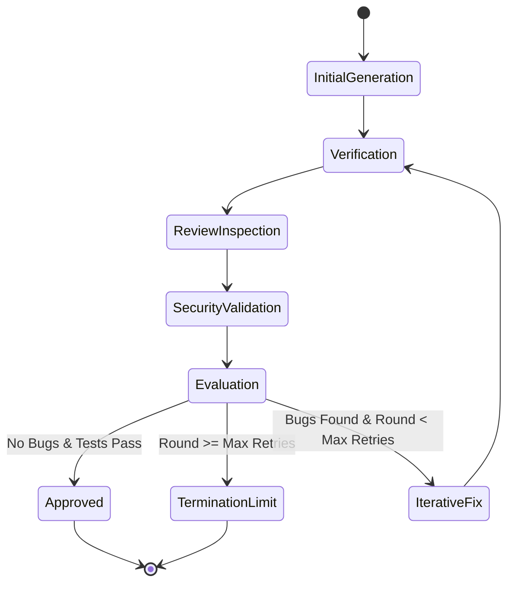

# 🏛️ OpenReviewAI Architecture & System Design Document

## 1. System Philosophy & Objectives
The goal of **OpenReviewAI** is to build a reliable, fully automated multi-agent software engineering workflow using exclusively **open-source tools and models**. 

In conventional single-LLM generation, code often contains subtle edge-case bugs, syntax regressions, or logic errors that the generating model fails to detect due to self-confirmation bias. By decomposing the engineering lifecycle into specialized roles—**Generator (LLM 1)**, **Reviewer (LLM 2)**, and **Validator (LLM 3)**—combined with deterministic **AST parsing** and **Sandbox execution**, the system achieves unprecedented code quality and reliability.

---

## 2. Agent Roles and Responsibilities

### Role 1: Generator (LLM 1 - Coder & Fixer)
- **Primary Goal:** Transform functional specifications into runnable, clean code, and iteratively resolve issues flagged by reviewers.
- **Recommended Open-Source Models:** `Qwen/Qwen2.5-Coder`, `deepseek-ai/DeepSeek-Coder-V2`, `codellama`.
- **System Capabilities:**
  - Extracts requirements and constructs comprehensive implementations.
  - In subsequent rounds, analyzes structured bug reports, isolates the root causes, produces targeted patches, and explains changes.

### Role 2: Reviewer (LLM 2 - Inspector & Static Auditor)
- **Primary Goal:** Scrutinize code against logic bugs, edge cases, off-by-one errors, type mismatches, and algorithmic complexity.
- **Recommended Open-Source Models:** `mistralai/Mistral-7B`, `google/gemma-2-9b-it`.
- **System Capabilities:**
  - Generates structured JSON feedback with strict schemas:
    ```json
    {
      "has_bugs": true,
      "status": "CHANGES_REQUESTED",
      "overall_score": 6,
      "summary": "Boundary conditions fail on null inputs.",
      "bugs": [
        {
          "line_number": 4,
          "category": "EDGE_CASE",
          "severity": "MAJOR",
          "description": "Fails when input is empty string or None.",
          "suggested_fix": "Add boundary check at function start."
        }
      ]
    }
    ```

### Role 3: Validator (LLM 3 - Security Auditor & Arbiter)
- **Primary Goal:** Perform secondary consensus check and security auditing (command injection, memory leaks, unhandled exceptions).
- **Recommended Open-Source Models:** `deepseek-r1`, `bonsai:latest`, `gemma2:2b`.
- **System Capabilities:**
  - Verifies that LLM 2's findings are legitimate.
  - Prevents hallucinated or conflicting reviewer suggestions from stalling the generator.

---

## 3. Sandboxed Execution & Verification Layer

Before code is presented to LLM 2, it passes through the deterministic verification engine:
1. **Python AST Analysis (`syntax_checker.py`):**
   - Parses code into an Abstract Syntax Tree using Python's `ast` module.
   - Flags syntax errors (`SyntaxError`) with line and column numbers before execution.
   - Extracts metadata: count of functions, classes, imports, and docstrings.
2. **Subprocess Isolation (`executor.py`):**
   - Writes code to an ephemeral temporary file.
   - Executes via `subprocess.run` with isolated environment variables.
   - Enforces a strict timeout (default: 5 seconds) to eliminate infinite loops.
3. **Unit Test Verification (`test_runner.py`):**
   - Appends unit test assertions into the execution script.
   - Traps assertion errors and formats stack traces for LLM 1 to digest.

---

## 4. Multi-Agent Finite State Machine



### Termination Guarantees
To avoid infinite cycles between generator and reviewer:
1. **Success Condition:** `is_approved = True` (Zero bugs reported + clean test run).
2. **Bound Condition:** `current_round >= max_retries` (default: 3). If reached, the engine halts, outputs the latest revision, and flags remaining unresolved items in the audit log.

---

## 5. Dual Engine Design

`OpenReviewAI` offers two orchestration layers:
1. **`openreview_ai.engine.WorkflowOrchestrator`:**
   - Native, highly optimized Python state coordinator.
   - Features lightweight event callbacks (`on_event`) that drive live UI progress bars and terminal rendering in real time.
2. **`openreview_ai.langgraph_workflow.build_langgraph_workflow`:**
   - Compiled LangGraph `StateGraph` adhering to industry-standard graph specifications.
   - Allows seamless extension into persistent databases, checkpointing, and distributed task queues.

---

## 6. Open-Source Provider Abstraction

The `BaseLLMProvider` interface abstracts all model inference:
- **`OllamaProvider`:** Talks directly to the local Ollama HTTP REST API (`/api/chat`). Zero token costs, complete privacy.
- **`HuggingFaceProvider`:** Connects to Hugging Face serverless inference.
- **`OpenAICompatibleProvider`:** Supports any server speaking the OpenAI specification (Groq, vLLM, DeepSeek API, LM Studio).
- **`MockSimulationProvider`:** Built-in high-fidelity intelligent simulation that demonstrates the full debate and correction cycle offline with zero external dependencies.
