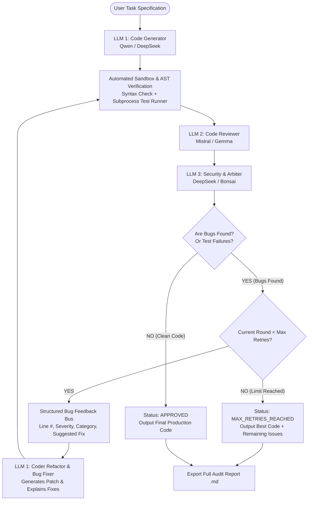

# 🛡️ OpenReviewAI: Multi-LLM Code Review & Iterative Bug Correction Engine

[](https://www.python.org/)
[](https://opensource.org/licenses/MIT)
[](#supported-models)
[](#testing)

An advanced multi-agent system where multiple open-source LLMs collaborate autonomously to write, review, test, and iteratively correct code until it is 100% bug-free and production-ready.

---

## 🎯 Project Overview & Internship Specification

Built specifically to address the multi-LLM architecture requirements for **Druidot Consulting Private Limited**:

> **Requirement from Employer / Sir:**
> *"Make multiple LLMs communicate with each other. If code is generated by one LLM, it should pass the code to another LLM to ask for review. If bugs are found, the 2nd or 3rd LLM should pass the review to the first LLM. Based on the review, the first LLM should fix and ask the second LLM for review. This process should continue till everything is fixed."*
>
> *"Include testing and a retry limit to ensure the process terminates reliably."*
>
> *"Use only opensource tools. Models can be Gemma, Mistral, Bonsai, Qwen and DeepSeek."*

`OpenReviewAI` implements this exact stateful, iterative multi-agent loop with:
- **Role 1: Generator LLM (Coder & Bug Fixer)** — *e.g., Qwen 2.5 Coder / DeepSeek Coder*
- **Role 2: Reviewer LLM (Inspector & Static Analyzer)** — *e.g., Mistral 7B / Gemma 2*
- **Role 3: Validator LLM (Security Auditor & Consensus Arbiter)** — *e.g., DeepSeek / Bonsai*
- **Automated Sandbox Execution & AST Validator** — Safe subprocess test runner with timeouts
- **Iterative Feedback Protocol** — Structured JSON bug reports passed back to LLM 1 for targeted refactoring
- **Finite Termination Guarantees** — Clean exit on `APPROVED` or configurable `MAX_RETRIES`

---

## 🏗️ Architecture & Interaction Flow



---

## 🌟 Key Features

1. **Autonomous Multi-LLM Debate & Feedback Exchange**:
   - Structured JSON communication protocol between LLMs.
   - Categorized bug reports (`SYNTAX`, `LOGIC`, `RUNTIME`, `EDGE_CASE`, `SECURITY`, `PERFORMANCE`).
   - Line-by-line severity ratings (`CRITICAL`, `MAJOR`, `MINOR`, `SUGGESTION`).
2. **100% Open-Source Tooling & Models**:
   - Explicit support for **Gemma**, **Mistral**, **Bonsai**, **Qwen**, and **DeepSeek**.
   - Multiple backend providers:
     - **Ollama**: Local zero-cost inference (`http://localhost:11434`).
     - **Hugging Face Inference API**: Free hosted open-source models.
     - **OpenAI-Compatible**: Groq, DeepSeek API, Together AI, vLLM, LM Studio.
     - **Smart Simulator**: Offline high-fidelity simulation for instant demos and CI without API keys or GPUs!
3. **Dual Orchestration Engines**:
   - **Engine 1: State Machine Orchestrator** (`WorkflowOrchestrator`): Typed, deterministic event streaming for CLI & Streamlit.
   - **Engine 2: LangGraph StateGraph** (`build_langgraph_workflow`): Industry-standard graph-based stateful agent routing.
4. **Isolated Sandbox Verification**:
   - Python AST parser extracts functions, classes, docstrings, and checks syntax.
   - Subprocess sandbox executes code with strict timeout protection (kills infinite loops automatically).
   - Automated unit test assertions validator.
5. **Interactive Streamlit Web Studio (`app.py`)**:
   - Visual chat stream showing messages between LLM 1, LLM 2, and LLM 3.
   - Unified & side-by-side code diff viewer across rounds.
   - Real-time bug tracker table.
   - One-click Markdown audit report & Python script downloads.
6. **Rich Terminal CLI (`cli.py`)**:
   - Colored terminal output with syntax highlighting, diffs, and review summary cards.

---

## 🚀 Quickstart Guide

### 1. Installation
Clone or navigate to the repository directory:
```bash
git clone https://github.com/your-username/OpenReviewAI.git
cd OpenReviewAI
```

Install requirements:
```bash
pip install -r requirements.txt
```

### 2. Launch the Web Studio (Streamlit)
Double-click `run_app.bat` or run:
```bash
streamlit run app.py
```
Open your browser at `http://localhost:8501`.

### 3. Run via Terminal CLI
Double-click `run_cli.bat` or run:
```bash
# Quick offline simulation demo
python cli.py --demo

# With custom prompt
python cli.py --prompt "Write a python function to find the longest common prefix among strings."

# Using local Ollama with Qwen and DeepSeek
python cli.py --provider ollama --generator "qwen2.5:0.5b" --reviewer "deepseek-coder:1.3b"
```

---

## 💻 Python API Usage

You can embed OpenReviewAI into any Python project in just a few lines:

```python
from openreview_ai.config import WorkflowConfig
from openreview_ai.engine import WorkflowOrchestrator

# Configure open-source models
config = WorkflowConfig(
    provider_type="mock",  # 'ollama', 'huggingface', 'openai_compat', or 'mock'
    generator_model="qwen2.5:0.5b",
    reviewer_model="mistral:latest",
    validator_model="deepseek-coder:1.3b",
    max_retries=3,
    enable_sandbox_execution=True
)

orchestrator = WorkflowOrchestrator(config=config)

# Run workflow
result = orchestrator.run(
    task_prompt="Write a function to check if a string is a palindrome, ignoring special characters.",
    target_language="python"
)

print(f"Status: {result.status}")
print(f"Iterations: {result.rounds_count}")
print(f"Bugs Resolved: {result.total_bugs_fixed}")
print("Final Code:\n", result.final_code)
```

---

## 🦙 Open-Source Model Configuration

| Family | Recommended Models | Provider |
| :--- | :--- | :--- |
| **Qwen** | `qwen2.5:0.5b`, `qwen2.5-coder:1.5b`, `qwen2.5-coder:7b` | Ollama / HF / Groq |
| **DeepSeek** | `deepseek-coder:1.3b`, `deepseek-coder:6.7b`, `deepseek-r1:1.5b` | Ollama / DeepSeek API |
| **Mistral** | `mistral:latest`, `mistralai/Mistral-7B-Instruct-v0.3` | Ollama / HF / Groq |
| **Gemma** | `gemma2:2b`, `gemma2:9b`, `google/gemma-2-2b-it` | Ollama / HF / Groq |
| **Bonsai / CodeLlama** | `codellama:7b`, `starcoder2:3b`, `bonsai:latest` | Ollama / HF |

---

## 🧪 Testing

Run the automated test suite with pytest:
```bash
python -m pytest -v
```

All 19 test cases verify:
- Data schemas and bug item serialization
- Subprocess sandbox execution and timeout protection
- AST syntax checking and metadata analysis
- Agent prompts and JSON response extractors
- Multi-round iterative loop and termination boundaries
- LangGraph multi-agent StateGraph routing
- Unified diff viewer and Markdown audit exporter

---

## 📁 Repository Structure

```
OpenReviewAI/
├── app.py                      # Interactive Streamlit Web Studio
├── cli.py                      # Rich Terminal CLI Application
├── openreview_ai/              # Core Package
│   ├── config.py               # Model presets & configuration settings
│   ├── schema.py               # Pydantic models (ReviewState, BugItem, WorkflowResult)
│   ├── engine.py               # State machine review loop orchestrator
│   ├── langgraph_workflow.py   # LangGraph StateGraph implementation
│   ├── agents/
│   │   ├── base.py             # Agent base with JSON & code extraction
│   │   ├── generator.py        # LLM 1: Code Generator & Bug Fixer
│   │   ├── reviewer.py         # LLM 2: Static & Semantic Code Reviewer
│   │   └── validator.py        # LLM 3: Security & Consensus Arbiter
│   ├── providers/
│   │   ├── base.py             # Abstract LLM provider interface
│   │   ├── ollama.py           # Ollama client (Local open source)
│   │   ├── huggingface.py      # Hugging Face Inference API client
│   │   ├── openai_compat.py    # OpenAI-compatible API (Groq, vLLM, DeepSeek)
│   │   ├── mock_provider.py    # High-fidelity offline simulation provider
│   │   └── factory.py          # Provider factory
│   ├── sandbox/
│   │   ├── executor.py         # Isolated subprocess code runner
│   │   ├── syntax_checker.py   # Python AST syntax & complexity validator
│   │   └── test_runner.py      # Unit test suite runner
│   └── utils/
│       ├── diff_viewer.py      # Unified code diff generator
│       ├── report_exporter.py  # Markdown audit report builder
│       └── prompt_templates.py # System prompts for Generator, Reviewer, Validator
├── tests/                      # Pytest automated test suite
├── examples/                   # Standalone runnable scripts
├── requirements.txt            # Project dependencies
├── .env.example                # Sample environment configuration
├── run_app.bat                 # One-click Windows Web Studio launcher
├── run_cli.bat                 # One-click Windows CLI launcher
└── run_tests.bat               # One-click Windows test runner
```

---

## 📄 License
MIT License. Open-source software developed for Druidot Consulting Private Limited interview evaluation.
