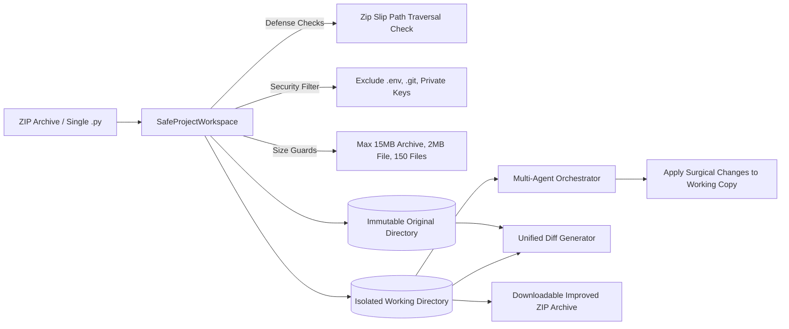

# OpenReview AI — System Architecture

## 1. High-Level Overview

**OpenReview AI** is a local-first, multi-agent code generation, review, validation, and self-correction platform designed for software engineering teams and developers who require rigorous AI-driven code improvement without transmitting proprietary code to cloud AI APIs.

The system is built upon **LangGraph StateGraph** and a dual-engine architecture orchestrating three specialized agents:
1. **Agent A — Code Generator / Fixer** (Generates initial code or applies targeted patches to existing modules).
2. **Agent B — Independent Code Reviewer** (Adversarially audits logic, boundary conditions, performance, maintainability, and security).
3. **Agent C — Empirical Evidence Validator** (Performs AST syntax verification, Ruff/AST static analysis, sandboxed subprocess test execution, and multi-criteria evidence arbitration).

```
   ┌────────────────────────────────────────────────────────────────────────┐
   │                          OPENREVIEW AI ARCHITECTURE                    │
   │                                                                        │
   │   ┌───────────────┐        ┌───────────────┐        ┌──────────────┐   │
   │   │    AGENT A    │───────>│    AGENT B    │───────>│   AGENT C    │   │
   │   │   Generator   │  Code  │   Reviewer    │ Findings│  Validator   │   │
   │   └───────────────┘        └───────────────┘        └──────────────┘   │
   │           ▲                                                │           │
   │           └─────────── Iterative Feedback Loop ───────────┘           │
   │                          (Bounded Retries: 1–5)                        │
   └────────────────────────────────────────────────────────────────────────┘
```

The system ensures that code is never certified as correct simply because an LLM claims it passes. It enforces strict empirical separation between **model opinions**, **deterministic syntax parsing** (`ast.parse`), and **automated functional execution** (isolated sandboxed subprocesses).

---

## 2. Multi-Agent Orchestration with LangGraph StateGraph

### 2.1 StateGraph Architecture & Workflow Topology

The orchestrator operates as a cyclic finite state machine implemented via `langgraph.graph.StateGraph` using a typed shared state (`AgentGraphState`):

```mermaid
graph TD
    Start([__START__]) --> ValReq[1. Validate Request]
    ValReq -->|Invalid Prompt/Code| RecErr[Record Error]
    ValReq -->|Valid| AnaInp[2. Analyze Input]
    AnaInp --> GenNode[3. Generator Agent]
    GenNode --> SynStat[4. Syntax & Static Validation]
    SynStat --> RevNode[5. Reviewer Agent]
    RevNode --> ValNode[6. Validator Agent]
    ValNode --> EvalAcc[7. Evaluate Acceptance Criteria]
    
    EvalAcc -->|All Acceptance Criteria Passed| SaveFin[8. Save Final Result]
    EvalAcc -->|Issues Flagged & Retries Remain| GenFix[9. Generator Correction]
    EvalAcc -->|Retries Exhausted| SavePart[10. Save Partial Result]
    EvalAcc -->|Unrecoverable Failure| RecErr
    
    GenFix --> SynStat
    SaveFin --> EndNode([__END__])
    SavePart --> EndNode
    RecErr --> EndNode

    classDef agent fill:#eff6ff,stroke:#2563eb,stroke-width:2px;
    classDef check fill:#f0fdf4,stroke:#16a34a,stroke-width:2px;
    classDef exit fill:#f8fafc,stroke:#64748b,stroke-width:2px;
    classDef err fill:#fef2f2,stroke:#dc2626,stroke-width:2px;
    
    class GenNode,RevNode,ValNode,GenFix agent;
    class SynStat,EvalAcc check;
    class SaveFin,SavePart,EndNode exit;
    class RecErr err;
```



### 2.2 Shared Workflow State Schema (`AgentGraphState`)

The LangGraph shared state is defined as a strongly typed TypedDict with safe, non-destructive mutation semantics:

| State Key | Type | Description |
|:---|:---|:---|
| `run_id` | `str` | Unique execution tracking identifier (`run_YYYYMMDD_HHMMSS_UUID`). |
| `task_description` | `str` | User's natural language goal and engineering requirements. |
| `input_mode` | `str` | Input origin (`"prompt"`, `"paste"`, `"file"`, `"archive"`). |
| `uploaded_files_metadata` | `List[Dict]` | Manifest of files, sizes, and permissions in uploaded project. |
| `original_source_files` | `Dict[str, str]` | Immutable backup copy of baseline source files. |
| `working_source_files` | `Dict[str, str]` | Isolated working directory source files subject to patching. |
| `generator_model` | `str` | Configured model ID for Agent A (e.g., `qwen2.5:0.5b`). |
| `reviewer_model` | `str` | Configured model ID for Agent B (e.g., `deepseek-coder:1.3b`). |
| `validator_configuration` | `Dict` | Sandbox timeout, AST flags, Ruff linter settings. |
| `current_attempt` | `int` | Current active iteration round (1-indexed). |
| `max_attempts` | `int` | Configured iteration ceiling (typically 3, range 1–5). |
| `generated_code` | `str` | Candidate Python source code produced in current round. |
| `reviewer_findings` | `List[Dict]` | Structured findings (verdict, issues, file, line, suggestions). |
| `validation_results` | `Dict` | AST status, node metrics, cyclomatic complexity, security flags. |
| `test_results` | `Dict` | Exit code, stdout, stderr, execution duration, assertion verdict. |
| `current_stage` | `str` | Current workflow stage for streaming event provenance. |
| `iteration_history` | `List[Dict]` | Immutable archive of prior iteration snapshots and code diffs. |
| `workflow_errors` | `List[str]` | Stack of non-fatal and fatal runtime errors. |
| `acceptance_status` | `str` | Granular acceptance status code (see Section 4). |
| `final_status` | `str` | Overall high-level verdict (`"APPROVED"`, `"RETRY_LIMIT_REACHED"`, etc.). |
| `stop_reason` | `str` | Explicit termination cause (`"ALL_CHECKS_PASSED"`, `"RETRIES_EXHAUSTED"`, etc.). |
| `started_at` / `completed_at` | `str` | ISO 8601 UTC timestamps. |
| `duration` | `float` | Wall-clock execution time in seconds. |

---

## 3. Specialized Agent Responsibilities

### 3.1 Agent A — Generator / Fixer
- **Initial Generation:** Inspects the user's task prompt, architectural constraints, and baseline code to produce clean, PEP 8-compliant Python modules.
- **Targeted Correction:** In correction cycles, receives the full structured review feedback, failed test traces, AST syntax error locations, and static warnings. Applies surgical fixes without breaking existing working functions or adding unsolicited dependencies.
- **Output:** Returns clean Python code with Markdown code fences stripped, accompanied by a brief summary of changes.

### 3.2 Agent B — Independent Reviewer
- **Adversarial Audit:** Evaluates code independently from the generator. Assesses edge cases, null/empty collections, type safety, algorithmic complexity, boundary conditions, resource leaks, and requirement compliance.
- **Structured JSON Findings:** Produces a standardized JSON schema:
  - `verdict`: `"PASS"` or `"FAIL"`.
  - `summary`: High-level architectural assessment.
  - `issues`: List of items containing `file`, `line`, `category` (logic/security/edge_case/style), `severity` (critical/major/minor), `confidence` (0.0 to 1.0), `description`, and `suggested_fix`.
  - `requirements_met`: List of verified requirements.
  - `unresolved_concerns`: List of outstanding issues.
- **Contradiction Guards:** If the reviewer returns `"PASS"` while listing unresolved critical bugs or runtime failures, the parser strictly overrides the verdict to `"FAIL"`.

### 3.3 Agent C — Evidence Validator
- **AST Parsing:** Parses code via Python's built-in `ast` module to detect missing colons, indentation errors, and structural malformations prior to execution.
- **Static Analysis:** Runs Ruff (if installed) or AST structural inspection to compute cyclomatic complexity, function count, docstring ratio, and security flags (`eval`, `exec`, `subprocess`, `os.system`).
- **Sandboxed Execution:** Executes code and unit test assertions in an isolated subprocess with a strict 5.0-second timeout, memory quotas, and blocked dangerous imports.
- **Evidence Arbitration:** Evaluates whether code meets configured acceptance policies. Never accepts model assertions without empirical execution evidence.

---

## 4. Rigorous Acceptance Criteria System

OpenReview AI rejects false equivalence between model sentiment and verified functional correctness. The system defines explicit status distinctions:

```
  ┌────────────────────────────────────────────────────────────────────────┐
  │                       ACCEPTANCE STATUS DEFINITIONS                    │
  ├────────────────────────┬───────────────────────────────────────────────┤
  │ Status Code            │ Empirical Meaning                             │
  ├────────────────────────┼───────────────────────────────────────────────┤
  │ SYNTAX_PASSED          │ Python AST parsed with zero syntax errors.    │
  │ STATIC_ANALYSIS_PASSED │ Ruff/AST static analysis identified no blocks.│
  │ TESTS_PASSED           │ Real test assertions executed with exit code 0│
  │ REVIEW_PASSED          │ Independent Reviewer returned validated PASS. │
  │ VALIDATION_PASSED      │ Both syntax, static, and tests passed.        │
  │ FINAL_ACCEPTED         │ All required acceptance criteria verified.    │
  │ PARTIAL                │ Code corrected partially; some issues remain. │
  │ RETRY_LIMIT_REACHED    │ Max correction attempts exhausted.            │
  │ NOT_RUN                │ Automated tests were omitted or disabled.     │
  │ FAILED                 │ Unrecoverable error or fatal syntax defect.   │
  └────────────────────────┴───────────────────────────────────────────────┘
```

> **Critical Rule:** If no unit tests are provided by the user, OpenReview AI displays an explicit **`NOT_RUN: No Unit Tests Provided`** badge and notes that functional correctness has not been verified against automated test assertions, preventing false security illusions.

---

## 5. Safe Workspace & Project Archive Architecture

For multi-file project archives and existing repository improvements:



1. **Extraction Sandbox:** Archives are extracted into a disposable, unique temporary directory (`openreview_ws_*`).
2. **Path Traversal Defense:** Canonical destination paths are checked to prevent Zip Slip (`../` escapes).
3. **Symlink Rejection:** Symlinks pointing outside the workspace boundary are rejected.
4. **Secret Exclusion:** `.env`, `.pem`, `.key`, `.git/`, and virtual environments (`venv`, `.venv`, `__pycache__`) are excluded from analysis.
5. **Immutable Original:** The original source files are preserved in a read-only baseline directory. Changes are applied solely to an isolated working copy.
6. **Unified Diff & Export:** Changes are computed via `difflib.unified_diff` with line-level addition/deletion tracking, allowing one-click download of the improved project ZIP.

---

## 6. Real-Time Event Streaming Provenance

OpenReview AI emits strongly typed lifecycle events consumed by the UI to show verified progress without simulated timers:

| Event Name | Stage | Description |
|:---|:---|:---|
| `run_started` | Initialization | Workflow triggered with unique run ID and configuration. |
| `input_validated` | Input Audit | User prompt, constraints, and source code validated. |
| `files_analyzed` | Analysis | Project manifest generated and target module selected. |
| `generator_started` | Generation | Agent A invoked to draft initial solution or targeted patch. |
| `generator_completed` | Generation | Source code received from Agent A. |
| `syntax_check_started` | AST Validation | Abstract Syntax Tree parsing initiated. |
| `syntax_check_completed`| AST Validation | AST syntax confirmed valid or error coordinates recorded. |
| `tests_started` | Sandbox Execution | Subprocess sandbox executing test assertions. |
| `tests_completed` | Sandbox Execution | Test outcome, exit code, and stdout/stderr recorded. |
| `reviewer_started` | Adversarial Audit | Agent B auditing code logic and security boundaries. |
| `reviewer_completed` | Adversarial Audit | Structured findings and verdict received from Agent B. |
| `validator_started` | Evidence Audit | Agent C arbitrating empirical test and review evidence. |
| `validator_completed` | Evidence Audit | Acceptance criteria evaluated against policy. |
| `correction_started` | Self-Correction | Agent A triggered with aggregated review & test feedback. |
| `correction_completed`| Self-Correction | Updated candidate code received for re-validation. |
| `iteration_completed` | Round Finalize | Snapshot of iteration stored in immutable history. |
| `retry_limit_reached` | Termination | Configured attempt limit reached without full approval. |
| `run_completed` | Termination | Workflow finalized successfully with full provenance. |

---

## 7. Persistence & History Store

All workflow runs are persisted locally under `outputs/`:
- `outputs/runs/{run_id}.json`: Complete execution record containing run metadata, model assignments, iteration snapshots, bug findings, execution results, and acceptance statuses.
- `outputs/code/{run_id}.py`: Final approved or best-effort Python source module.
- `outputs/reports/{run_id}.md`: Full Markdown audit report with executive summary, iteration audit log, unified diff, and security assessment.
