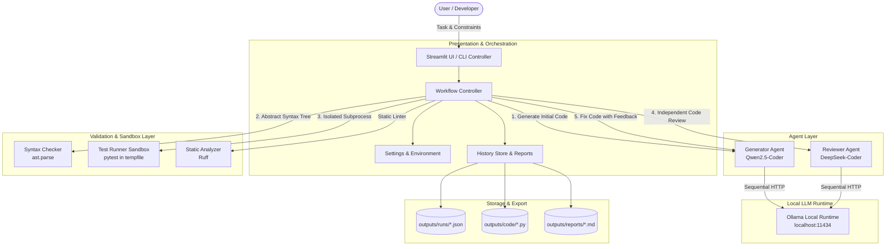

# OpenReview AI — System Architecture

## 1. High-Level Overview

**OpenReview AI** is a multi-agent, collaborative code generation, review, and self-correction system built on local, open-weight Large Language Models (LLMs). It pairs a **Code Generator Agent** (e.g., `qwen2.5-coder:3b`) with an independent, adversarial **Code Reviewer Agent** (e.g., `deepseek-coder:1.3b`) inside an automated validation and feedback loop.

The system ensures that code is never certified as correct simply because an LLM claims it passes. It enforces strict separation between:
1. **Model review opinions** (adversarial feedback, bug detection, edge case analysis).
2. **Deterministic syntax parsing** (`ast.parse`).
3. **Automated functional testing** (`pytest` running in an isolated sandbox).

---

## 2. Component Architecture



---

## 3. Data Flow & Iteration Lifecycle

```mermaid
sequenceDiagram
    autonumber
    actor User as User / Developer
    participant Ctrl as Workflow Controller
    participant Gen as Generator Agent
    participant Syn as AST Syntax Checker
    participant Tst as Pytest Sandbox
    participant Rev as Reviewer Agent
    participant Store as History Store

    User->>Ctrl: Submit Task (Task, Constraints, Tests, MaxAttempts=3)
    Ctrl->>Store: Initialize Run ID (e.g. run_20261022_...)
    
    loop Up to Max Attempts (1 to 5)
        alt Attempt == 1
            Ctrl->>Gen: generate_code(task, constraints)
        else Attempt > 1
            Ctrl->>Gen: fix_code(task, current_code, review_feedback, syntax_err, test_err)
        end
        Gen-->>Ctrl: Python Source Code
        Ctrl->>Store: Save Code Iteration Snapshot

        Ctrl->>Syn: check_syntax(code)
        alt Syntax Invalid
            Syn-->>Ctrl: SyntaxError (line, column, message)
            Note over Ctrl: Skip test & review; immediately trigger fix
        else Syntax Valid
            Syn-->>Ctrl: Syntax Clean
            opt Test Suite Provided
                Ctrl->>Tst: run_tests(code, test_code, timeout=10s)
                Tst-->>Ctrl: TestExecutionResult (PASSED / FAILED / TIMEOUT)
            end
            Ctrl->>Rev: review_code(task, code)
            Rev-->>Ctrl: Structured JSON ReviewResult (verdict, issues, suggestions)
        end

        Ctrl->>Ctrl: Evaluate Acceptance Policy
        alt Acceptance Met (Syntax Valid + Tests PASSED + Reviewer PASS)
            Note over Ctrl: Criteria Satisfied -> Terminate Successfully
        else Acceptance Failed and Attempt == MaxAttempts
            Note over Ctrl: Terminate with RETRY_LIMIT_REACHED / REVIEW_FAILED / VALIDATION_FAILED
        else Acceptance Failed and Attempt < MaxAttempts
            Note over Ctrl: Aggregate actionable feedback for next revision
        end
    end

    Ctrl->>Store: Save Final Code & WorkflowReport JSON
    Ctrl-->>User: Display Final Code, Diff View, Review Notes, & Downloadable Reports
```

---

## 4. Key Architectural Subsystems

### A. Presentation Layer (`app.py` & `main.py`)
- **Streamlit Web Application (`app.py`):** Interactive developer dashboard featuring:
  - System status & local Ollama health monitoring.
  - Task submission with constraints and pytest inputs.
  - Live progress display with real-time stage updates.
  - Line-by-line unified code diff between iterations.
  - Tabular defect review breakdown with severity ratings.
  - Pytest evidence viewer (stdout, stderr, duration).
  - Historical run browser with deletion and export features.
- **Command Line Interface (`main.py`):** Full headless execution mode for scripting, evaluation, automated CI, and offline testing (`--mock`).

### B. Workflow Controller (`workflow/controller.py`)
- Manages iteration loop with hard limits (default 3, max 5).
- Prevents infinite recursion and accidental runaway requests.
- Maintains isolated chronological audit trail per attempt.
- Explicit status tracking:
  - `INITIALIZING`
  - `RUNNING`
  - `REVIEW_PASSED` (Passed review with valid syntax, but no unit test suite was provided)
  - `PASSED` (Fully validated: Syntax valid, test suite executed and passed, reviewer issued PASS)
  - `REVIEW_FAILED` (Reviewer rejected code after retry limit)
  - `VALIDATION_FAILED` (Syntax error or pytest test assertions failed)
  - `RETRY_LIMIT_REACHED`
  - `ERROR`

### C. Independent AI Agents (`agents/`)
- **Generator Agent (`agents/generator.py`):**
  - Synthesizes complete Python source implementations.
  - Ingests aggregated multi-source feedback (reviewer comments, syntax errors, pytest stack traces).
  - Employs safe markdown fence parsing to prevent code corruption.
- **Reviewer Agent (`agents/reviewer.py`):**
  - Adversarial code auditor.
  - Evaluates functional correctness, boundary conditions, logic errors, and security issues.
  - Enforces strict JSON schema output parsed directly into Pydantic models.
  - Overrides contradictory verdicts (e.g. model claims PASS while reporting defects).

### D. Validation & Sandboxing (`validation/`)
- **Syntax Checker (`validation/syntax_checker.py`):**
  - AST-based parsing (`ast.parse`) without executing untrusted code.
- **Test Runner (`validation/test_runner.py`):**
  - Executes tests in an isolated temporary directory (`tempfile.mkdtemp`).
  - Cleans environment variables, disallows `.pyc` caching (`-B`), and enforces Python isolated mode (`-I`).
  - Subprocess timeout boundary (default 10s) protects against infinite loops.
- **Static Analyzer (`validation/static_analyzer.py`):**
  - Optional Ruff integration for fast style and lint diagnostics.

### E. Persistence & Reporting (`storage/`)
- **History Store (`storage/history_store.py`):**
  - Saves run metadata and iteration snapshots into `outputs/runs/` and `outputs/code/`.
  - Computes authentic aggregate metrics (runs, pass rate, average iterations, execution duration).
- **Report Generator (`storage/report_generator.py`):**
  - Compiles comprehensive, reproducible Markdown reports containing audit alerts, issue tables, and source diffs.
