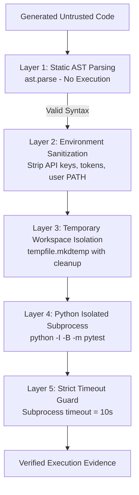

# OpenReview AI — Security & Sandboxing Policy

## 1. Threat Model: Untrusted Generated Code

Code generated by Large Language Models (LLMs) must always be treated as **untrusted input**. Even when prompted with benign programming tasks, LLMs may produce code that:
- Executes destructive filesystem operations (e.g., `os.remove`, recursive directory deletion).
- Makes unauthorized outbound network requests (e.g., downloading binaries, exfiltrating data).
- Enters uncontrolled infinite loops or resource exhaustion (fork bombs, memory leaks).
- Contains unintentional security flaws (e.g., shell injection via `subprocess.Popen(shell=True)`).

---

## 2. Multi-Layer Defense Architecture

OpenReview AI implements a defense-in-depth model across the validation pipeline:



### Layer 1: Zero-Execution AST Inspection
- `validation/syntax_checker.py` uses the standard library `ast.parse` module.
- Compiles the code to an Abstract Syntax Tree in memory.
- If syntax or indentation errors exist, execution is aborted immediately before any runtime invocation.

### Layer 2: Sanitized Environment Variables
- Subprocesses executed by `validation/test_runner.py` do NOT inherit the host process's full environment.
- Sensitive environment variables (e.g., system tokens, cloud credentials, personal paths) are stripped.
- Only essential Windows system directories (`SYSTEMROOT`, `TEMP`) are passed to allow the Python runtime to boot.

### Layer 3: Temporary Directory Isolation & Cleanup
- Tests are executed within an ephemeral directory created via `tempfile.mkdtemp(prefix="openreview_sandbox_")`.
- Code cannot write files into the repository root or parent directory.
- A `finally:` block guarantees recursive cleanup of the temporary sandbox directory after execution.

### Layer 4: Python Process Hardening Flags
- The test runner invokes Python with hardened runtime flags:
  - `-I`: **Isolated mode**. Python ignores environment variables like `PYTHONPATH`, ignores user site-packages, and isolates system modules.
  - `-B`: **Don't write `.pyc`**. Prevents bytecode pollution on disk.

### Layer 5: Strict Timeouts
- All subprocesses are bounded by a configurable timeout (default: 10 seconds).
- Any attempt to run an infinite loop (e.g., `while True: pass`) raises `subprocess.TimeoutExpired`, terminating the process and classifying the run as `TIMEOUT`.

---

## 3. Sandboxing Limitations & Docker Recommendations

> [!CAUTION]
> **Subprocess isolation is NOT an operating system-level hypervisor boundary.**  
> While temporary directories, timeout bounds, and Python isolated flags prevent common bugs and resource leaks, an isolated subprocess on Windows does not restrict raw socket creation or lower-level kernel calls.

### Production Recommendations
For enterprise deployments evaluating code from untrusted multi-tenant users:
1. **Container Isolation (Docker / Podman):**
   Execute the test suite inside an ephemeral Docker container with:
   ```bash
   docker run --rm --network none --memory 512m --cpus 1.0 -v /temp:/app:ro python:3.13-slim pytest
   ```
   - `--network none`: Disables all inbound and outbound network access.
   - `--memory 512m`: Prevents memory exhaustion attacks.
   - `--read-only`: Mounts root filesystem as read-only.
2. **MicroVM Sandboxes (gVisor / Firecracker):**
   Provides hardware-assisted microVM sandboxing for complete kernel isolation.

---

## 4. Privacy & API Key Protection

1. **Zero External Data Transmission:** OpenReview AI connects strictly to your local Ollama instance (`http://localhost:11434`). It does not send user prompts, source code, or test data to third-party cloud providers.
2. **No Paid API Keys Required:** No OpenAI, Anthropic, or external API keys are used or stored.
3. **No Secret Ingestion:** The `.gitignore` configuration explicitly excludes `.env`, `*.secret`, `*.pem`, and `*.key` files.
